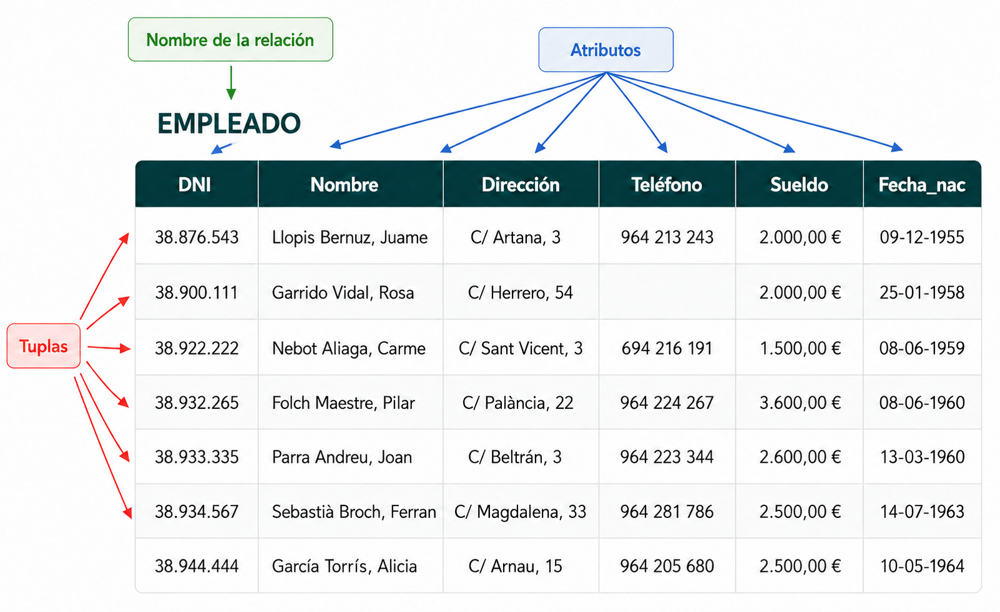

<!--
hide:
    - toc
---
-->
# 2. Estructura del Modelo Relacional

El elemento básico del Modelo Relacional es la **RELACIÓN**, que es una **tabla** bidimensional con características y restricciones específicas.

- **Nombre de la RELACIÓN**

    Identificador único de la tabla (ej: EMPLEADO).
    
- **Filas (tuplas)**

    Información de cada ocurrencia o individuo.
    También llamadas registros.

- **Columnas (atributos)**

    Características de los individuos.
    También llamadas campos.

---

| Concepto | Significado | Ejemplo en la tabla EMPLEADO de arriba |
|----------|-------------|----------------------------------------|
| **Esquema/Estructura** | Definición de atributos, dominios y restricciones. | EMPLEADO(DNI, Nombre, Dirección, Teléfono, Sueldo, Fecha-nac), con sus dominios y restricciones; por ejemplo, elegir DNI como PK. |
| **Estado de la Relación** | Información contenida en un momento específico. | Las **7 filas** que aparecen en la tabla, con los datos actuales de esos empleados. Si cambia un sueldo o se añade un empleado, cambia el estado. |
| **Clave Candidata** | Atributo(s) que identifican unívocamente cada tupla, sin incluir atributos innecesarios. | **DNI** o **Teléfono** podrían ser claves candidatas si se garantiza que sus valores son **únicos para cada empleado y no nulos**. En la tabla mostrada, Teléfono no cumple esta condición porque falta el de Rosa. |
| **Clave Principal/Primaria (PK)** | La clave candidata elegida para identificar tuplas. | Si elegimos **DNI** como PK, el valor **38.876.543** identifica la fila de **Llopis Bernuz, Juame**. |
| **Valor Nulo** | Ausencia de valor en un atributo. | La celda **Teléfono** de **Garrido Vidal, Rosa** aparece vacía: en este ejemplo representa **NULL**, porque desconocemos su teléfono. No significa que sea cero ni una cadena de texto vacía. |
| **Dominio** | Conjunto de valores posibles para cada atributo. | **Fecha-nac** admite fechas válidas, como **09-12-1955**; **Sueldo** admite importes monetarios, como **2.000,00 €**. Los valores mostrados son ejemplos, no todo el dominio. |

## 2.1 Representación de una Relación (Tabla)

=== "Representación 1: Notación Textual"

    

    - **Convenciones**

        - Nombre de tabla en MAYÚSCULAS.
        - Atributos en minúsculas, separados por comas.
        - Clave principal subrayada.
        - Evitar caracteres especiales (ñ, acentos, guiones).

    - **Ejemplo**

        | Relación |
        |---|
        | EMPLEADO (<u>dni</u>, nombre, direccion, telefono, sueldo, fecha-n)|
        | PK: (dni) |

    

    
=== "Representación 2: Diagrama Visual"

    

    - **Convenciones**

        - Una tabla con el nombre en la parte superior.
        - Los atributos listados en el interior.
        - La clave principal en negrita o subrayada.

    - **Ejemplo**

        | Relación |
        |---|
        |  |

    

---

## 2.2 Restricciones básicas

Al igual que en otros modelos de datos, en el Modelo Relacional existen restricciones, es decir, estructuras u ocurrencias no permitidas.

Las **restricciones** establecen qué datos se pueden guardar y ayudan a evitar información incorrecta. Forman parte del esquema y deben cumplirse en todos los estados de la tabla.

| Restricción | ¿Qué exige? | Ejemplo |
|-------------|-------------|---------|
| **Clave primaria (PK)** | Identifica cada fila. Sus valores no pueden repetirse ni ser nulos. Si tiene varios campos, la combinación debe ser única y ninguno puede ser nulo. | Si elegimos **DNI** como PK de EMPLEADO, no puede haber dos empleados con el mismo DNI ni uno sin DNI. |
| **Clave ajena (FK)** | Referencia una clave primaria o candidata de otra tabla o de la misma tabla. Todo valor no nulo debe corresponder a una clave existente en la tabla referenciada. | Si añadimos **departamento** a EMPLEADO como FK hacia DEPARTAMENTO(num-d), no podemos asignar un departamento que no exista. |
| **No nulo (NOT NULL)** | Obliga a que un atributo tenga un valor. | Si **Nombre** es no nulo, no podemos guardar un empleado con Nombre = NULL. |
| **Único (UNIQUE)** | Impide repetir un valor o una combinación de valores. No obliga por sí solo a que exista un valor: para eso se añade no nulo. | Si añadimos **correo** y lo declaramos único, dos empleados no pueden tener la misma dirección de correo. |
| **Dominio** | Limita los valores que puede tomar un atributo: tipo de dato, formato o valores permitidos. | **Fecha-nac** debe contener una fecha válida. Si establecemos que **Sueldo** no puede ser negativo, un valor de −500 € no sería válido. |

**En la transformación del modelo E/R**, estas reglas nos permitirán conservar sus condiciones: por ejemplo, una FK con **unicidad** limita a uno el número de filas que pueden referenciar la misma clave, y una FK **no nula** obliga a que cada fila tenga una referencia.

Las veremos con más detalle en el apartado **[4. Restricciones](4_restricciones.md)**.
