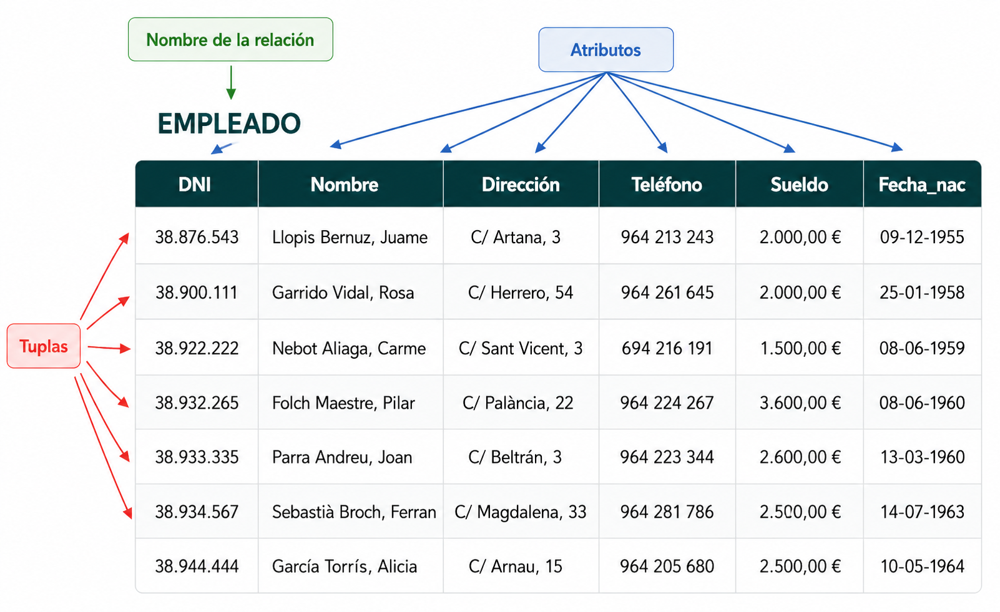

<!--
hide:
    - toc
---
-->
# 2. Estructura del Modelo Relacional

El elemento básico del Modelo Relacional es la **RELACIÓN**, que es una **tabla** bidimensional con características y restricciones específicas.

---

## 2.1 Componentes de una Relación (Tabla)

- **Nombre de la relación**

    Identificador único de la tabla (ej: EMPLEADO).
    
- **Filas (tuplas)**

    Información de cada ocurrencia o individuo.
    También llamadas registros.

- **Columnas (atributos)**

    Características de los individuos.
    También llamadas campos.

## 2.2 Definiciones Clave

| Concepto | Significado |
|----------|-------------|
| **Esquema/Estructura** | Definición de atributos, dominios y restricciones |
| **Estado de la Relación** | Información contenida en un momento específico |
| **Clave Candidata** | Atributo(s) que identifican unívocamente cada tupla |
| **Clave Principal/Primaria** | La clave candidata elegida para identificar tuplas |
| **Valor Nulo** | Ausencia de valor en un atributo (ej: sin teléfono) |
| **Dominio** | Conjunto de valores posibles para cada atributo.

## 2.3 Representación de una Relación (Tabla)

=== "Representación 1: Notación Textual"

    

    - **Convenciones**

        - Nombre de tabla en MAYÚSCULAS.
        - Atributos en minúsculas, separados por comas.
        - Clave principal subrayada.
        - Evitar caracteres especiales (ñ, acentos, guiones).

    - **Ejemplo**

        | Relación |
        |---|
        | EMPLEADO (<u>dni</u>, nombre, direccion, telefono, sueldo, fecha_n)|

    

    
=== "Representación 2: Diagrama Visual"

    

    - **Convenciones**

        - Una tabla con el nombre en la parte superior.
        - Los atributos listados en el interior.
        - La clave principal en negrita o subrayada.

    - **Ejemplo**

        | Relación |
        |---|
        |  |

    

---