# 3. Transformación del M. E/R al M. Relacional
<!--
<iframe src="../presentacion_parte_1.pdf" width="100%" height="800px" style="border-radius: 8px; box-shadow: 0 4px 6px -1px rgba(0, 0, 0, 0.1); border: none;">
</iframe>

Si no ves el visor de arriba o prefieres leerlo aparte: 
🎓 **[Descargar Presentación Parte 1 (PDF)](presentacion_parte_1.pdf)**
-->

A continuación veremos las reglas de transformación del Modelo E/R al Modelo Relacional, de esta manera continuamos el proceso de diseño de una Base de Datos. 

!!!Tip "Reglas de transformación"
    
    - Las entidades pasan a ser tablas
    - Los atributos pasan a ser columnas
    - Los atributos identificadores pasan a ser **claves primarias (PK)**.
    - Las relaciones, dependiendo de la cardinalidad, pasarán a ser **claves ajenas (FK)** y/o **tablas**.
    - Los atributos de las relaciones pasan a columnas detrás de las claves ajenas.

!!!Note ""
    Para entender mejor el proceso, continuaremos utilizando el ejemplo visto en el tema anterior y aplicaremos sobre él las transformaciones correspondientes, utilizando la **notaión textual**.

???+ "Ejemplo: Empresa"
    
    <!---->

## 3.1 Entidades

Toda entidad, fuerte o débil, se transformará en una tabla, con todos sus atributos, que se considerarán como simples. Se elige uno (o un conjunto) como **clave primaria (PK)**, que se representa mediante <u>subrayado</u>. 

En nuestro ejemplo, como teníamos 4 entidades, nos saldrán de momento 4 tablas:

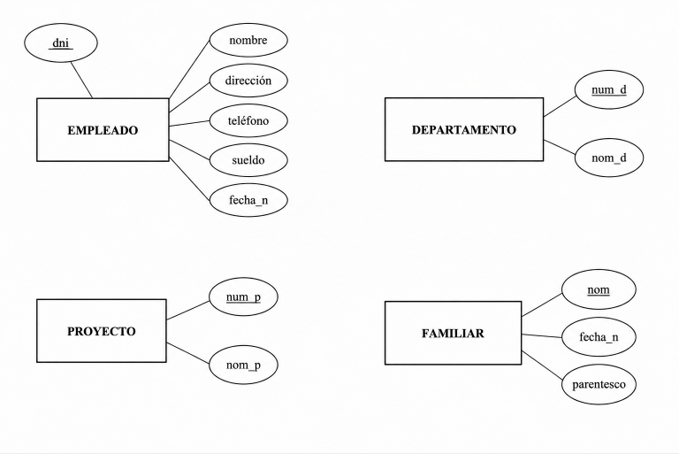

!!! tip "Recuerda"
    La **clave principal** se denota subrayándola.

!!! quote ""
    - EMPLEADO (<u>dni</u>, nombre, direccion, telefono, sueldo, fecha_n)
        - PK: (dni)
    - DEPARTAMENTO (<u>num_d</u>)
        - PK: (num_d)
    - PROYECTO (<u>num_p</u>, nombre_p)
        - PK: (num_p)
    - FAMILIAR (<u>nombre</u>, fecha_n, parentesco)
        - PK: (nombre)

<!---->

## 3.2 Relaciones 1:N

La clave primaria de la entidad situada en el lado 1 (A) se incorpora a la tabla correspondiente a la entidad situada en el lado N (B) como clave externa, también denominada **clave ajena, clave foránea o foreign key (FK)**. Esta clave referencia la clave primaria de A. En nuestros apuntes, la representamos resaltándola en <mark>amarillo</mark> e indicando su origen.

Si, además, la entidad situada en el lado N participa de forma total en la relación, la clave externa no puede ser nula (es decir, siempre debe tener un valor). Lo indicaremos mediante la restricción [no nulo].

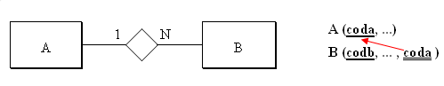

<!--
La siguiente animación intenta explicarlo mejor:

<iframe src="https://slides.com/aliciasalvador/bd-t3-exemple_clau_externa/embed" width="576" height="420" title="Copy of BD-T3-exemple_clau_externa" scrolling="no" frameborder="0" webkitallowfullscreen mozallowfullscreen allowfullscreen></iframe>
  
Si además la entidad que participa con grado N lo hace de forma **total** (como en la figura de abajo), la clave externa **no puede ser nula** (es decir siempre ha de tener un valor).

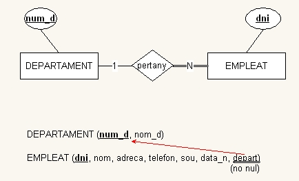
-->
Las relaciones 1:N de nuestro **ejemplo** se representarían así:

<!--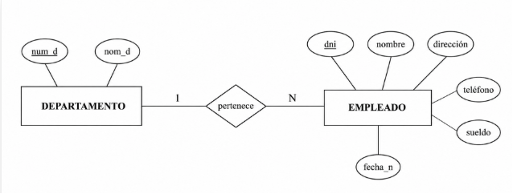-->

???+ "Ejemplo: Empresa"
    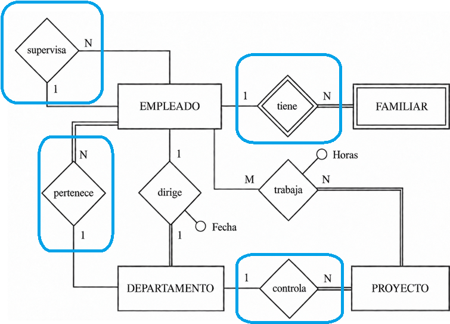

!!! quote ""
    - EMPLEADO (<u>dni</u>, nombre, direccion, telefono, sueldo, fecha_n, <mark>departamento</mark>, <mark>supervisor</mark>)
        - PK: (dni)
        - FK: departamento->DEPARTAMENTO(num_d) [no nulo]
        - FK: supervisor->EMPLEADO(dni)
    - DEPARTAMENTO (<u>num_d</u>, nombre_d)
        - PK: (num_d)
    - PROYECTO (<u>num_p</u>, nombre_p, <mark>departamento</mark>)
        - PK: (num_p)
        - FK: departamento->DEPARTAMENTO(num_d) [no nulo]
    - FAMILIAR (<u>nombre</u>, fecha_n, parentesco, <mark>dni_e</mark>)
        - PK: (nombre)
        - FK: dni_e->EMPLEADO(dni) [no nulo]

  * Por la relación **_Pertenece_** (figura de arriba) incluiremos el atributo **departamento** a **Empleado**, que además deberá ser no nulo.

  * Por la relación **_Controla_** incluiremos el atributo **departamento** a **Proyecto** (no nulo).

  * Por la relación **_Supervisa_** incluiremos el atributo **supervisor** a **Empleado** (es reflexiva), pero este sí que puede ser nulo. Aunque parezca extraño, un campo puede ser clave externa que apunta a la clave principal de la misma tabla.

  * Por la relación **_Tiene_** entre empleado y familiar, incluiremos en **FAMILIAR** el atributo **dni_e**, pero como Familiar es débil la veremos mejor un poco más adelante.

### Relación reflexiva: empleado y supervisor

Una relación es **reflexiva** cuando una entidad se relaciona consigo misma. En este ejemplo, los empleados pueden supervisar a otros empleados: la entidad **EMPLEADO** participa en la relación **Supervisa** con dos roles distintos, supervisor y empleado supervisado.

Si cada empleado tiene como máximo un supervisor y un supervisor puede supervisar a varios empleados, la relación es **1:N**. Aplicamos la misma regla de transformación que para cualquier relación 1:N: incorporamos la clave primaria del lado 1 como clave externa en la tabla del lado N. Como ambos lados corresponden a la misma entidad, la clave externa queda en **EMPLEADO** y referencia esa misma tabla:

!!! quote ""
    - EMPLEADO (<u>dni</u>, nombre, direccion, telefono, sueldo, fecha_n, <mark>supervisor</mark>)
        - PK: (dni)
        - FK: supervisor->EMPLEADO(dni)

El atributo `supervisor` contiene el `dni` del empleado que supervisa a esa persona. Puede ser **nulo** cuando el empleado no tiene supervisor (por ejemplo, quien dirige la organización). Un mismo `dni` de supervisor puede aparecer en varias filas, ya que una persona puede supervisar a varios empleados.

!!! example "Ejemplo"
    Si la empleada con DNI `12345678A` supervisa al empleado con DNI `87654321B`, en la fila de este último se almacena `supervisor = 12345678A`. La clave externa garantiza que ese supervisor existe en **EMPLEADO**.

## 3.3 Relaciones M:N

Por cada relación **M:N** se crea una **tabla intermedia**.

En esa tabla:

- Las claves principales de las dos entidades pasan a ser **claves externas**.
- La combinación de esas claves externas forma la **clave primaria** (o parte de ella).
- Se añaden también los atributos propios de la relación.

### Ejemplo base

Relación M:N entre **EMPLEADO** y **PROYECTO**, con atributo **horas**:

La traducción al modelo relacional queda:

!!! quote ""
    - TRABAJA (<mark><u>dni, num_p</u></mark>, horas)
        - PK: (dni, num_p)
        - FK: dni->EMPLEADO(dni)
        - FK: num_p->PROYECTO(num_p)

### ¿Cuándo no basta con la clave compuesta?

Pregunta clave: **¿puede repetirse la combinación `(dni, num_p)` en diferentes momentos?**

- Si **no** puede repetirse, la clave compuesta `(dni, num_p)` es suficiente.
- Si **sí** puede repetirse (caso histórico), hay que añadir otro atributo a la clave principal.

En el ejemplo histórico:

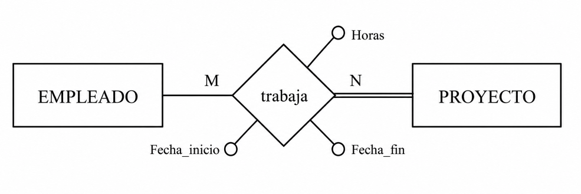

Se añade **fecha_inicio** a la clave principal para diferenciar participaciones distintas del mismo empleado en el mismo proyecto:

!!! quote ""
    - TRABAJA (<mark><u>dni, num_p</mark>, fecha incio</u>, fecha_fin, horas)
        - PK: (dni, num_p, fecha incio)
        - FK: dni->EMPLEADO(dni)
        - FK: num_p->PROYECTO(num_p)

### Criterio práctico

Evita claves principales excesivamente largas. Como regla práctica, si la clave principal empieza a tener demasiados campos (por ejemplo, 4 o más), conviene usar una clave artificial (como `id_trabaja`) y mantener las claves externas igualmente.

### Relación reflexiva N:N: empleados que colaboran

Una relación reflexiva también puede ser **N:N**. Por ejemplo, un empleado puede colaborar con varios empleados y, a su vez, colaborar con varios más. Como en cualquier relación N:N, se crea una tabla intermedia; en este caso, sus dos claves externas apuntan a la misma tabla **EMPLEADO**, pero representan roles distintos:

!!! quote ""
    - EMPLEADO (<u>dni</u>, nombre, ...)
        - PK: (dni)
    - COLABORA (<mark><u>dni_empleado, dni_colaborador</u></mark>)
        - PK: (dni_empleado, dni_colaborador)
        - FK: dni_empleado->EMPLEADO(dni)
        - FK: dni_colaborador->EMPLEADO(dni)

La clave primaria compuesta evita repetir la pareja (A, B), pero permite guardar también (B, A), porque las considera distintas. Si la colaboración es mutua, ambas representan la misma colaboración. Para evitar duplicarla, podemos acordar que se guarde siempre primero el DNI menor. En temas posteriores veremos cómo hacer que la base de datos compruebe esta regla.

!!! example "📝 Practica ahora"
    Con lo visto hasta ahora ya puedes resolver los **ejercicios 1, 2 y 3** de la sección [Ejercicios](5_ejercicios.md).

## 3.4 Relaciones 1:1

No existe una única traducción para una relación **1:1**. La decisión depende de la participación (**total** o **parcial**) y del criterio práctico de diseño.

### Caso 1: Una entidad participa de forma total

Si entre **A** y **B** solo una entidad participa de forma total (por ejemplo, **B**), la traducción recomendada es:

- Añadir una **clave externa (FK)** en **B**.
- Marcarla con la restricción [no nulo]  (siempre que la participación sea total).
- Marcarla con la restricción [unico] para mantener el 1:1.
- Añadir en esa tabla los atributos de la relación.

Ejemplo **dirige** (EMPLEADO - DEPARTAMENTO):

La opción elegida es colocar la clave externa en **DEPARTAMENTO**:  
Todos los departamentos tienen director (no nula) y solo uno (única), pero no todos los empleados dirigen un departamento.

!!! quote ""
    - EMPLEADO (<u>dni</u>, nombre, direccion, telefono, sueldo, fecha_n)
        - PK: (dni)
    - DEPARTAMENTO (<u>num_d</u>, nom_d, <mark>director</mark>, Fecha)
        - PK: (num_d)
        - FK: director->EMPLEADO(dni) 
        [no nulo] 
        [unico]

### Caso 2: Ambas entidades participan de forma total

Se puede:

- Fusionar todo en una sola tabla (entidades + relación + atributos), o
- Mantener dos tablas y aplicar el caso 1 (clave externa en una de ellas).

Ejemplo:

!!! quote ""
    - PERSONA (<u>dni</u>,....(datos persona)....(datos colección)...)
        - PK: (dni)

De todas formas, puede que nos interese tener dos tablas (para separar claramente los dos tipos de información). En ese caso, podríamos traducir la relación como en el primer punto, con una clave externa (no nula) en una de las dos tablas, y tendríamos que elegir la tabla que menos se utilice.

!!! quote ""
    - PERSONA (<u>dni</u>, ...(datos persona)...)
        - PK: (dni)
    - COLECCION (<u>cod_col</u>, <mark>dni, </mark>...(datos colección)...)
        - PK: (cod_col)
        - FK: dni->PERSONA(dni)  [no nulo]  [unico]

### Caso 3: Ambas entidades participan de forma parcial

Si las dos entidades participan de forma parcial en una relación 1:1, podemos crear una tercera tabla para representar la relación, con las claves externas de las dos entidades y los posibles atributos de la relación. Así evitamos tener muchos valores nulos.

En el ejemplo, podría ocurrir que las colecciones pertenecieran a una persona particular o a una institución (no tienen propietario).

!!! quote ""
    - PERSONA (<u>dni</u>, ...(datos persona)...)
        - PK: (dni)
    - COLECCION (<u>cod_col</u>, ...(datos colección)...)
        - PK: (cod_col)
    - PROPIETARIO (<u><mark>dni, </mark>, <mark>cod_col </mark></u>)    
        - PK: (dni, cod_col)
        - FK: dni->PERSONA(dni)
        - FK: cod_col->COLECCION(cod_col)

Pero, como comentábamos al principio, tendremos que aplicar el sentido común, ya que puede que una de las dos entidades participe de forma «casi» total (por ejemplo, casi todas las colecciones pertenecen a una persona). En ese caso, podría ser mejor traducir la relación como en el primer caso, colocando la clave externa en la tabla cuya participación sea «casi» total, ya que tendrá relativamente pocos valores nulos y resultaría más costoso mantener otra tabla. Evidentemente, en este caso la clave externa sí podría admitir valores nulos.

!!! quote ""
    - PERSONA (<u>dni</u>, ...(datos persona)...)
        - PK: (dni)
    - COLECCION (<u>cod_col</u>, <mark>dni, </mark>...(datos colección)...)
        - PK: (cod_col)
        - FK: dni->PERSONA(dni) [unico]

!!!Tip "En resumen"
    Una relación **1:1** casi siempre la traduciremos colocando una clave externa en la tabla cuya participación en la relación sea total o casi total (o en aquella que previsiblemente tenga más ocurrencias en la relación).

---

     

### Regla práctica

En la mayoría de escenarios reales, una relación **1:1** se traduce mejor como **clave externa en la tabla con participación total o casi total**.

### Relación reflexiva 1:1: empleados emparejados como mentores

Una relación reflexiva **1:1** relaciona instancias de la misma entidad, con un máximo de una instancia en cada rol. Por ejemplo, cada empleado puede tener como máximo un mentor y cada empleado puede ser mentor de como máximo otra persona.

Se puede representar con una clave externa a la propia tabla **EMPLEADO**. La restricción de unicidad mantiene la cardinalidad 1:1; el valor puede ser nulo si no todos los empleados tienen mentor:

!!! quote ""
    - EMPLEADO (<u>dni</u>, nombre, <mark>mentor</mark>)
        - PK: (dni)
        - FK: mentor->EMPLEADO(dni) [unico]

Si la participación exigiera que todos tuvieran mentor, `mentor` sería además [no nulo]. La decisión de dónde ubicar la clave externa sigue el criterio general del caso 1:1 descrito arriba.

## 3.5 Entidades débiles

Una entidad débil depende de una entidad principal para existir y participa de forma **total** en la relación de dependencia. Al transformarla al modelo relacional, su tabla incorpora una **clave externa no nula** que referencia a la entidad principal.

Además, en nuestros apuntes aplicaremos las siguientes reglas:

- Dependencia en **existencia**: la entidad débil se indica con (borrar en cascada).

    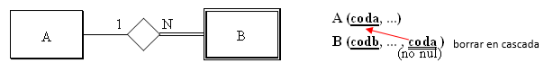

- Dependencia en **identificación**: además de lo anterior, la clave externa forma parte de la clave primaria de la entidad débil. En este caso, no indicamos explícitamente que es [no nulo], ya que esta restricción está implícita al formar parte de la clave primaria.

    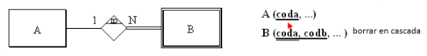

En el ejemplo:

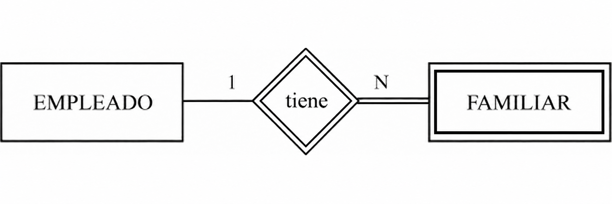

!!! quote ""
    - EMPLEADO (<u>dni</u>, nombre, direccion, telefono, sueldo, fecha_n)
        - PK: (dni)
    - FAMILIAR (<u><mark>dni_e</mark>, nom_f</u>, fecha_n, parentesco  (borrar en cascada)
        - PK: (dni_e, nom_f)
        - FK: dni_e->PERSONA(dni)

!!!Note "Nota práctica"
    - Si la relación en **identificación** es **1:N**, normalmente hace falta otro atributo para completar la clave principal.
    - Si es **1:1**, la clave externa puede ser suficiente como clave principal.
        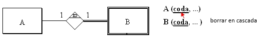

!!! example "📝 Practica ahora"
    Con lo visto hasta ahora ya puedes resolver los **ejercicios 4 y 5** de la sección [Ejercicios](5_ejercicios.md).

## 3.6 Resumen de dependencias

=== "1:N"
    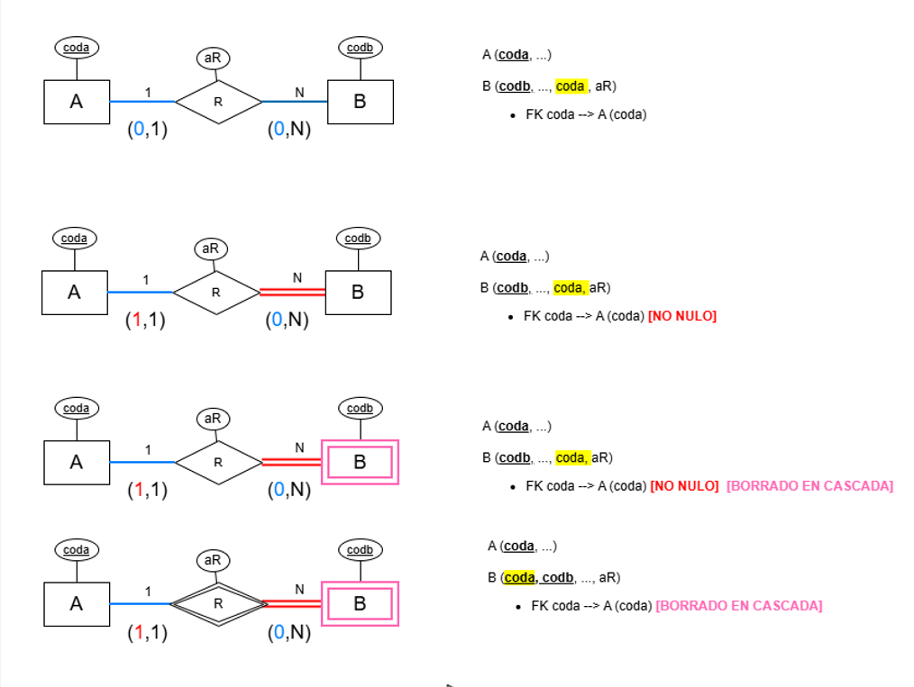
=== "1:1"
    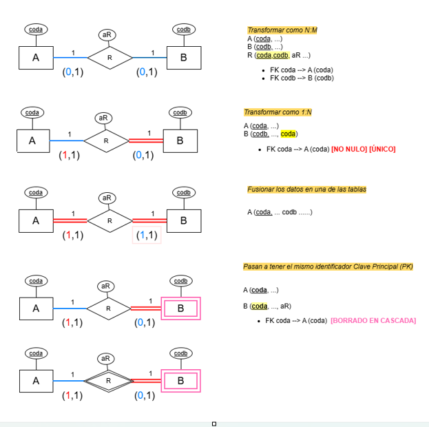{width=800}

=== "N:M"
    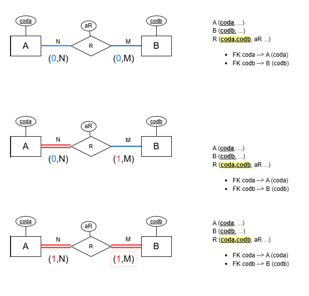{width=800}

## 3.7 Claves externas compuestas

Una duda frecuente aparece cuando la tabla referenciada tiene clave principal de varios campos.

Ejemplo: la tabla **FAMILIAR** tiene clave principal compuesta. Si otra tabla depende de ella (por ejemplo, cartas/comunicaciones), la relación en el modelo E/R podría ser:

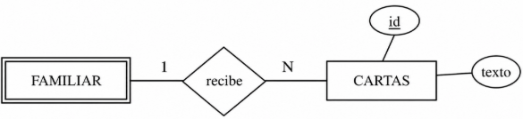

Si la relación es 1:N, la tabla dependiente tendrá una **clave externa compuesta** por esos dos campos.

Importante:

- No son dos claves externas separadas.
- Es **una única clave externa compuesta**.

!!! quote ""
    - FAMILIAR (<u><i>dni_e</i>, nom_f</u>, fecha_n, parentesco  (borrar en cascada)
        - PK: (dni_e, nom_f)
        - FK: dni_e->PERSONA(dni)
    - CARTAS (<u>id</u>, texto, <mark>dni_e, nom_f</mark>)
        - PK: (id)
        - FK: dni_e, nom_f->FAMILIAR(dni_e, nom_f)

  

## 3.8 Relaciones ternarias

Las relaciones de grado 3 pueden generar una nueva tabla dependiendo de la cardinalidad de la relación:

### Cardinalidad N:N:N

En este caso creamos una tabla. La clave primaria de la nueva tabla estará formada por las tres claves de las entidades que participan en la relación.

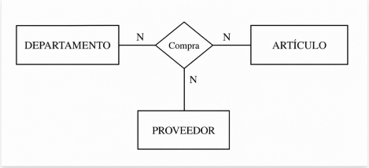

Creamos la tabla COMPRA:
!!! quote ""
    - DEPARTAMENTO (<u>num_d</u>, ....)
        - PK: (num_d)
    - ARTICULO (<u>cod_art</u>, ....)
        - PK: (cod_art)
    - PROVEEDOR (<u>cod_pr</u>, ....)
        - PK: (cod_pr)
    - COMPRA (<u><mark>num_d</mark>, <mark>cod_art</mark>, <mark>cod_pr</mark> </u>) 
        - PK: (num_d, cod_art, cod_pr)
        - FK: num_d->DEPARTAMENTO(num_d)
        - FK: cod_art->ARTICULO(cod_art)
        - FK: cod_pr->PROVEEDOR(cod_pr)

### Cardinalidad 1:N:N

En este caso creamos una tabla. La clave primaria de la nueva tabla estará formada por las dos claves de las entidades que participan como N en la relación.

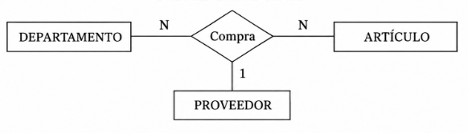

La tabla resultante sería:
!!! quote ""
    - COMPRA (<u><mark>num_d</mark>, <mark>cod_art</mark> </u>, <mark>cod_pr</mark>) 
        - PK: (num_d, cod_art)
        - FK: num_d->DEPARTAMENTO(num_d)
        - FK: cod_art->ARTICULO(cod_art)
        - FK: cod_pr->PROVEEDOR(cod_pr) [no nulo]

### Cardinalidad 1:1:N

Creamos una tabla para la relación con las claves primarias de las tres entidades como claves externas. La clave primaria se forma con la clave de la entidad del lado N y la de una de las entidades del lado 1. La combinación del lado N con el otro lado 1 debe declararse [única].

{width=600}

!!! quote ""
    - COMPRA (<u><mark>num_d</mark>, <mark>cod_art</mark> </u>, <mark>cod_pr</mark>) 
        - PK: (num_d, cod_art)
        - FK: num_d->DEPARTAMENTO(num_d)
        - FK: cod_art->ARTICULO(cod_art)
        - FK: cod_pr->PROVEEDOR(cod_pr) [no nulo] [única]

### Ternaria con atributos en la relación

En el ejemplo ternario, con atributos como **fecha de compra** y **cantidad**:

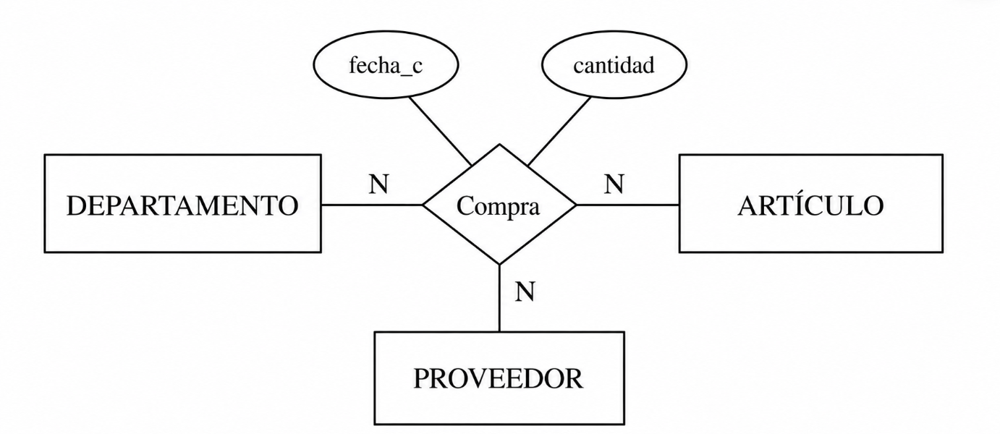{width=600}

!!! quote ""
    - DEPARTAMENTO (<u>num_d</u>, ....)
        - PK: (num_d)
    - ARTICULO (<u>cod_art</u>, ....)
        - PK: (cod_art)
    - PROVEEDOR (<u>cod_pr</u>, ....)
        - PK: (cod_pr)
    - COMPRA (<u><mark>num_d</mark>, <mark>cod_art</mark>, <mark>cod_pr</mark>, fecha_c </u>, cantidad) 
        - PK: (num_d, cod_art, cod_pr, fecha_c)
        - FK: num_d->DEPARTAMENTO(num_d)
        - FK: cod_art->ARTICULO(cod_art)
        - FK: cod_pr->PROVEEDOR(cod_pr)

Como todas las entidades participan con N, inicialmente todas sus claves externas forman parte de la clave principal. Sin embargo, puede no ser suficiente si una combinación puede repetirse en el tiempo (por ejemplo, mismo departamento, artículo y proveedor en compras distintas).

En ese caso hay dos opciones:

- Añadir otro atributo diferenciador a la clave principal.
- Sustituir la clave principal por una clave artificial cuando la compuesta se vuelve demasiado larga.

Las claves externas se mantienen y, normalmente, son no nulas:

!!! quote ""
    - DEPARTAMENTO (<u>num_d</u>, ....)
        - PK: (num_d)
    - ARTICULO (<u>cod_art</u>, ....)
        - PK: (cod_art)
    - PROVEEDOR (<u>cod_pr</u>, ....)
        - PK: (cod_pr)
    - COMPRA (<u>id</u>,<mark>num_d</mark>, <mark>cod_art</mark>, <mark>cod_pr</mark>, fecha_c , cantidad) 
        - PK: (id)
        - FK: num_d->DEPARTAMENTO(num_d) [no nulo]
        - FK: cod_art->ARTICULO(cod_art) [no nulo]
        - FK: cod_pr->PROVEEDOR(cod_pr) [no nulo]

## 3.9 Especialización y Herencia

Las especializaciones no tienen una única traducción óptima. La solución teórica puede ser correcta, pero en la práctica puede generar demasiadas tablas y mayor mantenimiento.

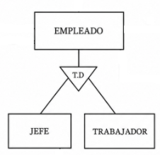

### Opción 1: Mantener superclase y subclases

Cada subtipo se transforma en una tabla que incorpora la clave primaria del supertipo y sus atributos específicos. Esta clave actúa también como clave ajena hacia la tabla del supertipo y, en nuestros apuntes, la definimos con actualización y borrado en cascada.  Opcionalmente, podemos añadir en la tabla del supertipo un campo **tipo** que indique el subtipo al que pertenece cada registro.
Si la especialización es solapada, un campo con un único valor no basta: un empleado podría pertenecer a varios subtipos.

En el ejemplo:

!!! quote ""
    - EMPLEADO (<u>dni</u>,nombre, direccion, telefono,..., tipo)
        - PK: (dni)
    - JEFE (<u><mark>dni</mark></u>, opinion) (borrar en cascada)
        - PK: (dni)
        - FK: dni->EMPLEADO(dni)
    - TRABAJADOR (<u><mark>dni</mark></u>, horas_extra) (borrar en cascada)
        - PK: (dni)
        - FK: dni->EMPLEADO(dni)

### Opción 2: Simplificar subclases

Los atributos de las subclases pasan a la superclase. También se adaptan las relaciones asociadas a las subclases. En este caso, el campo que identifica el tipo es obligatorio.

!!! quote ""
    - EMPLEADO (<u>dni</u>,nombre, direccion, telefono,... tipo, opinion, horas_extra)
        - PK: (dni)

### Opción 3: Integrar el supertipo en los subtipos

Creamos una tabla por subtipo, incorporando los atributos del supertipo y los específicos de cada subtipo. No se crea una tabla para el supertipo. Sus relaciones se trasladan a las tablas de los subtipos.

!!! quote ""
    - JEFE (<u>dni</u>, nombre, direccion, telefono, ..., opinion)
        - PK: (dni)
    - TRABAJADOR (<u>dni</u>, nombre, direccion, telefono, ..., horas_extra)
        - PK: (dni)
        
!!! example "📝 Practica ahora"
    Con lo visto hasta ahora ya puedes resolver los **ejercicios 6 al 10** de la sección [Ejercicios](5_ejercicios.md).

### Criterio práctico

Elige la opción que mejor equilibre claridad del modelo, volumen de datos y coste de mantenimiento.
<!--
## 3.10 Restricciones externas

Ya hemos comentado que restricciones externas son restricciones que no se pueden expresar por medio del modelo de datos. Entonces las expresaremos de palabra.

Normalmente, las restricciones externas del Modelo E/R continuarán siéndolo en el Modelo Relacional, porque tampoco se podrán expresar. En nuestro ejemplo teníamos las restricciones externas del Modelo E/R:

> **Rex1**: El jefe de un departamento debe ser miembro de este.

> **Rex2**: Un empleado solo puede trabajar en proyectos coordinados por su departamento.

Esto tampoco se puede expresar con el Modelo Relacional, por lo tanto las mantendremos.

Aparte, se pueden crear más restricciones externas, porque con el Modelo Relacional no se puede expresar todo lo que se podía expresar con el Modelo E/R. Por ejemplo, en la relación:

ya hemos comentado que dará lugar, aparte de las tablas de las entidades, a otra tabla:

!!! quote ""
    - TRABAJA (<u><mark>dni</mark>, <mark>num_p</mark></u>, horas)
        - PK: (dni, num_p)
        - FK: dni->EMPLEADO(dni)
        - FK: num_p->PROYECTO(num_p)

donde **dni** y **num_p** son claves externas. Pero la entidad proyecto participa de forma total en la relación, es decir, en todo proyecto debe haber un empleado trabajando. ¿Cómo controlamos esto? Pues es una nueva restricción externa que la podríamos formular así:

> **RexR3**: Todo proyecto debe tener como mínimo un empleado trabajando en él.

Las participaciones totales que nos supondrán una restricción externa son:

  * En una relación **1:N**, una participación total de la entidad que participa con grado 1.
  

  * En una relación **M:N**, cualquier participación total (si las dos participan de forma total, entonces habrá dos restricciones externas).
  

  * En una relación **1:1**, depende de la manera de traducirse.

La manera de implementar las restricciones externas será por medio de un TRIGGER, que se active cuando haya una actualización (inserción, modificación o borrado) que afecte a la restricción externa. Por ejemplo, en la restricción **RexR3** los momentos importantes son después de insertar un nuevo proyecto, y antes de eliminar o modificar en la tabla **Trabaja** (por si un proyecto se queda sin gente trabajando en él).

Las acciones a desarrollar podrían ser sacar un aviso, o obligar a insertar como mínimo una tupla en la tabla **Trabaja**, en el caso de la inserción de un nuevo proyecto; en el caso de modificación o eliminación en **Trabaja** podría impedirse esta actualización.

En nuestro ejemplo tendremos las restricciones externas al Modelo Relacional:

> **RexR1**: El jefe de un departamento debe ser miembro de este.

> **RexR2**: Un empleado solo puede trabajar en proyectos coordinados por su departamento.

> **RexR3**: Todo proyecto debe tener como mínimo un empleado trabajando en él.
-->
