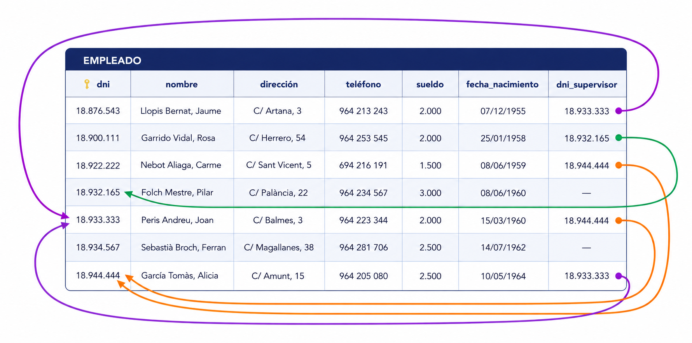
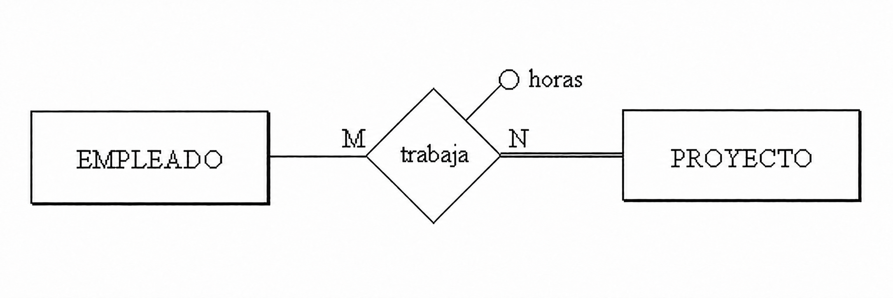

# 4. Restricciones

El Modelo Relacional define restricciones que garantizan la integridad de los datos. Hay dos tipos: **inherentes** (impuestas por el modelo) y **de usuario** (definidas por los diseñadores).

Como este apartado continúa la transformación del modelo E/R al modelo relacional, la mayoría de estas restricciones ya se han aplicado en los ejemplos anteriores. Ahora las reuniremos, definiremos con más precisión y veremos cómo condicionan el diseño de las tablas.

---

## 4.1 Restricciones Inherentes

Son impuestas por el propio Modelo Relacional. Toda relación válida debe cumplirlas:

### 1. Valores Atómicos

- Cada valor debe ser **simple e indivisible**
- NO se permiten atributos compuestos o multivaluados
- Excepto si se definen como campos simples separados

!!! example "Ejemplo"
    ❌ Nombre = "Juan García López" (compuesto)
    
    ✅ Nombre = "Juan", Apellido1 = "García", Apellido2 = "López" (atómicos)

### 2. Tuplas Distintas

- **No pueden haber tuplas duplicadas** en una relación: Cada fila debe ser única y representar una única ocurrencia de la entidad. Para garantizar esta unicidad se utilizan las **claves primarias**.

### 3. Orden No Significativo

- El **orden de las tuplas no importa**
- El **orden de los atributos no importa**
- Los datos se acceden por contenido, no por posición

---

## 4.2 Restricciones de Usuario (Semánticas)

Las define el usuario para garantizar que la BD represente la realidad y evitar errores.

## 4.2.1 Restricción de Dominio

Especifica qué valores puede tomar un atributo. Por ejemplo:

| Aspecto | Descripción | Ejemplo |
|--------|-------------|---------|
| **Tipo de dato** | Entero, real, texto, fecha, hora, etc. | Sueldo: Real (rechaza "2.R00") |
| **Rango** | Intervalo permitido (ej: nota 0-10) | Fecha: Formato DD-MM-YYYY (rechaza "31-2-1958") |
| **Enumeración** | Valores específicos permitidos | Nota: (MD, IN, SUF, BI, NOT, SOB) |

## 4.2.2 Restricción de Clave Principal

Define un atributo (o conjunto) como **identificador único** de cada tupla.

**Características**:  

- No puede ser nulo
- No puede repetirse
- Debe ser simple (máximo 3 campos)

**Representación**:

!!! quote ""
    - EMPLEADO (<u>dni</u>, nombre, direccion, telefono, sueldo, fecha_n)
        - PK: (dni)

!!! tip "Buena Práctica"
    Si no existe una clave natural candidata, crear un campo artificial (ID, código, etc.)

## 4.2.3 Restricción de Unicidad

Asegura que un campo (o conjunto) no se repita, **sin ser clave principal**.

!!! info "Cuándo usarla"
    Cuando algunos valores pueden ser nulos pero, si existen, deben ser únicos.
    
    

**Representación**:

!!! Example "Ejemplo: no puede haber dos Empleados con el mismo email"
    - EMPLEADO (<u>dni</u>, nombre, email)
        - PK: (dni)
        - email [unico]

## 4.2.4 Restricción de Valor No Nulo

Obliga a que el atributo **siempre tenga un valor**.

**Representación**:

!!! Example "Ejemplo: el atributo nombre siempre es obligatorio"
    - EMPLEADO (<u>dni</u>, nombre, direccion, telefono, sueldo, fecha_n)
        - PK: (dni)
        - nombre  [no nulo]

## 4.2.5 Integridad Referencial

Garantiza que todo valor no nulo de una clave externa corresponda a un registro existente en la tabla referenciada.

Si en **FAMILIAR** existe `dni_empleado` como clave externa hacia `EMPLEADO.dni`, no puede aparecer un `dni_empleado` que no exista en EMPLEADO.

!!! example "Ejemplo"
    No es válido insertar en FAMILIAR el DNI `18.754.321` si no existe antes en EMPLEADO.

También puede haber claves externas reflexivas (la misma tabla se referencia a sí misma), por ejemplo el atributo `supervisor` en EMPLEADO.

## 4.2.6 Acciones sobre claves ajenas

Cuando se borra o modifica una clave referenciada, suelen definirse estas acciones:

- **NO ACTION**: bloquea la operación si rompe integridad.
- **CASCADE**: propaga el cambio o borrado en cascada.
- **SET NULL / SET DEFAULT**: sustituye el valor de la clave externa por nulo o por defecto.

---

## 4.2.7 Restricciones Externas

Las **restricciones externas** son aquellas que no se pueden expresar directamente mediante el modelo de datos. Por tanto, las describiremos mediante texto.

Normalmente, las restricciones externas del modelo E/R seguirán siendo externas en el modelo relacional. En nuestro ejemplo teníamos:

> **Rex1**: El jefe de un departamento debe ser miembro de este.
>
> **Rex2**: Un empleado solo puede trabajar en proyectos coordinados por su departamento.

Estas condiciones no quedan garantizadas mediante las claves primarias y externas del esquema obtenido, por lo que las mantendremos como restricciones externas.

Además, pueden aparecer nuevas restricciones externas al transformar el modelo E/R al modelo relacional. Por ejemplo, en la siguiente relación:

{width=600}

Además de las tablas de las entidades, se crea una tabla para la relación:

!!!quote ""
    - TRABAJA (<u><mark>dni</mark>, <mark>num_p</mark></u>, horas)  
        - PK: (dni, num_p)
        - FK: dni->EMPLEADO(dni)  
        - FK: num_p->PROYECTO(num_p)  

En la tabla **TRABAJA**, los atributos **dni** y **num_p** son claves externas y forman conjuntamente la clave primaria. También se incorpora el atributo **horas** de la relación.

Sin embargo, la entidad **PROYECTO** participa de forma **total**: todo proyecto debe tener al menos un empleado trabajando en él.

Las claves externas de TRABAJA garantizan que el empleado y el proyecto referenciados existan, pero **no garantizan que todos los proyectos aparezcan en TRABAJA**. Por tanto, necesitamos una nueva restricción externa:

> **RexR3**: Todo proyecto debe tener al menos un empleado trabajando en él.

### Participaciones totales que generan restricciones externas

- En una relación **1:N**, la participación total de la entidad situada en el lado **1**.
- En una relación **M:N**, cualquier participación total. Si ambas entidades participan de forma total, habrá dos restricciones externas.
- En una relación **1:1**, dependerá de cómo se transforme la relación al modelo relacional.

### Implementación de las restricciones externas

Las restricciones externas pueden implementarse mediante **triggers**, que se ejecutan cuando se produce una inserción, modificación o eliminación que afecta a la restricción.

Para garantizar **RexR3**, debemos controlar:

- La **creación de proyectos**, para garantizar que se registre al menos un empleado trabajando en cada nuevo proyecto.
- Las **modificaciones y eliminaciones en TRABAJA**, para evitar que un proyecto se quede sin empleados.

La comprobación puede realizarse al finalizar la transacción, si el SGBD lo permite. Así, podemos insertar primero el proyecto y después su correspondiente fila en TRABAJA.

Si una modificación o eliminación en TRABAJA deja un proyecto existente sin empleados, debe impedirse la operación.

!!! note "Restricciones externas del ejemplo"
    En nuestro ejemplo, tendremos las siguientes restricciones externas en el modelo relacional:

    - **Rex1**: El jefe de un departamento debe ser miembro de este.
    - **Rex2**: Un empleado solo puede trabajar en proyectos coordinados por su departamento.
    - **Rex3**: Todo proyecto debe tener al menos un empleado trabajando en él.

