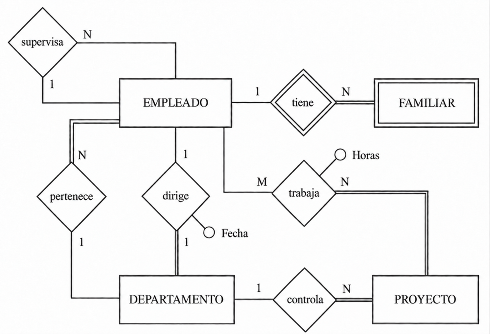
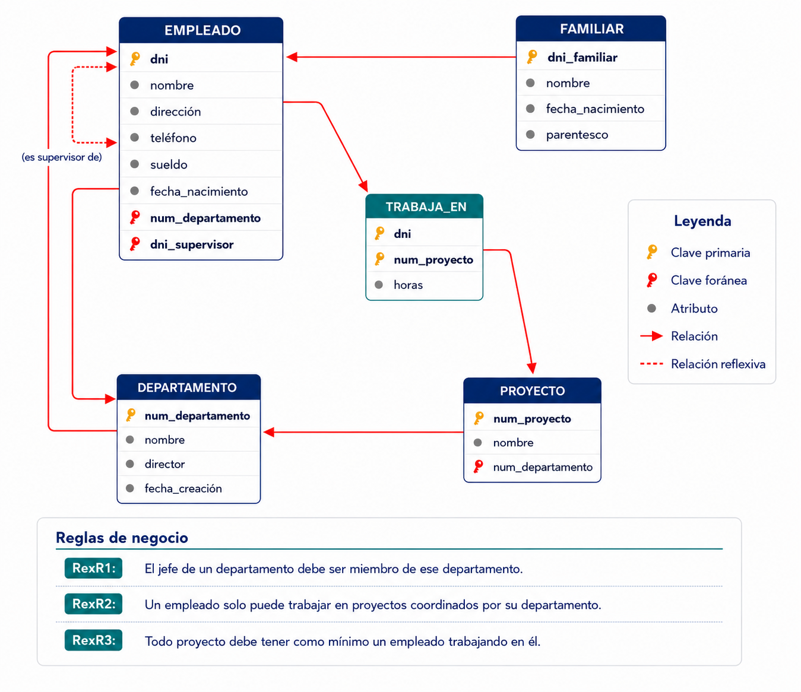
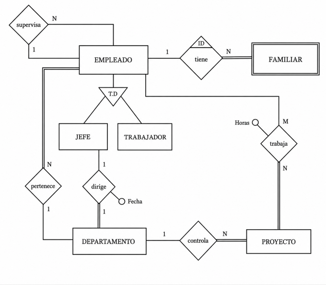
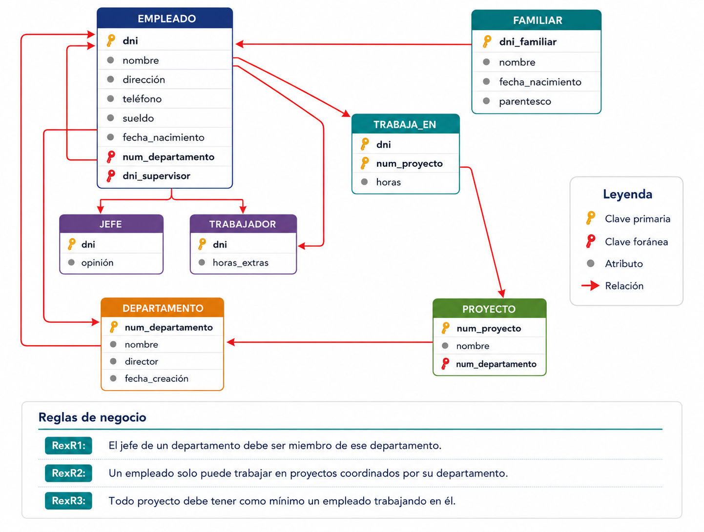

---
hide:
    - toc
---

# Ejemplo Completo

Vamos a ver cómo quedará definitivamente la traducción del ejemplo que estamos arrastrando desde el Tema 2. Daremos 2 versiones, teniendo en cuenta o no la especialización de que el trabajador puede ser jefe o trabajador normal.

Sin tener en cuenta la especialización tendremos esta solución:

???+ "Ejemplo: Empresa"
    {width=800}

!!! quote ""
    - EMPLEADO (<u>dni</u>, nombre, direccion, telefono, sueldo, fecha_n, <mark>departamento</mark>, <mark>supervisor</mark>)
        - FK: departamento->DEPARTAMENTO(num_d) [no nulo]
        - FK: supervisor->EMPLEADO(dni)
    - FAMILIAR (<u><mark>dni_e</mark>, nombre_f</u>, fecha_n, parentesco, ) (borrar en cascada)
        - FK: dni_e->EMPLEADO(dni)
    - DEPARTAMENTO (<u>num_d</u>, nombre_d, <mark>director</mark>, fecha)
        - FK: director->EMPLEADO(dni) [no nulo] [unico]
    - PROYECTO (<u>num_p</u>, nombre_p, <mark>departamento</mark>)
        - FK: departamento->DEPARTAMENTO(num_d) [no nulo]
    - TRABAJA (<u><mark>dni</mark>, <mark>num_p</mark></u>, horas)    
        - FK: dni->EMPLEADO(dni)
        - FK: num_p->PROYECTO(num_p)
    

Y esta sería la forma alternativa de representarlo:

{width=600}

Y teniendo en cuenta la especialización:

???+ "Ejemplo con especialización: Empresa"
    
    

!!! quote ""
    - EMPLEADO (<u>dni</u>, nombre, direccion, telefono, sueldo, fecha_n, <mark>departamento</mark>, <mark>supervisor</mark>)
        - FK: departamento->DEPARTAMENTO(num_d) [no nulo]
        - FK: supervisor->EMPLEADO(dni)
    - JEFE (<u><mark>dni</mark></u>, opinion) (borrar en cascada)
        - FK: dni->EMPLEADO(dni)
    - TRABAJADOR  (<u><mark>dni</mark></u>, horas_extra)  (borrar en cascada)
        - FK: dni->EMPLEADO(dni)     
    - FAMILIAR (<u><mark>dni_e</mark>, nombre_f</u>, fecha_n, parentesco, ) (borrar en cascada)
        - FK: dni_e->EMPLEADO(dni)
    - DEPARTAMENTO (<u>num_d</u>, nombre_d, <mark>director</mark>, fecha)
        - FK: director->JEFE(dni) [no nulo] [unico]
    - PROYECTO (<u>num_p</u>, nombre_p, <mark>departamento</mark>)
        - FK: departamento->DEPARTAMENTO(num_d) [no nulo]
    - TRABAJA (<u><mark>dni</mark>, <mark>num_p</mark></u>, horas)    
        - FK: dni->EMPLEADO(dni)
        - FK: num_p->PROYECTO(num_p)
    

Y aquí tendríamos la representación alternativa:

{width=600}