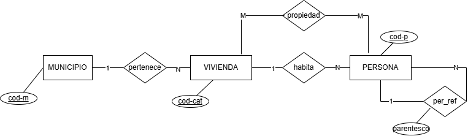
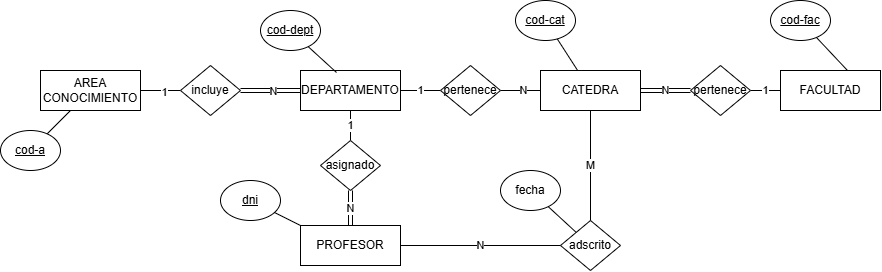
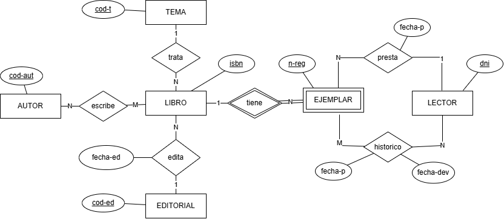
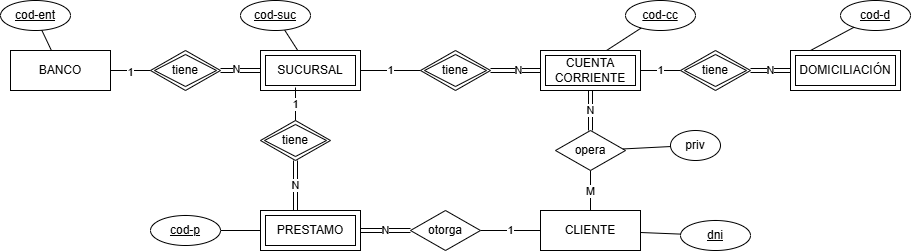
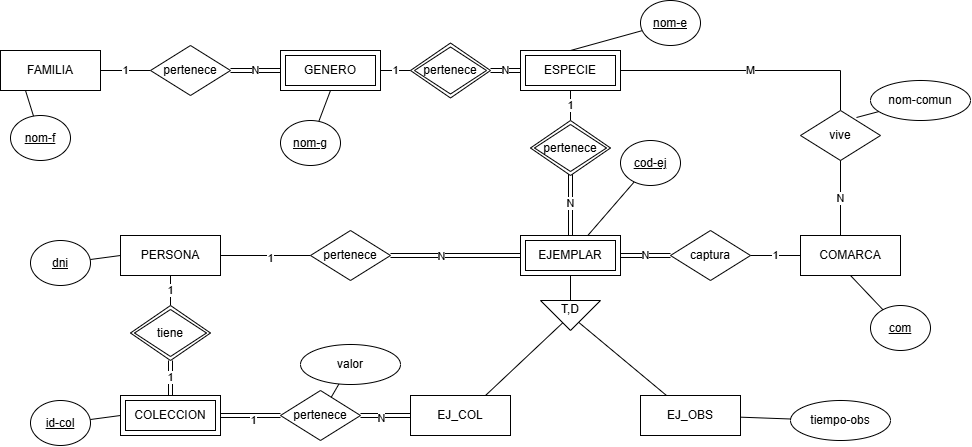
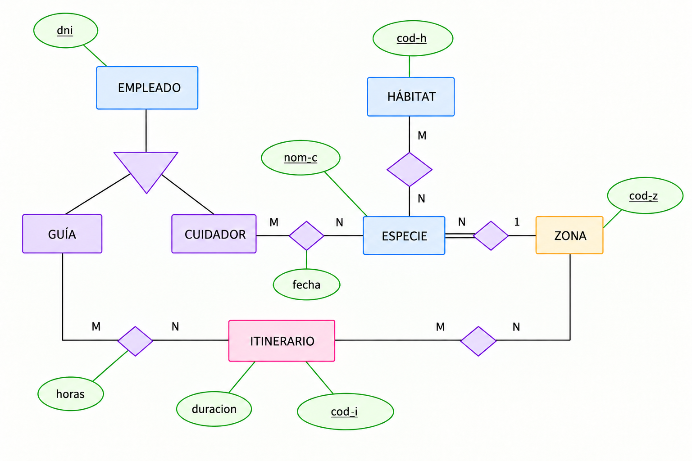
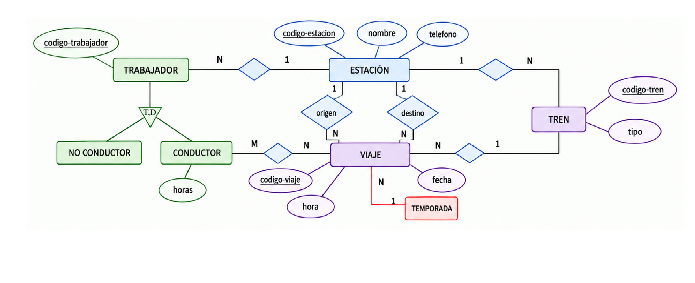
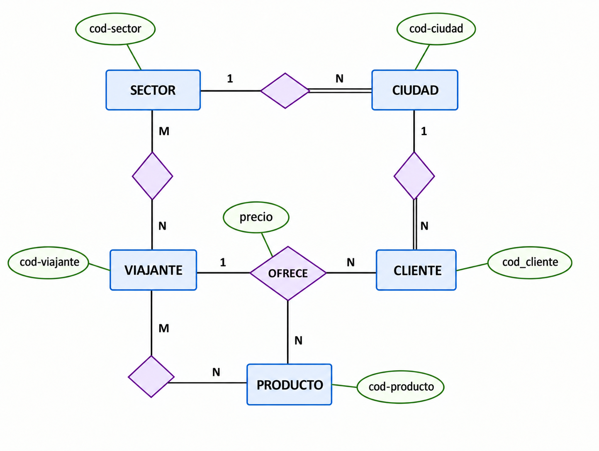
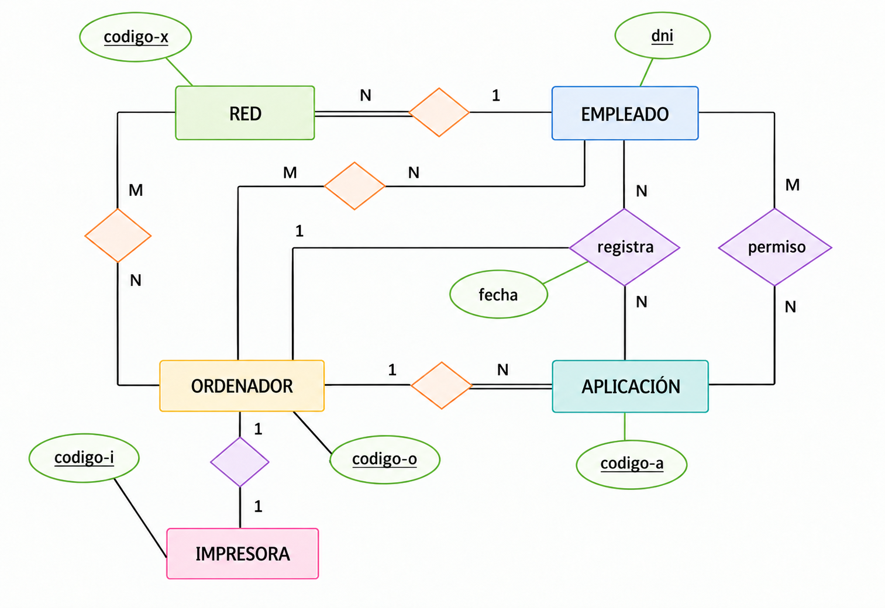

---
hide:
  - toc
---

# Soluciones

!!! warning "Advertencia"
    Antes de consultar la solución, asegúrate de haber intentado resolver el ejercicio. Comparar tu propuesta con la solución te ayudará mucho más que leerla directamente.

!!! info "Atributos de los enunciados y de las soluciones"
    Para simplificar los diagramas E/R, se han omitido algunos atributos descriptivos que sí aparecen en las soluciones. Al resolver los ejercicios, incluye solo los atributos del diagrama: no tienes que añadir los demás y no se penalizará su ausencia.
    
??? example "Ejercicio 1"

    ??? question "Enunciado"
        Recordad que teníamos 3 opciones:

       { .grayscale width=400 }

    ??? success "Solución propuesta"
        !!! quote "Opción 1"
            - **SOCIO** (<u>dni</u>, nombre, direccion, telefono, correo)
                - PK: (dni)
            - **VINO** (<u>codi-vi</u>, descripcion, anio-cogida)
                - PK: (codi-vi)
            - **RETIRA** (<u>cod-retira</u>, <mark>dni</mark>, <mark>codi-vi</mark>, fecha, cant)
                - PK: (cod-retira)
                - FK: dni->SOCIO(dni)
                - FK: codi-vi->VINO(codi-vi)

        !!! quote "Opción 2"
            - **SOCIO** (<u>dni</u>, nombre, direccion, telefono, correo)
                - PK: (dni)
            - **VINO** (<u>codi-vi</u>, descripcion, anio-cogida)
                - PK: (codi-vi)
            - **VALE** (<u>num-vale</u>, <mark>dni</mark>, <mark>codi-vi</mark>, fecha, cant)
                - PK: (num-vale)
                - FK: dni->SOCIO(dni)
                - FK: codi-vi->VINO(codi-vi)

        !!! quote "Opción 3"
            - **SOCIO** (<u>dni</u>, nombre, direccion, telefono, correo)
                - PK: (dni)
            - **VINO** (<u>codi-vi</u>, descripcion, anio-cogida)
                - PK: (codi-vi)
            - **VALE** (<u>num-vale</u>, <mark>dni</mark>,fecha)
                - PK: (num-vale)
                - FK: dni->SOCIO(dni)
            - **RETIRA** (<u><mark>num-vale</mark>, <mark>codi-vi</mark></u>, cant)
                - PK: (num-vale, codi-vi)
                - FK: num-vale->VALE(num-vale)
                - FK: codi-vi->VINO(codi-vi)

??? example "Ejercicio 2"

    ??? question "Enunciado"
        { .grayscale }

    ??? success "Solución propuesta"
        - **MUNICIPIO** (<u>cod-m</u>)
            - PK: (cod-m)
        - **VIVIENDA** (<u>cod-cat</u>, <mark>cod-m</mark>)
            - PK: (cod-cat)
            - FK: cod-m->MUNICIPIO(cod-m)
        - **PERSONA** (<u>cod-p</u>, <mark>cod-cat</mark>, <mark>cod-per-ref</mark>, parentesco)
            - PK: (cod-p)
            - FK: cod-cat->VIVIENDA(cod-cat)
            - FK: cod-per-ref->PERSONA(cod-p)
        - **PROPIEDAD** (<u><mark>cod-p</mark>,<mark>cod-cat</mark></u>)
            - PK: (cod-p, cod-cat)
            - FK: cod-p->PERSONA(cod-p)
            - FK: cod-cat->VIVIENDA(cod-cat)

??? example "Ejercicio 3"

    ??? question "Enunciado"
        { .grayscale }

    ??? success "Solución propuesta"
        - **ÁREA DE CONOCIMIENTO** (<u>cod-a</u>)
            - PK: (cod-a)
        - **FACULTAD** (<u>cod-fac</u>)
            - PK: (cod-fac)
        - **DEPARTAMENTO** (<u>cod-dept</u>, <mark>cod-a</mark>)
            - PK: (cod-dept)
            - FK: cod-a->ÁREA DE CONOCIMIENTO(cod-a) [no nulo]
        - **CÁTEDRA** (<u>cod-cat</u>, <mark>cod-dept</mark>, <mark>cod-fac</mark>)
            - PK: (cod-cat)
            - FK: cod-dept->DEPARTAMENTO(cod-dept)
            - FK: cod-fac->FACULTAD(cod-fac) [no nulo]
        - **PROFESOR** (<u>dni</u>, <mark>cod-dept</mark>)
            - PK: (dni)
            - FK: cod-dept->DEPARTAMENTO(cod-dept) [no nulo]
        - **ADSCRITO_A** (<u><mark>dni</mark>, <mark>cod-cat</mark></u>, fecha)
            - PK: (dni, cod-cat)
            - FK: dni->PROFESOR(dni)
            - FK: cod-cat->CÁTEDRA(cod-cat)

??? example "Ejercicio 4"

    ??? question "Enunciado"
        { .grayscale }

    ??? success "Solución propuesta"
        - **TEMA** (<u>cod-t</u>)
            - PK: (cod-t)
        - **AUTOR** (<u>cod-aut</u>)
            - PK: (cod-aut)
        - **EDITORIAL** (<u>cod-ed</u>)
            - PK: (cod-ed)
        - **LIBRO** (<u>isbn</u>, <mark>cod-t</mark>, <mark>cod-ed</mark>, fecha-ed)
            - PK: (isbn)
            - FK: cod-t->TEMA(cod-t)
            - FK: cod-ed->EDITORIAL(cod-ed)
        - **EJEMPLAR** (<u><mark>isbn</mark>, n-reg</u>, <mark>dni</mark>, fecha-p) (borrar en cascada)
            - PK: (isbn, n-reg)
            - FK: isbn->LIBRO(isbn)
            - FK: dni->LECTOR(dni)
        - **ESCRIBE** (<u><mark>cod-aut</mark>, <mark>isbn</mark></u>)
            - PK: (cod-aut, isbn)
            - FK: cod-aut->AUTOR(cod-aut)
            - FK: isbn->LIBRO(isbn)
        - **LECTOR** (<u>dni</u>)
            - PK: (dni)
        - **HISTORICO** ( <u><mark>isbn, n-reg</mark>, <mark>dni</mark>, fecha-p</u>, fecha-dev)
            - PK: (isbn, n-reg, dni, fecha-p)
            - FK: isbn, n-reg->EJEMPLAR(isbn, n-reg)
            - FK: dni->LECTOR(dni)

??? example "Ejercicio 5"

    
    ??? question "Enunciado"
        
        { .grayscale }

    ??? success "Solución propuesta"
        !!! quote "Opción 1"
            - **BANCO** (<u>cod-ent</u>)
                - PK: (cod-ent)
            - **SUCURSAL** (<u><mark>cod-ent</mark>, cod-suc</u>) (borrar en cascada)
                - PK: (cod-ent, cod-suc)
                - FK: cod-ent->BANCO(cod-ent)
            - **CUENTA CORRIENTE** (<u><mark>cod-ent</mark>, <mark>cod-suc</mark></u>, <u>cod-cc</u>) (borrar en cascada)
                - PK: (cod-ent, cod-suc, cod-cc)
                - FK: cod-ent, cod-suc->SUCURSAL(cod-ent, cod-suc)
            - **DOMICILIACION** (<u><mark>cod-ent</mark>, <mark>cod-suc</mark>, <mark>cod-cc</mark>, cod-d</u>) (borrar en cascada)
                - PK: (cod-ent, cod-suc, cod-cc, cod-d)
                - FK: cod-ent, cod-suc, cod-cc->CUENTA CORRIENTE(cod-ent, cod-suc, cod-cc)
            - **CLIENTE** (<u>dni</u>)
                - PK: (dni)
            - **PRESTAMO** (<u><mark>cod-ent</mark>, <mark>cod-suc</mark>, cod-p</u>, <mark>dni</mark>) (borrar en cascada)
                - PK: (cod-ent, cod-suc, cod-p)
                - FK: cod-ent, cod-suc->SUCURSAL(cod-ent, cod-suc)
                - FK: dni->CLIENTE(dni) [no nulo]
            - **PERMISOS** (<u><mark>cod-ent</mark>, <mark>cod-suc</mark>, <mark>cod-cc</mark>, <mark>dni</mark>, privilegio</u>)
                - PK: (cod-ent, cod-suc, cod-cc, dni, privilegio)
                - FK: cod-ent, cod-suc, cod-cc->CUENTA CORRIENTE(cod-ent, cod-suc, cod-cc)
                - FK: dni->CLIENTE(dni)

        !!! quote "Opción 2"

            [nota] En **DOMICILIACION** y **PERMISOS** se ha aplicado el **criterio práctico**: como su clave compuesta "natural" tenía demasiados campos (4 y 5, respectivamente), se sustituye por una clave artificial (`num-d` y `cod-p`), manteniendo las claves externas correspondientes.
         
            - **BANCO** (<u>cod-ent</u>)
                - PK: (cod-ent)
            - **SUCURSAL** (<u><mark>cod-ent</mark>, cod-suc</u>) (borrar en cascada)
                - PK: (cod-ent, cod-suc)
                - FK: cod-ent->BANCO(cod-ent) 
            - **CUENTA CORRIENTE** (<u><mark>cod-ent</mark>, <mark>cod-suc</mark></u>, <u>cod-cc</u>) (borrar en cascada)
                - PK: (cod-ent, cod-suc, cod-cc)
                - FK: cod-ent, cod-suc->SUCURSAL(cod-ent, cod-suc)
            - **DOMICILIACION** (<u>num-d</u>,<mark>cod-ent</mark>, <mark>cod-suc</mark>, <mark>cod-cc</mark>) (borrar en cascada)
                - PK: (num-d)
                - FK: cod-ent, cod-suc, cod-cc->CUENTA CORRIENTE(cod-ent, cod-suc, cod-cc) [no nulo]
            - **CLIENTE** (<u>dni</u>)
                - PK: (dni)
            - **PRESTAMO** (<u><mark>cod-ent</mark>, <mark>cod-suc</mark>, cod-p</u>, <mark>dni</mark>) (borrar en cascada)
                - PK: (cod-ent, cod-suc, cod-p)
                - FK: cod-ent, cod-suc->SUCURSAL(cod-ent, cod-suc)
                - FK: dni->CLIENTE(dni) [no nulo]
            - **PERMISOS** (<u> cod-p</u>,<mark>cod-ent</mark>, <mark>cod-suc</mark>, <mark>cod-cc</mark>, <mark>dni</mark>, privilegio)
                - PK: (cod-p)
                - FK: cod-ent, cod-suc, cod-cc->CUENTA CORRIENTE(cod-ent, cod-suc, cod-cc) [no nulo]
                - FK: dni->CLIENTE(dni)  [no nulo]

           

??? example "Ejercicio 6"

    ??? question "Enunciado"

        { .grayscale }
        

    ??? success "Solución propuesta"
        !!! quote "Opción 1"
            - **FAMILIA** (<u>nom-f</u>)
                - PK: (nom-f)
            - **GENERO** (<u>nom-g</u>, <mark>nom-f</mark>) (borrar en cascada)
                - PK: (nom-g)
                - FK: nom-f->FAMILIA(nom-f) [no nulo]
            - **ESPECIE** (<u><mark>nom-g</mark>,nom-e </u>) (borrar en cascada)
                - PK: (nom-g, nom-e)
                - FK: nom-g->GENERO(nom-g)
            - **PERSONA** (<u>dni</u>)
                - PK: (dni)
            - **COMARCA** (<u>com</u>)
                - PK: (com)
            - **VIVE** (<u><mark>nom-g</mark>,<mark>nom-e</mark>, <mark>com</mark></u>, nom-comun)
                - PK: (nom-g, nom-e, com)
                - FK: nom-g,nom-e->ESPECIE(nom-g,nom-e)
                - FK: com->COMARCA(com)
            - **EJEMPLAR** (<u><mark>nom-g</mark>,<mark>nom-e</mark>,cod-ej</u>, <mark>dni</mark>, <mark>com</mark>) (borrar en cascada)
                - PK: (nom-g, nom-e, cod-ej)
                - FK: nom-g,nom-e->ESPECIE(nom-g,nom-e)
                - FK: dni->PERSONA(dni) [no nulo]
                - FK: com->COMARCA(com) [no nulo]
             - **EJ_COL** (<u><mark>nom-g</mark>,<mark>nom-e</mark>,<mark>cod-ej</mark></u>, <mark>dni</mark>, valor) (borrar en cascada)
                - PK: (nom-g, nom-e, cod-ej)
                - FK: cod-ej,nom-g,nom-e->EJEMPLAR(cod-ej,nom-g,nom-e)
                - FK: dni->COLECCION(dni) [no nulo]
            - **EJ_OBS** (<u><mark>nom-g</mark>,<mark>nom-e</mark>,<mark>cod-ej</mark></u>, tiempo-obs) (borrar en cascada)
                - PK: (nom-g, nom-e,cod-ej)
                - FK: cod-ej,nom-g,nom-e->EJEMPLAR(cod-ej,nom-g,nom-e)

              
            - **COLECCION** (<u><mark>dni</mark></u>, id-col) (borrar en cascada)
                - PK: (dni)
                - FK: dni->PERSONA(dni)
                      
            [nota] La PK de **COLECCION** es la misma que la de **PERSONA** (dni), ya que se trata de una relación 1:1 de identificación.

            [nota] La especialización de **EJEMPLAR** en **EJ_COL** y **EJ_OBS** es total y disjunta (T,D).   

        !!! quote "Opción 2"

            [nota] Esta opción se propone para **simplificar la clave primaria de EJEMPLAR y las claves de las tablas que lo referencian**. En la opción 1, la PK es compuesta: `(cod-ej, nom-g, nom-e)`. En la opción 2, se supone que **cada ejemplar tiene un `cod-ej` único entre todos los ejemplares, aunque sean de especies distintas**, por lo que la PK queda reducida a `(cod-ej)`. Así, **EJ_COL** y **EJ_OBS** también utilizan únicamente `cod-ej` como PK y FK a **EJEMPLAR**. Los atributos `nom-g` y `nom-e` se mantienen en **EJEMPLAR** como FK para indicar su especie. Esta simplificación solo es válida si se garantiza esa unicidad global de `cod-ej`.

            - **FAMILIA** (<u>nom-f</u>)
                - PK: (nom-f)
            - **GENERO** (<u>nom-g</u>, <mark>nom-f</mark>) (borrar en cascada)
                - PK: (nom-g)
                - FK: nom-f->FAMILIA(nom-f) [no nulo]
            - **ESPECIE** (<u><mark>nom-g</mark>,nom-e</u>) (borrar en cascada)
                - PK: (nom-g, nom-e)
                - FK: nom-g->GENERO(nom-g)
            - **PERSONA** (<u>dni</u>)
                - PK: (dni)
            - **COMARCA** (<u>com</u>)
                - PK: (com)
            - **VIVE** (<u><mark>nom-g</mark>,<mark>nom-e</mark>, <mark>com</mark></u>, nom-comun)
                - PK: (nom-g, nom-e, com)
                - FK: nom-g,nom-e->ESPECIE(nom-g,nom-e)
                - FK: com->COMARCA(com)
            - **EJEMPLAR** (<u>cod-ej</u>, <mark>nom-g</mark>,<mark>nom-e</mark>, <mark>dni</mark>, <mark>com</mark>) (borrar en cascada)
                - PK: (cod-ej)
                - FK: nom-g,nom-e->ESPECIE(nom-g,nom-e) [no nulo]
                - FK: dni->PERSONA(dni) [no nulo]
                - FK: com->COMARCA(com) [no nulo]
            
            - **EJ_COL** (<u><mark>cod-ej</mark></u>, <mark>dni</mark>, valor) (borrar en cascada)
                - PK: (cod-ej)
                - FK: cod-ej->EJEMPLAR(cod-ej)
                - FK: dni->COLECCION(dni) [no nulo]
            - **EJ_OBS** (<u><mark>cod-ej</mark></u>, tiempo-obs) (borrar en cascada)
                - PK: (cod-ej)
                - FK: cod-ej->EJEMPLAR(cod-ej)

            - **COLECCION** (<u><mark>dni</mark></u>, id-col) (borrar en cascada)
                - PK: (dni)
                - FK: dni->PERSONA(dni)[no nulo]    

             [nota] La PK de **COLECCION** es la misma que la de **PERSONA** (dni), ya que se trata de una relación 1:1 de identificación.

             [nota] La especialización de **EJEMPLAR** en **EJ_COL** y **EJ_OBS** es total y disjunta (T,D).    

            

??? example "Ejercicio 7"

    ??? question "Enunciado"
        Realizar el esquema relacional correspondiente a un Parque Zoológico que quiere guardar información de las especies que tiene, los empleados (cuidadores y guías), y los distintos itinerarios de visita que ofrece.

        
        
        { .grayscale }

    ??? success "Solución propuesta"
        - **EMPLEADO** (<u>dni</u>, nombre, direccion, telefono, fecha-inicio)
            - PK: (dni)
        - **GUIA** (<u><mark>dni</mark></u>) (borrar en cascada)
            - PK: (dni)
            - FK: dni->EMPLEADO(dni)
        - **CUIDADOR** (<u><mark>dni</mark></u>) (borrar en cascada)
            - PK: (dni)
            - FK: dni->EMPLEADO(dni)
        - **HABITAT** (<u>cod-h</u>, clima, vegetacion)
            - PK: (cod-h)
        - **ZONA** (<u>cod-z</u>, extension)
            - PK: (cod-z)
        - **ESPECIE** (<u>nom-c</u>, <mark>cod-z</mark>, nombre, descripcion)
            - PK: (nom-c)
            - FK: cod-z->ZONA(cod-z) [no nulo]
        - **ESPECIE_HABITAT** (<u><mark>nom-c</mark>, <mark>cod-h</mark></u>)
            - PK: (nom-c, cod-h)
            - FK: nom-c->ESPECIE(nom-c)
            - FK: cod-h->HABITAT(cod-h)
        - **CUIDADOR_ESPECIE** (<u><mark>dni</mark>, <mark>nom-c</mark></u>, fecha)
            - PK: (dni, nom-c)
            - FK: dni->CUIDADOR(dni)
            - FK: nom-c->ESPECIE(nom-c)
        - **ITINERARIO** (<u>cod-i</u>, duracion, longitud, max-visitantes, num-especies)
            - PK: (cod-i)
        - **GUIA_ITINERARIO** (<u><mark>dni</mark>, <mark>cod-i</mark></u>, horas)
            - PK: (dni, cod-i)
            - FK: dni->GUIA(dni)
            - FK: cod-i->ITINERARIO(cod-i)
        - **ITINERARIO_ZONA** (<u><mark>cod-i</mark>, <mark>cod-z</mark></u>)
            - PK: (cod-i, cod-z)
            - FK: cod-i->ITINERARIO(cod-i)
            - FK: cod-z->ZONA(cod-z)

??? example "Ejercicio 8"

    ??? question "Enunciado"
        Realizar el esquema relacional correspondiente a una empresa de líneas ferroviarias.

        {.grayscale}

    ??? success "Solución propuesta"       
        - **TRABAJADOR** (<u>codigo-trabajador</u>, <mark>codigo-estacion</mark>)
            - PK: (codigo-trabajador)
            - FK: codigo-estacion->ESTACIÓN(codigo-estacion)
        - **NO CONDUCTOR** (<u><mark>codigo-trabajador</mark></u>) (borrar en cascada)
            - PK: (codigo-trabajador)
            - FK: codigo-trabajador->TRABAJADOR(codigo-trabajador)
        - **CONDUCTOR** (<u><mark>codigo-trabajador</mark></u>, horas) (borrar en cascada)
            - PK: (codigo-trabajador)
            - FK: codigo-trabajador->TRABAJADOR(codigo-trabajador)
        - **ESTACIÓN** (<u>codigo-estacion</u>, nombre, telefono)
            - PK: (codigo-estacion)
        - **TREN** (<u>codigo-tren</u>, <mark>codigo-estacion</mark>, tipo)
            - PK: (codigo-tren)
            - FK: codigo-estacion->ESTACIÓN(codigo-estacion)
        - **TEMPORADA** (<u>cod-temporada</u>)
            - PK: (cod-temporada)
        - **VIAJE** (<u>codigo-viaje</u>, hora, fecha, <mark>codigo-estacion-origen</mark>, <mark>codigo-estacion-destino</mark>, <mark>codigo-tren</mark>, <mark>cod-temporada</mark>)
            - PK: (codigo-viaje)
            - FK: codigo-estacion-origen->ESTACIÓN(codigo-estacion)
            - FK: codigo-estacion-destino->ESTACIÓN(codigo-estacion)
            - FK: codigo-tren->TREN(codigo-tren)
            - FK: cod-temporada->TEMPORADA(cod-temporada)
        - **CONDUCTOR_VIAJE** (<u><mark>codigo-trabajador</mark>, <mark>codigo-viaje</mark></u>)
            - PK: (codigo-trabajador, codigo-viaje)
            - FK: codigo-trabajador->CONDUCTOR(codigo-trabajador)
            - FK: codigo-viaje->VIAJE(codigo-viaje)
<!--
        !!! quote "Opción 2"

            - **TRABAJADOR** (<u>codigo-trabajador</u>, <mark>codigo-estacion</mark>)
                - PK: (codigo-trabajador)
                - FK: codigo-estacion->ESTACIÓN(codigo-estacion)
            - **NO CONDUCTOR** (<u><mark>codigo-trabajador</mark></u>) (borrar en cascada)
                - PK: (codigo-trabajador)
                - FK: codigo-trabajador->TRABAJADOR(codigo-trabajador)
            - **CONDUCTOR** (<u><mark>codigo-trabajador</mark></u>, horas) (borrar en cascada)
                - PK: (codigo-trabajador)
                - FK: codigo-trabajador->TRABAJADOR(codigo-trabajador)
            - **ESTACIÓN** (<u>codigo-estacion</u>, nombre, telefono)
                - PK: (codigo-estacion)
            - **TREN** (<u>codigo-tren</u>, <mark>codigo-estacion</mark>, tipo)
                - PK: (codigo-tren)
                - FK: codigo-estacion->ESTACIÓN(codigo-estacion)
            - **TEMPORADA** (<u>cod-temporada</u>)
                - PK: (cod-temporada)
            - **TRAYECTO** (<u>codigo-trayecto</u>, hora)
                - PK: (codigo-trayecto)
            - **PARADAS** (<u><mark>codigo-estacion</mark>, <mark>codigo-trayecto</mark></u>)
                - PK: (codigo-estacion, codigo-trayecto)
                - FK: codigo-trayecto->TRAYECTO(codigo-trayecto)
                - FK: codigo-estacion->ESTACIÓN(codigo-estacion)
            - **VIAJE** (<u><mark>codigo-trayecto</mark>, fecha</u>, <mark>codigo-tren</mark>, <mark>cod-temporada</mark>) (borrar en cascada)
                - PK: (codigo-trayecto, fecha)
                - FK: codigo-trayecto->TRAYECTO(codigo-trayecto)
                - FK: codigo-tren->TREN(codigo-tren)
                - FK: cod-temporada->TEMPORADA(cod-temporada)
            - **CONDUCTOR_VIAJE** (<u><mark>codigo-trabajador</mark>, <mark>codigo-trayecto</mark>, <mark>fecha</mark></u>)
                - PK: (codigo-trabajador, codigo-trayecto, fecha)
                - FK: codigo-trabajador->CONDUCTOR(codigo-trabajador)
                - FK: codigo-trayecto, fecha->VIAJE(codigo-trayecto, fecha)
-->

??? example "Ejercicio 9"

    ??? question "Enunciado"
        Realizar el esquema relacional correspondiente a un sistema de información de una empresa que vende gran variedad de productos. Para la venta de estos productos, dispone de un conjunto de viajantes que realizan visitas a los clientes ofreciendo sus productos.

        { .grayscale }

    ??? success "Solución propuesta"
        - **SECTOR** (<u>cod-sector</u>)
            - PK: (cod-sector)
        - **CIUDAD** (<u>cod-ciudad</u>, <mark>cod-sector</mark>)
            - PK: (cod-ciudad)
            - FK: cod-sector->SECTOR(cod-sector) [no nulo]
        - **VIAJANTE** (<u>cod-viajante</u>)
            - PK: (cod-viajante)
        - **CLIENTE** (<u>cod-cliente</u>, <mark>cod-ciudad</mark>)
            - PK: (cod-cliente)
            - FK: cod-ciudad->CIUDAD(cod-ciudad) [no nulo]
        - **PRODUCTO** (<u>cod-producto</u>)
            - PK: (cod-producto)
        - **VIAJANTE_PRODUCTO** (<u><mark>cod-viajante</mark>, <mark>cod-producto</mark></u>)
            - PK: (cod-viajante, cod-producto)
            - FK: cod-viajante->VIAJANTE(cod-viajante)
            - FK: cod-producto->PRODUCTO(cod-producto)
        - **SECTOR_VIAJA** (<u><mark>cod-sector</mark>, <mark>cod-viajante</mark></u>)
            - PK: (cod-sector, cod-viajante)
            - FK: cod-viajante->VIAJANTE(cod-viajante)
            - FK: cod-sector->SECTOR(cod-sector)
        - **OFRECE** (<u><mark>cod-cliente</mark>, <mark>cod-producto</mark></u>, <mark>cod-viajante</mark>, precio)
            - PK: (cod-cliente, cod-producto)
            - FK: cod-viajante->VIAJANTE(cod-viajante) [no nulo]
            - FK: cod-cliente->CLIENTE(cod-cliente)
            - FK: cod-producto->PRODUCTO(cod-producto)
            

??? example "Ejercicio 10"

    ??? question "Enunciado"
        Realizar el esquema relacional correspondiente a un sistema de información sobre el material informático de una empresa.

        { .grayscale }

    ??? success "Solución propuesta"
        - **RED** (<u>codigo-x</u>, <mark>dni</mark>)
            - PK: (codigo-x)
            - FK: dni->EMPLEADO(dni) [no nulo]
        - **EMPLEADO** (<u>dni</u>, nombre, direccion, telefono)
            - PK: (dni)
        - **ORDENADOR** (<u>codigo-o</u>)
            - PK: (codigo-o)
        - **IMPRESORA** (<u>codigo-i</u>, <mark>codigo-o</mark>)
            - PK: (codigo-i)
            - FK: codigo-o->ORDENADOR(codigo-o)  [unico]
        - **APLICACION** (<u>codigo-a</u>,<mark>codigo-o</mark>)
            - PK: (codigo-a)
            - FK: codigo-o->ORDENADOR(codigo-o) [no nulo]
        - **RED_ORDENADOR** (<u><mark>codigo-x</mark></u>, <u><mark>codigo-o</mark></u>)
            - PK: (codigo-x, codigo-o)
            - FK: codigo-x->RED(codigo-x)
            - FK: codigo-o->ORDENADOR(codigo-o)
        - **EMPLEADO_ORDENADOR** (<u><mark>dni</mark>, <mark>codigo-o</mark></u>)
            - PK: (dni, codigo-o)
            - FK: dni->EMPLEADO(dni)
            - FK: codigo-o->ORDENADOR(codigo-o)
        - **PERMISO** (<u><mark>dni</mark>, <mark>codigo-a</mark></u>)
            - PK: (dni, codigo-a)
            - FK: dni->EMPLEADO(dni)
            - FK: codigo-a->APLICACIÓN(codigo-a)
        - **REGISTRA** (<u> <mark>dni</mark>, <mark>codigo-a</mark></u>, <mark>codigo-o</mark>, fecha)
            - PK: (dni, codigo-a)
            - FK: dni->EMPLEADO(dni) 
            - FK: codigo-a->APLICACIÓN(codigo-a) 
            - FK: codigo-o->ORDENADOR(codigo-o)  [no nulo]

        !!! note "Nota: alternativa para la relación 1:1 ORDENADOR-IMPRESORA"
            La relación 1:1 entre ORDENADOR e IMPRESORA también se puede resolver creando una tabla adicional para la relación, en vez de incorporar la clave ajena en IMPRESORA:

            - **ORDENADOR** (<u>codigo-o</u>)
                - PK: (codigo-o)
            - **IMPRESORA** (<u>codigo-i</u>)
                - PK: (codigo-i)
            - **ORDENADOR_IMPRESORA** (<u><mark>codigo-o</mark>, <mark>codigo-i</mark></u>)
                - PK: (codigo-o, codigo-i)
                - FK: codigo-o->ORDENADOR(codigo-o)
                - FK: codigo-i->IMPRESORA(codigo-i)
