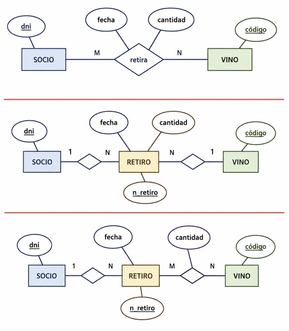
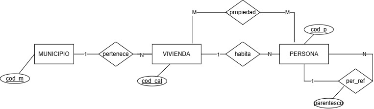
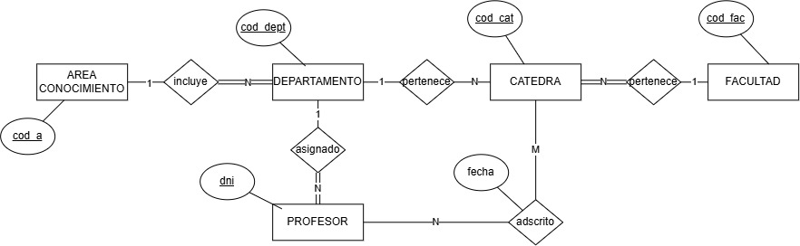
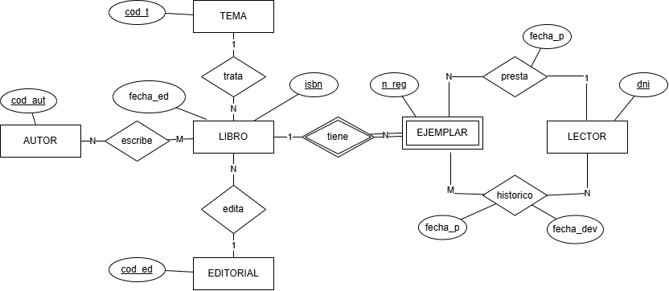
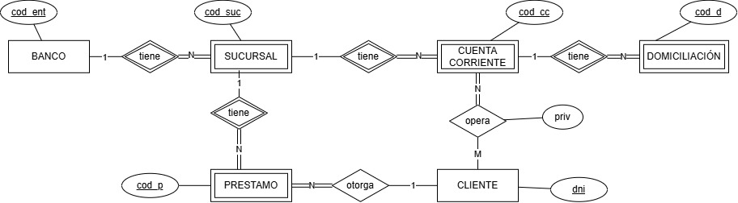
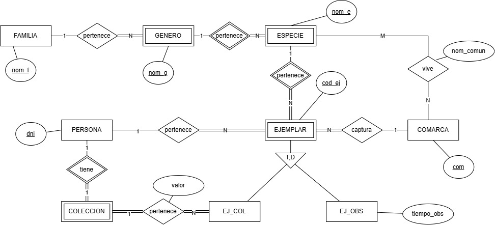
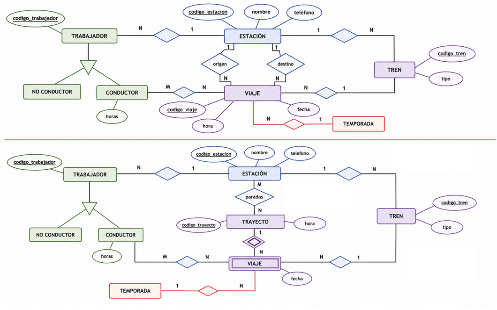
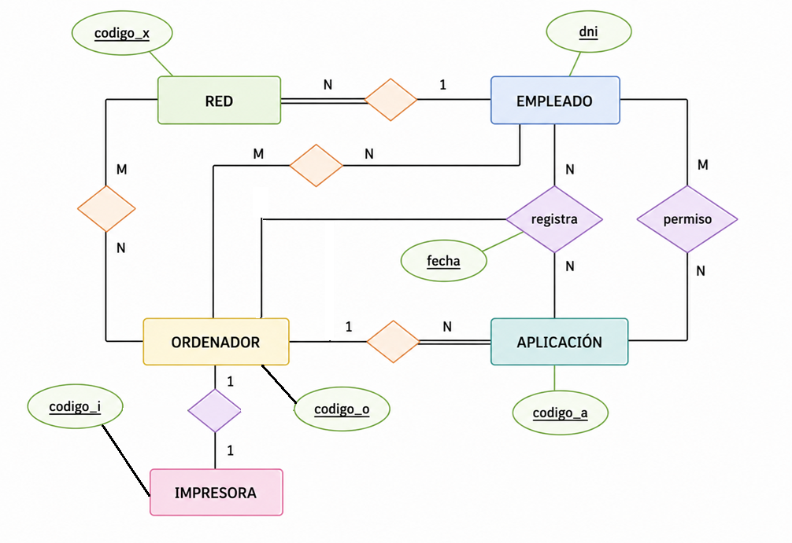
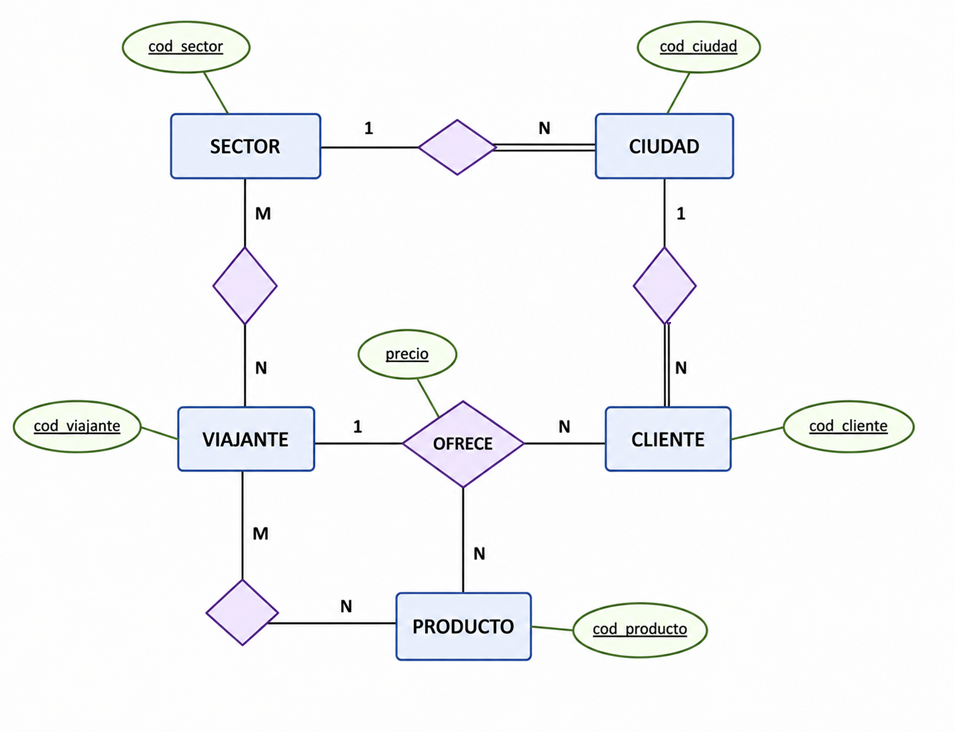
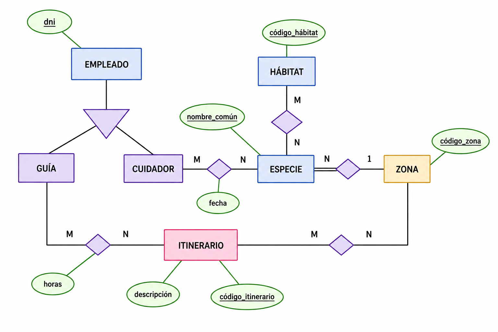

---
hide:
  - toc
---

# Soluciones

!!! warning "Advertencia"
    Antes de consultar la resolución, asegúrate de haber intentado resolver el ejercicio. Comparar tu propuesta con la solución te ayudará mucho más que leerla directamente.

??? example "Ejercicio 1"

    ??? question "Enunciado"
        Recordad que teníamos 3 opciones:

        { .grayscale width=400 }

    ??? success "Solución propuesta"
        !!! quote "Opción 1"
            - **SOCIO** (<u>dni</u>, nombre, direccion, telefono, correo)
            - **VINO** (<u>codi_vi</u>, descripcion, anio_cogida)
            - **RETIRA** (<u>cod_re</u>, <mark>dni</mark>, <mark>codi_vi</mark>, fecha, cant)
                - FK: dni->SOCIO(dni)
                - FK: codi_vi->VINO(codi_vi)

        !!! quote "Opción 2"
            - **SOCIO** (<u>dni</u>, nombre, direccion, telefono, correo)
            - **VINO** (<u>codi_vi</u>, descripcion, anio_cogida)
            - **VALE** (<u>num_val</u>, <mark>dni</mark>, <mark>codi_vi</mark>, fecha, cant)
                - FK: dni->SOCIO(dni)
                - FK: codi_vi->VINO(num_p)

        !!! quote "Opción 3"
            - **SOCIO** (<u>dni</u>, nombre, direccion, telefono, correo)
            - **VINO** (<u>codi_vi</u>, descripcion, anio_cogida)
            - **VALE** (<u>num_val</u>, <mark>dni</mark>,fecha)
                - FK: dni->SOCIO(dni)
            - **RETIRA** (<u><mark>num_val</mark>, <mark>dni</mark>, cant</u>)
                - FK: num_val->VALE(num_val)
                - FK: codi_vi->VINO(num_p)

??? example "Ejercicio 2"

    ??? question "Enunciado"
        { .grayscale }

    ??? success "Solución propuesta"
        - **MUNICIPIO** (<u>codigo_municipio</u>)
        - **VIVIENDA** (<u>referencia_catastral</u>, <mark>codigo_municipio</mark>)
            - FK: codigo_municipio->MUNICIPIO(codigo_municipio)
        - **PERSONA** (<u>codigo_persona</u>, <mark>referencia_catastral</mark>, <mark>codigo_persona_cabeza_familia</mark>, parentesco)
            - FK: referencia_catastral->VIVIENDA(referencia_catastral)
            - FK: codigo_persona_cabeza_familia->PERSONA(codigo_persona)
        - **PROPIEDAD** (<u><mark>codigo_persona</mark>,<mark>referencia_catastral</mark></u>)
            - FK: codigo_persona->PERSONA(codigo_persona)
            - FK: referencia_catastral->VIVIENDA(referencia_catastral)

??? example "Ejercicio 3"

    ??? question "Enunciado"
        { .grayscale }

    ??? success "Solución propuesta"
        - **ÁREA DE CONOCIMIENTO** (<u>ID_Area</u>)
        - **FACULTAD** (<u>ID_Facultad</u>)
        - **DEPARTAMENTO** (<u>ID_Depto</u>, <mark>ID_Area</mark>)
            - FK: ID_Area->ÁREA DE CONOCIMIENTO(ID_Area) [no nulo]
        - **CÁTEDRA** (<u>ID_Catedra</u>, <mark>ID_Depto</mark>, <mark>ID_Facultad</mark>)
            - FK: ID_Depto->DEPARTAMENTO(ID_Depto)
            - FK: ID_Facultad->FACULTAD(ID_Facultad) [no nulo]
        - **PROFESOR** (<u>ID_Profesor</u>, <mark>ID_Depto</mark>)
            - FK: ID_Depto->DEPARTAMENTO(ID_Depto) [no nulo]
        - **ADSCRITO_A** (<u><mark>ID_Profesor</mark>, <mark>ID_Catedra</mark></u>, fecha)
            - FK: ID_Profesor->PROFESOR(ID_Profesor)
            - FK: ID_Catedra->CÁTEDRA(ID_Catedra)

??? example "Ejercicio 4"

    ??? question "Enunciado"
        { .grayscale }

    ??? success "Solución propuesta"
        - **TEMA** (<u>codigo_tema</u>)
        - **AUTOR** (<u>codigo_autor</u>)
        - **EDITORIAL** (<u>codigo_editorial</u>)
        - **LIBRO** (<u>isbn</u>, <mark>codigo_tema</mark>, <mark>codigo_editorial</mark>)
            - FK: codigo_tema->TEMA(codigo_tema)
            - FK: codigo_editorial->EDITORIAL(codigo_editorial)
        - **EJEMPLAR** (<u>numero_registro</u>, <mark>isbn</mark>,<mark>dni</mark>, fecha_prestamo ) (borrar en cascada)
            - FK: isbn->LIBRO(isbn) [no nulo]
            - FK: dni->LECTOR(dni)
        - **ESCRIBE** (<u><mark>codigo_autor</mark>, <mark>isbn</mark></u>)
            - FK: codigo_autor->AUTOR(codigo_autor)
            - FK: isbn->LIBRO(isbn)
        - **LECTOR** (<u>dni</u>)
        - **HISTORICO** ( <u><mark>numero_registro</mark>, <mark>dni</mark>, fecha_prestamo</u>, fecha_devolucion)
            - FK: numero_registro->EJEMPLAR(numero_registro)
            - FK: dni->LECTOR(dni)

??? example "Ejercicio 5"

    
    ??? question "Enunciado"
    { .grayscale }

    ??? success "Solución propuesta"
        !!! quote "Opción 1"
            - **BANCO** (<u>numero_entidad</u>)
            - **SUCURSAL** (<u><mark>numero_entidad</mark>, numero_sucursal</u>) (borrar en cascada)
                - FK: numero_entidad->BANCO(numero_entidad) [no nulo]
            - **CUENTA CORRIENTE** (<u><mark>numero_entidad</mark>, <mark>numero_sucursal</mark></u>, <u>numero_cuenta</u>) (borrar en cascada)
                - FK: numero_entidad, numero_sucursal->SUCURSAL(numero_entidad, numero_sucursal)
            - **DOMICILIACION** (<u><mark>numero_entidad</mark>, <mark>numero_sucursal</mark>, <mark>numero_cuenta</mark>, numero_domicilio</u>) (borrar en cascada)
                - FK: numero_entidad, numero_sucursal, numero_cuenta->CUENTA CORRIENTE(numero_entidad, numero_sucursal, numero_cuenta)
            - **CLIENTE** (<u>dni</u>)
            - **PRESTAMO** (<u><mark>numero_entidad</mark>, <mark>numero_sucursal</mark>, numero_prestamo</u>, <mark>dni</mark>) (borrar en cascada)
                - FK: numero_entidad, numero_sucursal->SUCURSAL(numero_entidad, numero_sucursal)
                - FK: dni->CLIENTE(dni)
            - **PERMISOS** (<u><mark>numero_entidad</mark>, <mark>numero_sucursal</mark>, <mark>numero_cuenta</mark>, <mark>dni</mark></u>, privilegio)
                - FK: numero_entidad, numero_sucursal, numero_cuenta->CUENTA CORRIENTE(numero_entidad, numero_sucursal, numero_cuenta)
                - FK: dni->CLIENTE(dni)

        !!! quote "Opción 2"
            - **BANCO** (<u>numero_entidad</u>)
            - **SUCURSAL** (<u><mark>numero_entidad</mark>, numero_sucursal</u>) (borrar en cascada)
                - FK: numero_entidad->BANCO(numero_entidad) [no nulo]
            - **CUENTA CORRIENTE** (<u><mark>numero_entidad</mark>, <mark>numero_sucursal</mark></u>, <u>numero_cuenta</u>) (borrar en cascada)
                - FK: numero_entidad, numero_sucursal->SUCURSAL(numero_entidad, numero_sucursal)
            - **DOMICILIACION** (<u>num_d</u>,<mark>numero_entidad</mark>, <mark>numero_sucursal</mark>, <mark>numero_cuenta</mark>) (borrar en cascada)
                - FK: numero_entidad, numero_sucursal, numero_cuenta->CUENTA CORRIENTE(numero_entidad, numero_sucursal, numero_cuenta) [no nulo]
            - **CLIENTE** (<u>dni</u>)
            - **PRESTAMO** (<u><mark>numero_entidad</mark>, <mark>numero_sucursal</mark>, numero_prestamo</u>, <mark>dni</mark>) (borrar en cascada)
                - FK: numero_entidad, numero_sucursal->SUCURSAL(numero_entidad, numero_sucursal)
                - FK: dni->CLIENTE(dni)
            - **PERMISOS** (<u> cod_p</u>,<mark>numero_entidad</mark>, <mark>numero_sucursal</mark>, <mark>numero_cuenta</mark>, <mark>dni</mark>, privilegio)
                - FK: numero_entidad, numero_sucursal, numero_cuenta->CUENTA CORRIENTE(numero_entidad, numero_sucursal, numero_cuenta) [no nulo]
                - FK: dni->CLIENTE(dni)    

??? example "Ejercicio 6"

    ??? question "Enunciado"
        { .grayscale }

    ??? success "Solución propuesta"
        !!! quote "Opción 1"
            - **FAMILIA** (<u>nom_f</u>)
            - **GENERO** (<u>nom_g</u>, <mark>nom_f</mark>) (borrar en cascada)
                - FK: nom_f->FAMILIA(nom_f) [no nulo]
            - **ESPECIE** (<u>nom_g,<mark>nom_e</mark> </u>) (borrar en cascada)
                - FK: nom_g->GENERO(nom_g)
            - **PERSONA** (<u>dni</u>)
            - **COMARCA** (<u>com</u>)
            - **VIVE** (<u><mark>nom_g</mark>,<mark>nom_e</mark>, <mark>com</mark></u>, nom_comun)
                - FK: nomg,nom_e->ESPECIE(nomg,nom_e)
                - FK: com->COMARCA(com)
            - **EJEMPLAR** (<u>cod_ej, <mark>nom_g</mark>,<mark>nom_e</mark></u>, <mark>dni</mark>, <mark>com</mark>) (borrar en cascada)
                - FK: nom_g,nom_e->ESPECIE(nom_g,nom_e)
                - FK: dni->PERSONA(dni) [no nulo]
                - FK: com->COMARCA(com) [no nulo]
            - **COLECCIONISTA** (<u><mark>dni</mark></u>) (borrar en cascada)
                - FK: dni->PERSONA(dni)
            - **EJ_COL** (<u><mark>cod_ej</mark>, <mark>nom_g</mark>,<mark>nom_e</mark></u>, <mark>dni</mark>, valor) (borrar en cascada)
                - FK: cod_ej,nom_g,nom_e->EJEMPLAR(cod_ej,nomg,nom_e)
                - FK: dni->COLECCION(dni) [no nulo]
            - **EJ_OBS** (<u><mark>cod_ej</mark>, <mark>nom_g</mark>,<mark>nom_e</mark></u>, tiempo_obs) (borrar en cascada)
                - FK: cod_ej,nom_g,nom_e->EJEMPLAR(cod_ej,nomg,nom_e)

            [nota] La especialización de **EJEMPLAR** en **EJ_COL** y **EJ_OBS** es total y disjunta (T,D).

        !!! quote "Opción 2"
            - **FAMILIA** (<u>nom_f</u>)
            - **GENERO** (<u>nom_g</u>, <mark>nom_f</mark>) (borrar en cascada)
                - FK: nom_f->FAMILIA(nom_f) [no nulo]
            - **ESPECIE** (<u>nom_g,<mark>nom_e</mark> </u>) (borrar en cascada)
                - FK: nom_g->GENERO(nom_g)
            - **PERSONA** (<u>dni</u>)
            - **COMARCA** (<u>com</u>)
            - **VIVE** (<u><mark>nom_g</mark>,<mark>nom_e</mark>, <mark>com</mark></u>, nom_comun)
                - FK: nomg,nom_e->ESPECIE(nomg,nom_e)
                - FK: com->COMARCA(com)
            - **EJEMPLAR** (<u>cod_ej</u>, <mark>nom_g</mark>,<mark>nom_e</mark>, <mark>dni</mark>, <mark>com</mark>) (borrar en cascada)
                - FK: nom_g,nom_e->ESPECIE(nom_g,nom_e) [no nulo]
                - FK: dni->PERSONA(dni) [no nulo]
                - FK: com->COMARCA(com) [no nulo]
            - **COLECCIONISTA** (<u><mark>dni</mark></u>) (borrar en cascada)
                - FK: cod_ej->EJEMPLAR(cod_ej)
                - FK: dni->PERSONA(dni)[no nulo]
            - **EJ_COL** (<u><mark>cod_ej</mark></u>, <mark>dni</mark>, valor) (borrar en cascada)
                - FK: dni->COLECCION(dni) [no nulo]
            - **EJ_OBS** (<u><mark>cod_ej</mark></u>, tiempo_obs) (borrar en cascada)
                - FK: cod_ej->EJEMPLAR(cod_ej)

??? example "Ejercicio 7"

    ??? question "Enunciado"
        Realizar el esquema relacional correspondiente a una empresa de líneas ferroviarias.

        En la de arriba consideramos únicamente los viajes (y no los trayectos). Además, solo marcamos estación de origen y de destino de un viaje.

        En la segunda incorporamos los trayectos, y además marcamos todas las estaciones donde se para en un trayecto.

        { .grayscale }

    ??? success "Solución propuesta"
        !!! quote "Opción 1"

            - **TRABAJADOR** (<u>codigo_trabajador</u>, <mark>codigo_estacion</mark>)
                - FK: codigo_estacion->ESTACIÓN(codigo_estacion)
            - **NO CONDUCTOR** (<u><mark>codigo_trabajador</mark></u>) (borrar en cascada)
                - FK: codigo_trabajador->TRABAJADOR(codigo_trabajador)
            - **CONDUCTOR** (<u><mark>codigo_trabajador</mark></u>, horas) (borrar en cascada)
                - FK: codigo_trabajador->TRABAJADOR(codigo_trabajador)
            - **ESTACIÓN** (<u>codigo_estacion</u>, nombre, telefono)
            - **TREN** (<u>codigo_tren</u>, tipo)
            - **TEMPORADA** (<u>cod_temporada</u>)
            - **VIAJE** (<u>codigo_viaje</u>, hora, fecha, <mark>codigo_estacion_origen</mark>, <mark>codigo_estacion_destino</mark>, <mark>codigo_tren</mark>, <mark>cod_temporada</mark>)
                - FK: codigo_estacion_origen->ESTACIÓN(codigo_estacion)
                - FK: codigo_estacion_destino->ESTACIÓN(codigo_estacion)
                - FK: codigo_tren->TREN(codigo_tren)
                - FK: cod_temporada->TEMPORADA(cod_temporada)
            - **CONDUCTOR_VIAJE** (<u><mark>codigo_trabajador</mark>, <mark>codigo_viaje</mark></u>)
                - FK: codigo_trabajador->CONDUCTOR(codigo_trabajador)
                - FK: codigo_viaje->VIAJE(codigo_viaje)

        !!! quote "Opción 2"

            - **TRABAJADOR** (<u>codigo_trabajador</u>, <mark>codigo_estacion</mark>)
                - FK: codigo_estacion->ESTACIÓN(codigo_estacion)
            - **NO CONDUCTOR** (<u><mark>codigo_trabajador</mark></u>) (borrar en cascada)
                - FK: codigo_trabajador->TRABAJADOR(codigo_trabajador)
            - **CONDUCTOR** (<u><mark>codigo_trabajador</mark></u>, horas) (borrar en cascada)
                - FK: codigo_trabajador->TRABAJADOR(codigo_trabajador)
            - **ESTACIÓN** (<u>codigo_estacion</u>, nombre, telefono)
            - **TREN** (<u>codigo_tren</u>, tipo)
            - **TEMPORADA** (<u>cod_temporada</u>)
            - **TRAYECTO** (<u>codigo_trayecto</u>, hora)
            - **PARADAS** (<u><mark>codigo_estacion</mark>, <mark>codigo_trayecto</mark></u>)
                - FK: codigo_trayecto->TRAYECTO(codigo_trayecto)
                - FK: codigo_estacion->ESTACIÓN(codigo_estacion)
            - **VIAJE** (<u><mark>codigo_trayecto</mark>, fecha</u>, <mark>codigo_tren</mark>, <mark>cod_temporada</mark>) (borrar en cascada)
                - FK: codigo_trayecto->TRAYECTO(codigo_trayecto)
                - FK: codigo_tren->TREN(codigo_tren)
                - FK: cod_temporada->TEMPORADA(cod_temporada)
            - **CONDUCTOR_VIAJE** (<u><mark>codigo_trabajador</mark>, <mark>codigo_trayecto</mark>, <mark>fecha</mark></u>)
                - FK: codigo_trabajador->CONDUCTOR(codigo_trabajador)
                - FK: codigo_trayecto, fecha->VIAJE(codigo_trayecto, fecha)

??? example "Ejercicio 8"

    ??? question "Enunciado"
        Realizar el esquema relacional correspondiente a un sistema de información sobre el material informático de una empresa.

        { .grayscale }

    ??? success "Solución propuesta"
        - **RED** (<u>codigo_x</u>, <mark>dni</mark>)
            - FK: dni->EMPLEADO(dni) [no nulo]
        - **EMPLEADO** (<u>dni</u>, nombre, direccion, telefono)
        - **ORDENADOR** (<u>codigo_o</u>)
        - **IMPRESORA** (<u>codigo_i</u>, <mark>codigo_o</mark>)
            - FK: codigo_o->ORDENADOR(codigo_o) [no nulo] [unico]
        - **APLICACIÓN** (<u>codigo_a,codigo_o</u>)
            - FK: codigo_o->ORDENADOR(codigo_o) [no nulo]
        - **RED_ORDENADOR** (<u><mark>codigo_x</mark></u>, <u><mark>codigo_o</mark></u>)
            - FK: codigo_x->RED(codigo_x)
            - FK: codigo_o->ORDENADOR(codigo_o)
        - **EMPLEADO_ORDENADOR** (<u><mark>dni</mark>, <mark>codigo_o</mark></u>)
            - FK: dni->EMPLEADO(dni)
            - FK: codigo_o->ORDENADOR(codigo_o)
        - **PERMISO** (<u><mark>dni</mark>, <mark>codigo_a</mark></u>)
            - FK: dni->EMPLEADO(dni)
            - FK: codigo_a->APLICACIÓN(codigo_a)
        - **REGISTRA** (<u>num_reg></u>, <mark>dni</mark>, <mark>codigo_o</mark>, <mark>codigo_a</mark>, fecha)
            - FK: dni->EMPLEADO(dni) [no nulo]
            - FK: codigo_o->ORDENADOR(codigo_o)  [no nulo]
            - FK: codigo_a->APLICACIÓN(codigo_a) [no nulo]

??? example "Ejercicio 9"

    ??? question "Enunciado"
        Realizar el esquema relacional correspondiente a un sistema de información de una empresa que vende gran variedad de productos. Para la venta de estos productos, dispone de un conjunto de viajantes que realizan visitas a los clientes ofreciendo sus productos.

        { .grayscale }

    ??? success "Solución propuesta"
        - **SECTOR** (<u>cod_sector</u>)
        - **CIUDAD** (<u>cod_ciudad</u>, <mark>cod_sector</mark>)
            - FK: cod_sector->SECTOR(cod_sector) [no nulo]
        - **VIAJANTE** (<u>cod_viajante</u>)
        - **CLIENTE** (<u>cod_cliente</u>, <mark>cod_ciudad</mark>)
            - FK: cod_ciudad->CIUDAD(cod_ciudad) [no nulo]
        - **PRODUCTO** (<u>cod_producto</u>)
        - **VIAJANTE_PRODUCTO** (<u><mark>cod_viajante</mark>, <mark>cod_producto</mark></u>)
            - FK: cod_viajante->VIAJANTE(cod_viajante)
            - FK: cod_producto->PRODUCTO(cod_producto)
        - **SECTOR_VIAJA** (<u><mark>cod_sector</mark>, <mark>cod_viajante</mark></u>)
            - FK: cod_viajante->VIAJANTE(cod_viajante)
            - FK: cod_sector->SECTOR(cod_procod_sectorducto)
        - **OFRECE** (<u><mark>cod_cliente</mark>, <mark>cod_producto</mark></u>, <mark>cod_viajante</mark>, precio)
            - FK: cod_viajante->VIAJANTE(cod_viajante) [no nulo]
            - FK: cod_cliente->CLIENTE(cod_cliente)
            - FK: cod_producto->PRODUCTO(cod_producto)
            - precio: [no nulo]

??? example "Ejercicio 10"

    ??? question "Enunciado"
        Realizar el esquema relacional correspondiente a un Parque Zoológico que quiere guardar información de las especies que tiene, los empleados (cuidadores y guías), y los distintos itinerarios de visita que ofrece.

        { .grayscale }

    ??? success "Solución propuesta"
        - **EMPLEADO** (<u>dni</u>, nombre, direccion, telefono, fecha_inicio)
        - **GUIA** (<u><mark>dni</mark></u>) (borrar en cascada)
            - FK: dni->EMPLEAT(dni)
        - **CUIDADOR** (<u><mark>dni</mark></u>) (borrar en cascada)
            - FK: dni->EMPLEAT(dni)
        - **HABITAT** (<u>cod_h</u>, clima, vegetacion)
        - **ZONA** (<u>cod_z</u>, extension)
        - **ESPECIE** (<u>nom_c</u>, nombre, descripcion, <mark>cod_z</mark>)
            - FK: cod_z->ZONA(cod_z) [no nulo]
        - **ESPECIE_HABITAT** (<u><mark>nom_c</mark>, <mark>cod_h</mark></u>)
            - FK: nom_c->ESPECIE(nom_c)
            - FK: cod_h->HABITAT(cod_h)
        - **CUIDADOR_ESPECIE** (<u><mark>dni</mark>, <mark>nom_c</mark></u>, data)
            - FK: dni->CUIDADOR(dni)
            - FK: nom_c->ESPECIE(nom_c)
        - **ITINERARIO** (<u>cod_i</u>, duracion, longitud, max_visitantes, num_especies)
        - **GUIA_ITINERARIO** (<u><mark>dni</mark>, <mark>cod_i</mark></u>, horas)
            - FK: dni->GUIA(dni)
            - FK: cod_i->ITINERARIO(cod_i)
        - **ITINERARIO_ZONA** (<u><mark>cod_i</mark>, <mark>cod_z</mark></u>)
            - FK: cod_i->ITINERARIO(cod_i)
            - FK: cod_z->ZONA(cod_z)

