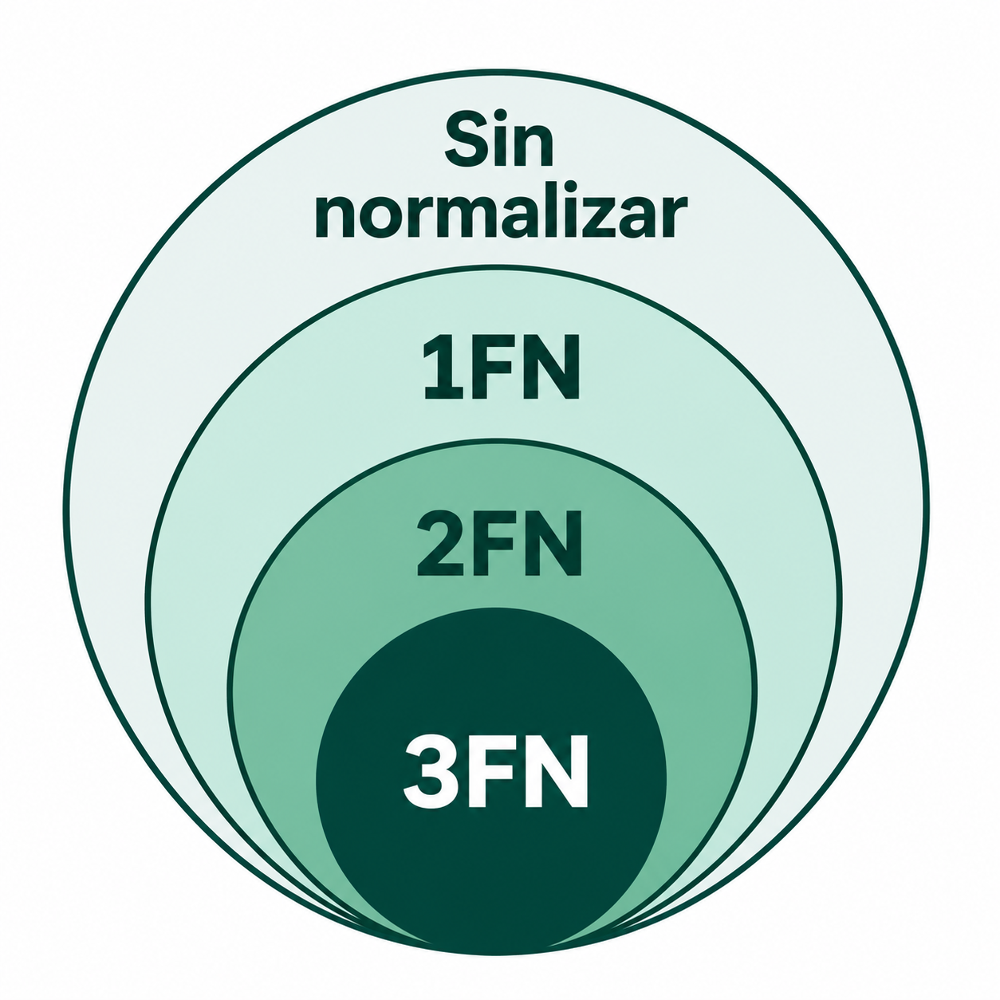

---
hide:
  - toc
---
# 1. Introducción a la Normalización

La **normalización** es el proceso que garantiza que los datos estén correctamente organizados en tablas, eliminando redundancias y asegurando la integridad.

La teoría de la normalización va perdiendo peso con el paso de los años como herramienta de diseño de bases de datos relacionales en favor de modelos de datos más ricos en su representación, el primero de ellos Entidad-Relación de Chen. Aún así, los conceptos que se van a desarrollar aquí son totalmente válidos desde el punto de vista de comprobar lo correcto que es un esquema de base de datos relacional, en el sentido de que no se produzcan redundancias innecesarias entre los datos a almacenar. 

Debemos ser conscientes, sin embargo, de que si la Base de Datos está bien diseñada desde el principio, estará prácticamente normalizada. La utilidad real de la normalización será cuando partamos de una Base de Datos directamente importada de un sistema de ficheros (un fichero → una tabla), donde normalmente estará muy mal diseñada.

## ¿Qué es la Normalización?

La normalización aplica una serie de reglas (formas normales) para transformar un esquema relacional en una estructura óptima, donde:

- Los datos son **independientes de las aplicaciones**
- Se obtiene el **máximo número de tablas posibles**
- Cada tabla contiene los atributos necesarios para una entidad o relación

---

## Cuándo se aplica la Normalización

La normalización se aplica después de completar todo el ciclo de diseño:

## Relación entre las formas normales

{ width=380 }

Las formas normales son **acumulativas**: cada una añade condiciones a las anteriores. Por eso los círculos aparecen unos dentro de otros:

- Una tabla en **1FN** tiene valores atómicos y no presenta atributos multivaluados ni grupos repetitivos.
- Para estar en **2FN**, debe cumplir la 1FN y no tener dependencias parciales de atributos no clave respecto a ninguna clave candidata.
- Para estar en **3FN**, debe cumplir la 2FN y, en los casos que estudiaremos, eliminar las dependencias transitivas entre atributos no clave.

Por tanto, **toda tabla en 3FN también está en 2FN y en 1FN**. El sentido inverso no está garantizado: una tabla puede estar en 1FN y todavía necesitar cambios para alcanzar la 2FN o la 3FN. La zona exterior representa las tablas que aún no cumplen la 1FN.

!!! info "Nota"
    Las tablas obtenidas del esquema relacional suelen estar bastante normalizadas, pero es recomendable analizarlas todas.

