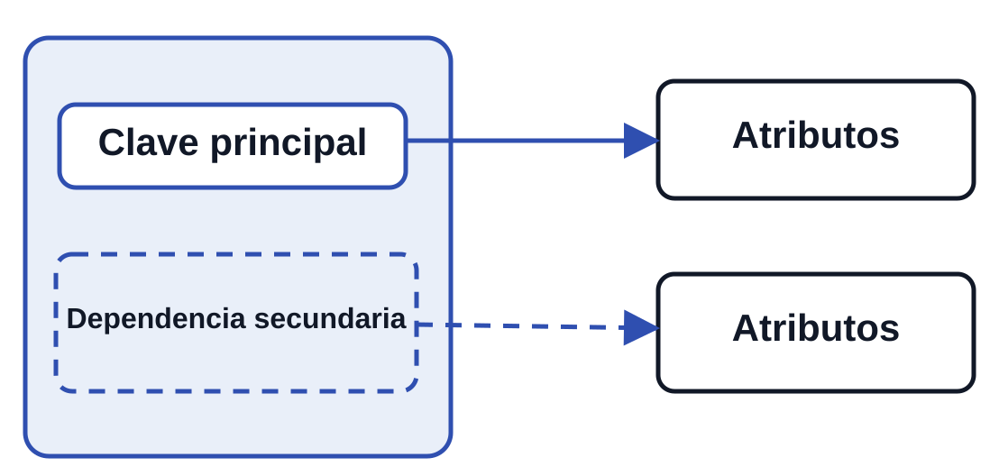

# 3. Dependencia Funcional

## 3.1 Dependencia Funcional

    
Dependencia funcional (A → B)
    

    Existe una dependencia funcional entre dos conjuntos de atributos cuando el valor de uno de ellos determina de forma única el valor del otro. 
    Se representa mediante:   

       
 A → B 

    y se lee:   

        
&emsp;"A determina funcionalmente a B".

    

---

## Ejemplos de Dependencias

### Dependencia Unidireccional

!!! example "DNI → NOMBRE"
    Cada DNI tiene un único NOMBRE.
    El inverso NO siempre se cumple (dos personas pueden tener el mismo nombre).

### Dependencia Bidireccional

!!! example "DNI ↔ NOMBRE"
    Si es garantizado que no hay nombres duplicados.
    Cada DNI tiene un único NOMBRE y viceversa.

### Dependencia sobre Conjunto de Atributos

!!! example "DNI . NÚM. PROYECTO → HORAS"
    Un empleado puede trabajar en varios proyectos, con unas horas semanales en cada uno.
    Solo DNI + NÚM. PROYECTO juntos determinan las HORAS de esa participación.
    DNI solo NO determina las HORAS, ni tampoco el número de proyecto por separado.

---

## Notación

- **X → Y**

    Cada valor de X tiene único valor de Y.

- **X ↔ Y**

    Dependencia bidireccional.
    La relación funciona en ambas direcciones.

- **X . Y → Z**

    X e Y determinan funcionalmente a Z.

- **X → Y | Z**

    X determina Y "o también" Z.

---

## 3.2 Dependencia Funcional Total

    
Dependencia funcional Total

Una dependencia funcional es total cuando un atributo depende de todos los atributos de una clave compuesta y no solo de una parte de ella.

### Ejemplo de Dependencia Parcial

!!! warning "Dependencia Parcial (NO deseable)"

    **DNI . NÚM. PROYECTO → NOMBRE**
    
    NOMBRE solo depende de DNI; no necesita el NÚM. PROYECTO.
    Esta es una **dependencia parcial** (unos atributos son irrelevantes).

### Ejemplo de Dependencia Total

!!! success "Dependencia Funcional Total (deseable)"
    **DNI . NÚM. PROYECTO → HORAS**
    
    Las HORAS semanales requieren tanto el DNI como el NÚM. PROYECTO.
    Sin conocer el empleado y el proyecto juntos, no se pueden determinar las HORAS de esa participación.

---

## 3.3 Grafo de Dependencias Funcionales

Es una representación visual que muestra gráficamente las relaciones entre atributos.

### Estructura del Grafo

**Estructura del grafo**

| Elemento | Representación |
|----------|----------------|
| **Clave Principal** | Recuadro con línea continua |
| **Atributos clave** | Dentro del recuadro |
| **Otros atributos** | Fuera del recuadro |
| **Dependencias secundarias** | Recuadro con línea discontinua |

**Representación visual**

{ width=400 }

El grafo permite visualizar:  

- Qué atributos se determinan mutuamente
- Qué dependencias son parciales o totales
- La cohesión de los datos

### Ejemplo: empleados, departamentos y proyectos

Retomamos la empresa del [modelo E/R](../Model_E-R/2_ejemplo.md) y del [modelo relacional](../Model_Relacional/3_transformacion_del_m_er_al_m_relacional.md). Para estudiar sus dependencias, reunimos en una tabla **EMPLEADO** los datos del empleado, el departamento al que pertenece y los proyectos en los que trabaja.

Cada fila representa la participación de un empleado en un proyecto. Un empleado puede participar en varios proyectos y cada participación tiene sus propias horas semanales. El departamento indicado es **el del empleado**; no tiene por qué ser el departamento que controla el proyecto.

**EMPLEADO**

| DNI | Núm. proyecto | Nombre empleado | Sueldo (€) | Núm. departamento | Nombre departamento | Nombre proyecto | Horas semanales |
|-----|---------------|-----------------|------------|-------------------|---------------------|-----------------|-----------------|
| 12345678A | 101 | Ana García López | 2400 | 10 | Informática | Portal web | 20 |
| 12345678A | 102 | Ana García López | 2400 | 10 | Informática | App móvil | 15 |
| 87654321B | 101 | Luis Pérez Ruiz | 2200 | 10 | Informática | Portal web | 30 |
| 11223344C | 102 | Marta Sánchez Gil | 2600 | 20 | Administración | App móvil | 10 |
| 11223344C | 103 | Marta Sánchez Gil | 2600 | 20 | Administración | Gestión interna | 25 |
| **A** | **B** | **C** | **D** | **E** | **F** | **G** | **H** |

Las letras de la última fila identifican los atributos, en orden alfabético, para simplificar la notación del grafo.

Elegimos **A . B (DNI, Núm. proyecto)** como clave principal. Las dependencias se deducen de las reglas de la empresa, no solo de los valores de estas filas:

* **A . B → H**: la combinación de **DNI y número de proyecto** determina las **horas semanales**. Es una dependencia total: ni el empleado ni el proyecto por separado determinan las horas de una participación.
* **A → C | D | E**: el **DNI** determina el **nombre, sueldo y departamento del empleado**. Son dependencias parciales respecto a la clave compuesta A . B.
* **E → F**: el **número de departamento** determina su **nombre**. Por tanto, A → E → F es una dependencia transitiva.
* **B → G**: el **número de proyecto** determina su **nombre**. Es otra dependencia parcial respecto a A . B.
* Como en el ejemplo de empresa los nombres de departamentos y proyectos son únicos, también se cumplen **F → E** y **G → B**. Se representan con flechas bidireccionales. Por ello, **A . G** también es una clave candidata.

**Dependencias**

**A . B** → **H**  
**A** → **C | D | E**  
**E** ↔ **F**  
**B** ↔ **G**  
**(clave principal = A . B)**

La clave principal determina todos los atributos. El grafo destaca las dependencias que permiten analizar la normalización, sin dibujar todas las que se deducen de ellas.

**Grafo asociado**

{ width=560 }

