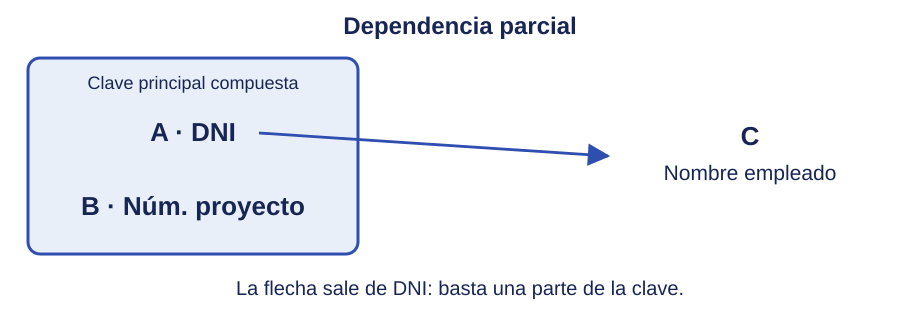
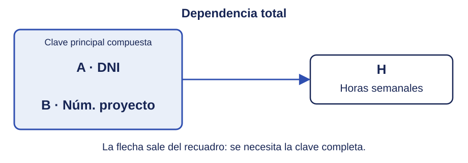
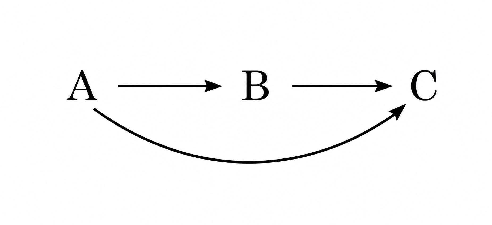
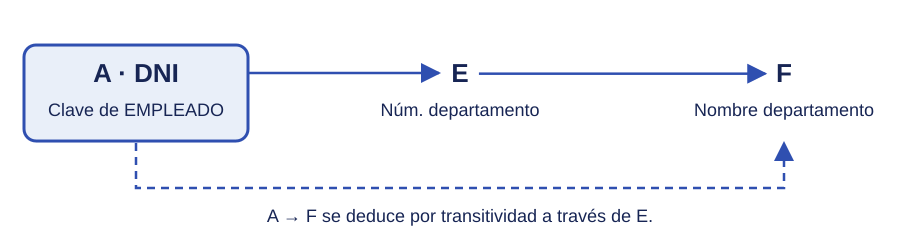
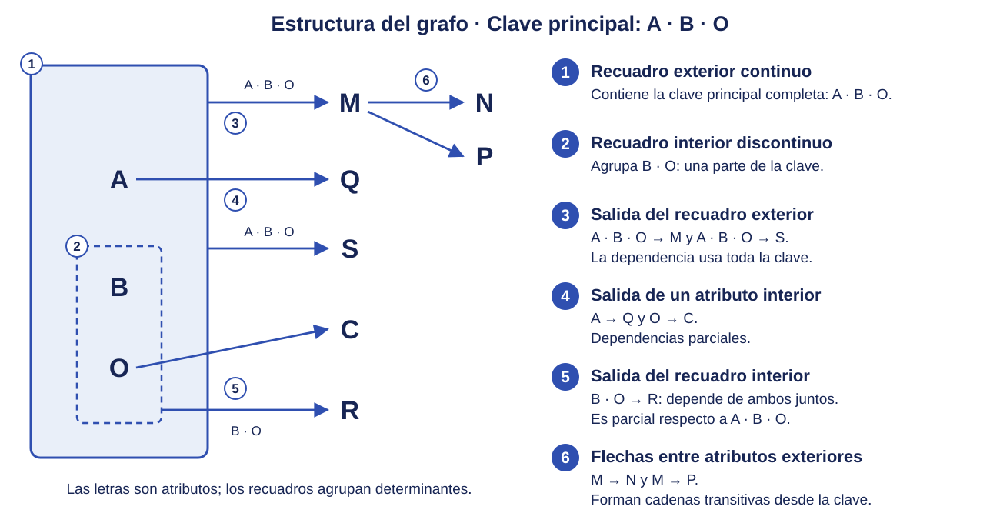
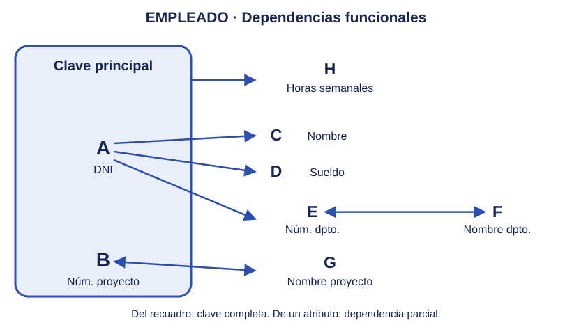

# 3. Dependencia Funcional

## 3.1 Dependencia Funcional

    
Dependencia funcional (A → B)
    

    Existe una dependencia funcional entre dos conjuntos de atributos cuando el valor de uno de ellos determina de forma única el valor del otro. 
    Se representa mediante:   

       
 A → B 

    y se lee:   

        
&emsp;"A determina funcionalmente a B".

    

---

## Ejemplos de Dependencias

### Dependencia Unidireccional

!!! example "DNI → NOMBRE"
    Cada DNI tiene un único NOMBRE.
    El inverso NO siempre se cumple (dos personas pueden tener el mismo nombre).

### Dependencia Bidireccional

!!! example "DNI ↔ NOMBRE"
    Si es garantizado que no hay nombres duplicados.
    Cada DNI tiene un único NOMBRE y viceversa.

### Dependencia sobre Conjunto de Atributos

!!! example "DNI . NÚM. PROYECTO → HORAS"
    Un empleado puede trabajar en varios proyectos, con unas horas semanales en cada uno.
    Solo DNI + NÚM. PROYECTO juntos determinan las HORAS de esa participación.
    DNI solo NO determina las HORAS, ni tampoco el número de proyecto por separado.

---

## Notación

- **X → Y**

    Cada valor de X tiene único valor de Y.

- **X ↔ Y**

    Dependencia bidireccional.
    La relación funciona en ambas direcciones.

- **X . Y → Z**

    X e Y determinan funcionalmente a Z.

- **X → Y | Z**

    X determina Y "o también" Z.

---

## 3.2 Dependencia Funcional Total

    
Dependencia funcional Total

Una dependencia funcional es total cuando un atributo depende de todos los atributos de una clave compuesta y no solo de una parte de ella.

### Ejemplo de Dependencia Parcial

!!! warning "Dependencia Parcial (NO deseable)"

    **DNI . NÚM. PROYECTO → NOMBRE**
    
    NOMBRE solo depende de DNI; no necesita el NÚM. PROYECTO.
    Esta es una **dependencia parcial** (unos atributos son irrelevantes).

{ width=700 }

### Ejemplo de Dependencia Total

!!! success "Dependencia Funcional Total (deseable)"
    **DNI . NÚM. PROYECTO → HORAS**
    
    Las HORAS semanales requieren tanto el DNI como el NÚM. PROYECTO.
    Sin conocer el empleado y el proyecto juntos, no se pueden determinar las HORAS de esa participación.

{ width=700 }

---

## 3.3 Dependencia Funcional Transitiva

La dependencia funcional transitiva se aplica para analizar las tablas en tercera forma normal (3FN). Consiste básicamente en considerar que **un atributo no primario solo debe conocerse a través de la clave principal o claves candidatas** (atributos que, aunque no son claves principales, sirven para identificar de manera única una fila en algunos contextos específicos). En otro caso, estará produciendo redundancia de información con las anomalías típicas que lleva consigo.

En términos simples, esta dependencia ocurre cuando un atributo no clave (o no primario) depende **indirectamente** de la clave principal mediante otro atributo.

Dependencia transitiva: (A→B→C)
 Si A→B y B→C, entonces decimos que C depende de forma transitiva de A.

 
---  
<!--
Supongamos tres subconjuntos distintos de atributos A, B y C que pertenecen a una tabla T, de manera que se cumplen las condiciones: <b>A</b> → <b>B</b> y <b>B</b> −∕→ <b>A</b>. Se dice que C tiene una <b>dependencia funcional transitiva</b> con A o que es transitivamente dependiente de A si se cumple que <b>B</b> →<b>C</b> 
--> 
  
Gráficamente se puede mostrar:

{width=200}

Por lo tanto, un atributo C es transitivamente dependiente de otro A si se conoce por diferentes vías, una directamente, y otra a partir de otro atributo intermedio B.

### Ejemplo: el nombre del departamento

Consideremos una tabla **EMPLEADO** con una fila por empleado. Su clave principal es el **DNI** y contiene, entre otros, estos atributos de la empresa:

* **A = DNI** del empleado.
* **E = Núm. departamento** al que pertenece.
* **F = Nombre departamento**.

Se cumplen las dependencias:

**A → E**: cada empleado pertenece a un único departamento.  
**E → F**: cada número de departamento determina su nombre.  
**Por tanto, A → F**: el DNI determina indirectamente el nombre del departamento.

La cadena de dependencia transitiva es:

**DNI → Núm. departamento → Nombre departamento (A → E → F)**

{ width=700 }

Por ejemplo, el empleado con DNI **12345678A** pertenece al departamento **10**, cuyo nombre es **Informática**. El nombre del departamento se conoce a través de su número; no es un dato propio del empleado.

Aunque en el ejemplo los nombres de departamento también son únicos (**F → E**), ni el número ni el nombre del departamento identifican a un empleado: varios empleados pueden pertenecer al mismo departamento.

Si guardamos el nombre del departamento en cada fila de EMPLEADO, repetimos ese dato para todos sus empleados. Al cambiar el nombre, tendríamos que actualizar varias filas. En la **3FN** separaremos **DEPARTAMENTO (num-d, nombre-d)** y conservaremos en EMPLEADO solo **num-d** como clave externa.

---

## 3.4 Grafo de Dependencias Funcionales

Es una representación visual que muestra gráficamente las relaciones entre atributos.

### Estructura del Grafo

El siguiente esquema muestra cómo leer cada parte de un grafo. **La clave principal es A . B . O**: los tres atributos aparecen una sola vez dentro del recuadro exterior.

{ width=1100 }
<!--
| Elemento | Cómo se interpreta en el esquema |
|----------|---------------------------------|
| **Recuadro exterior con línea continua** | Engloba todos los atributos de la clave principal: **A . B . O**. |
| **Recuadro interior con línea discontinua** | Agrupa una parte de la clave: **B . O**. No representa otra tabla ni una clave candidata. |
| **Flecha que sale del recuadro exterior** | Depende de la clave completa: **A . B . O → M** y **A . B . O → S**. |
| **Flecha que sale de un atributo interior** | Depende solo de ese atributo: **A → Q** y **O → C**. Son dependencias parciales respecto a la clave completa. |
| **Flecha que sale del recuadro interior** | Depende de ese subconjunto: **B . O → R**. También es una dependencia parcial. |
| **Flecha entre atributos exteriores** | Representa otra dependencia funcional: **M → N** y **M → P**. Permite reconocer las cadenas transitivas **A . B . O → M → N, P**. |

-->

La **posición de salida de cada flecha** indica su determinante. Los atributos situados fuera del recuadro exterior no forman parte de la clave principal representada.

El grafo permite visualizar:  

- Qué atributos se determinan mutuamente
- Qué dependencias son parciales o totales
- La cohesión de los datos

### Ejemplo: empleados, departamentos y proyectos

Retomamos la empresa del [modelo E/R](../Model_E-R/2_ejemplo.md) y del [modelo relacional](../Model_Relacional/3_transformacion_del_m_er_al_m_relacional.md). Para estudiar sus dependencias, reunimos en una tabla **EMPLEADO** los datos del empleado, el departamento al que pertenece y los proyectos en los que trabaja.

Cada fila representa la participación de un empleado en un proyecto. Un empleado puede participar en varios proyectos y cada participación tiene sus propias horas semanales. El departamento indicado es **el del empleado**; no tiene por qué ser el departamento que controla el proyecto.

**EMPLEADO**

| <u>DNI</u> | <u>Núm. proyecto</u> | Nombre empleado | Sueldo (€) | Núm. departamento | Nombre departamento | Nombre proyecto | Horas semanales |
|-----|---------------|-----------------|------------|-------------------|---------------------|-----------------|-----------------|
| 12345678A | 101 | Ana García López | 2400 | 10 | Informática | Portal web | 20 |
| 12345678A | 102 | Ana García López | 2400 | 10 | Informática | App móvil | 15 |
| 87654321B | 101 | Luis Pérez Ruiz | 2200 | 10 | Informática | Portal web | 30 |
| 11223344C | 102 | Marta Sánchez Gil | 2600 | 20 | Administración | App móvil | 10 |
| 11223344C | 103 | Marta Sánchez Gil | 2600 | 20 | Administración | Gestión interna | 25 |
| <u>**A**</u> | <u>**B**</u> | **C** | **D** | **E** | **F** | **G** | **H** |

Las letras de la última fila identifican los atributos, en orden alfabético, para simplificar la notación del grafo.

Elegimos **A . B (DNI, Núm. proyecto)** como clave principal. Las dependencias se deducen de las reglas de la empresa, no solo de los valores de estas filas:

* **A . B → H**: la combinación de **DNI y número de proyecto** determina las **horas semanales**. Es una dependencia total: ni el empleado ni el proyecto por separado determinan las horas de una participación.
* **A → C | D | E**: el **DNI** determina el **nombre, sueldo y departamento del empleado**. Son dependencias parciales respecto a la clave compuesta A . B.
* **E → F**: el **número de departamento** determina su **nombre**. Por tanto, A → E → F es una dependencia transitiva.
* **B → G**: el **número de proyecto** determina su **nombre**. Es otra dependencia parcial respecto a A . B.
* Como en el ejemplo de empresa los nombres de departamentos y proyectos son únicos, también se cumplen **F → E** y **G → B**. Se representan con flechas bidireccionales. Por ello, **A . G** también es una clave candidata.

**Dependencias**

**A . B** → **H**  
**A** → **C | D | E**  
**E** ↔ **F**  
**B** ↔ **G**  
**(clave principal = A . B)**

La clave principal determina todos los atributos. El grafo destaca las dependencias que permiten analizar la normalización, sin dibujar todas las que se deducen de ellas.

**Grafo asociado**

{ width=560 }

