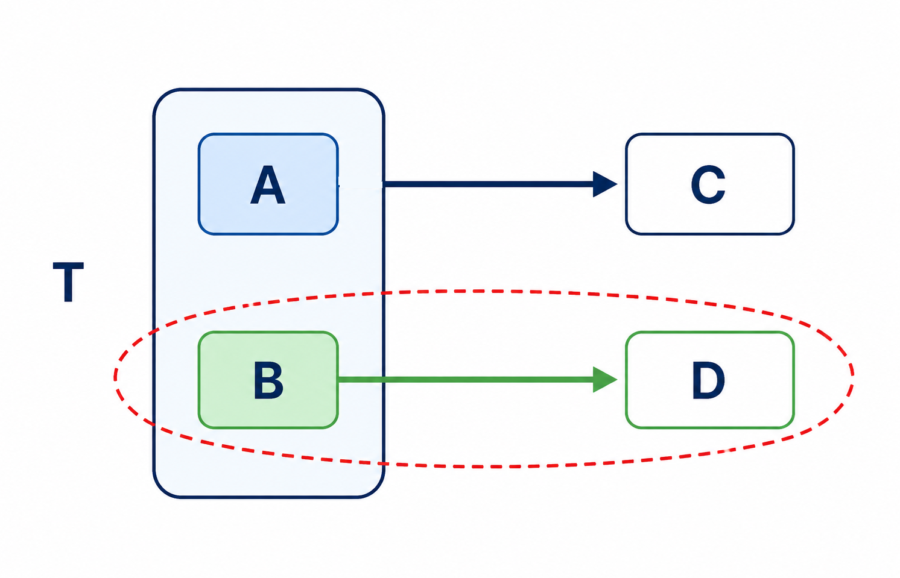
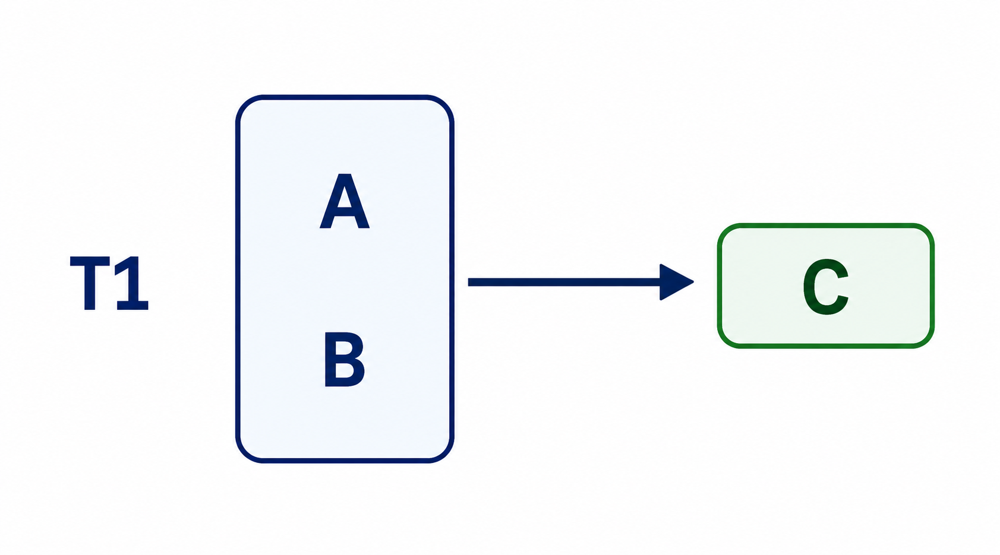
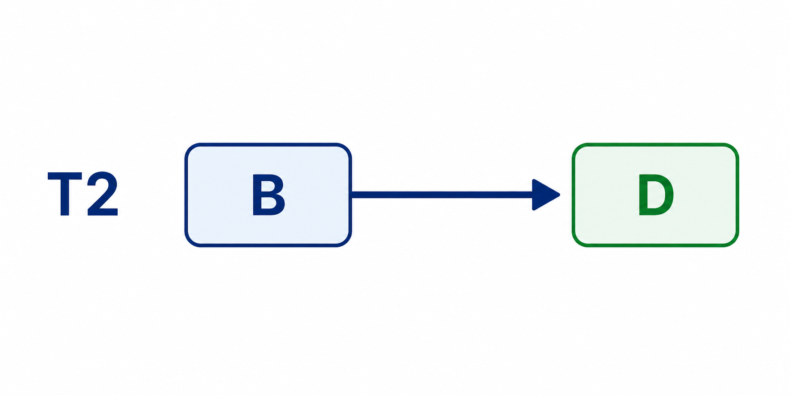

---
hide:
  - toc
---
# 4. Segunda Forma Normal (2FN)

Una relación está en Segunda Forma Normal (2FN) cuando:
<ul>
    <li>Está previamente en Primera Forma Normal (1FN).</li>
    <li>Todos los atributos que no forman parte de la clave dependen totalmente de la clave primaria.</li>
</ul>
Es decir, no pueden existir dependencias parciales respecto a una clave compuesta.

  
---  
  
Esta forma normal solo se considera si la clave principal es compuesta, y por tanto, está formada por varios atributos.

Si una tabla **T** tiene como atributos **A, B, C, D** y la clave es **A . B** cumpliéndose las dependencias:

**A . B** →**C**

**B** →**D**

Se observa que la tabla no se encuentra en 2FN ya que el atributo D no tiene una dependencia funcional total con la clave completa A . B, sino con una parte de la clave (B). El grafo de las dependencias funcionales sería:  

{ width=400 }

## Poner en 2FN

Para convertir una tabla que no está en segunda forma normal a 2FN, se realiza una proyección en dos partes:

### Parte A. Tabla principal

Se crea una **primera tabla** con la clave y todas sus dependencias totales con los atributos secundarios afectados:

{width=400}

### Parte B. Tabla de la dependencia parcial

Se crea una **segunda tabla** con la parte de la clave que tiene dependencias, y los atributos secundarios implicados:

{width=450}

!!!warning "Gráficamente"
    Si existe una flecha que sale del interior de la caja que engloba la clave, entonces la tabla no está en 2FN.

### Ejemplo aplicado: empleados, departamentos y proyectos

Partimos de la tabla **EMPLEADO** del [ejemplo del grafo de dependencias funcionales](3_dependencia_funcional.md#ejemplo-empleados-departamentos-y-proyectos). Conservamos las mismas letras:

| A | B | C | D | E | F | G | H |
|---|---|---|---|---|---|---|---|
| DNI | Núm. proyecto | Nombre empleado | Sueldo | Núm. departamento | Nombre departamento | Nombre proyecto | Horas semanales |

La clave principal es **A . B (DNI, Núm. proyecto)**. La tabla está en 1FN, pero **no está en 2FN**:

* **A . B → H** es total: las horas semanales dependen del empleado y del proyecto juntos.
* **A → C | D | E** son dependencias parciales: el nombre, sueldo y departamento del empleado dependen solo del DNI.
* **A → F** también es parcial respecto a A . B, aunque se deduce por transitividad de **A → E → F**: el nombre del departamento tampoco necesita el proyecto.
* **B → G** es parcial: el nombre del proyecto depende solo de su número.

Como en el ejemplo anterior, los nombres de departamentos y proyectos son únicos: **E ↔ F** y **B ↔ G**. Por tanto, **A . G** también es clave candidata; las dependencias de los datos del empleado respecto a A son parciales también respecto a esta clave.

**Grafo de dependencias inicial**

{ width=560 }

**Grafo en 2FN**

{ width=560 }

#### Descomposición en tablas

Separamos los datos según el determinante del que dependen:

1. **TRABAJA (A, B, H)** conserva la clave compuesta y las horas, que dependen de ella por completo.
2. **EMPLEADO (A, C, D, E, F)** reúne los datos que dependen del DNI, incluido el nombre del departamento a través de E.
3. **PROYECTO (B, G)** reúne el número y el nombre del proyecto.

En el **modelo relacional**:

!!! quote "Tablas en 2FN"
    - TRABAJA (<u>dni, num-p</u>, horas)
        - PK: (dni, num-p)
        - FK: dni → EMPLEADO(dni)
        - FK: num-p → PROYECTO(num-p)
    - EMPLEADO (<u>dni</u>, nombre, sueldo, num-d, nombre-d)
        - PK: dni
    - PROYECTO (<u>num-p</u>, nombre-p)
        - PK: num-p
        - Clave candidata alternativa: nombre-p (único).

Con los mismos datos del ejemplo, obtenemos:

**TRABAJA**

| DNI (A) | Núm. proyecto (B) | Horas semanales (H) |
|---------|------------------|--------------------|
| 12345678A | 101 | 20 |
| 12345678A | 102 | 15 |
| 87654321B | 101 | 30 |
| 11223344C | 102 | 10 |
| 11223344C | 103 | 25 |

**EMPLEADO**

| DNI (A) | Nombre (C) | Sueldo (D) | Núm. dpto. (E) | Nombre dpto. (F) |
|---------|------------|------------|----------------|-----------------|
| 12345678A | Ana García López | 2400 | 10 | Informática |
| 87654321B | Luis Pérez Ruiz | 2200 | 10 | Informática |
| 11223344C | Marta Sánchez Gil | 2600 | 20 | Administración |

**PROYECTO**

| Núm. proyecto (B) | Nombre proyecto (G) |
|------------------|---------------------|
| 101 | Portal web |
| 102 | App móvil |
| 103 | Gestión interna |

Ahora los datos del empleado se guardan una sola vez por DNI y los del proyecto una sola vez por número de proyecto. En TRABAJA solo quedan las horas de cada participación. Podemos reconstruir la tabla inicial uniendo las tres tablas por **dni** y **num-p**, sin perder información.

!!! note "2FN todavía permite dependencias transitivas"
    En EMPLEADO sigue existiendo **A → E → F** (DNI → Núm. departamento → Nombre departamento). La tabla está en 2FN, porque su clave es simple, pero aún no está en 3FN. Al estudiar la tercera forma normal separaremos los datos del departamento en su propia tabla.
