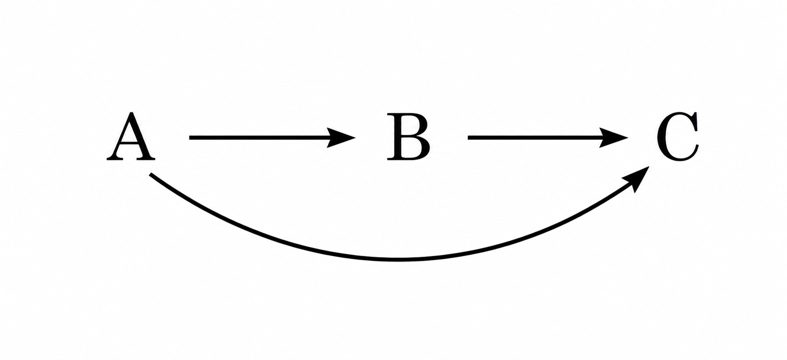

---
hide:
  - toc
---

# 5. Dependencia Funcional Transitiva

La dependencia funcional transitiva se aplica para analizar las tablas en tercera forma normal (3FN). Consiste básicamente en considerar que **un atributo no primario solo debe conocerse a través de la clave principal o claves secundarias** (atributos que, aunque no son claves principales, sirven para identificar de manera única una fila en algunos contextos específicos). En otro caso, estará produciendo redundancia de información con las anomalías típicas que lleva consigo.

En términos simples, esta dependencia ocurre cuando un atributo no clave (o no primario) depende **indirectamente** de la clave principal mediante otro atributo.

Dependencia transitiva:</b> (A→B→C)
 Si A→B y B→C, entonces decimos que C depende de forma transitiva de A.

 
---  
<!--
Supongamos tres subconjuntos distintos de atributos A, B y C que pertenecen a una tabla T, de manera que se cumplen las condiciones: <b>A</b> → <b>B</b> y <b>B</b> −∕→ <b>A</b>. Se dice que C tiene una <b>dependencia funcional transitiva</b> con A o que es transitivamente dependiente de A si se cumple que <b>B</b> →<b>C</b> 
--> 
  
Gráficamente se puede mostrar:

{width=200}

Por lo tanto, un atributo C es transitivamente dependiente de otro A si se conoce por diferentes vías, una directamente, y otra a partir de otro atributo intermedio B.

### Ejemplo: el nombre del departamento

Retomamos la tabla **EMPLEADO** obtenida al [aplicar la 2FN](4_segunda_forma_normal_2fn.md#ejemplo-aplicado-empleados-departamentos-y-proyectos). Su clave principal es el **DNI** y contiene, entre otros, estos atributos del ejemplo inicial:

* **A = DNI** del empleado.
* **E = Núm. departamento** al que pertenece.
* **F = Nombre departamento**.

Se cumplen las dependencias:

**A → E**: cada empleado pertenece a un único departamento.  
**E → F**: cada número de departamento determina su nombre.  
**Por tanto, A → F**: el DNI determina indirectamente el nombre del departamento.

La cadena de dependencia transitiva es:

**DNI → Núm. departamento → Nombre departamento (A → E → F)**

{ width=700 }

Por ejemplo, el empleado con DNI **12345678A** pertenece al departamento **10**, cuyo nombre es **Informática**. El nombre del departamento se conoce a través de su número; no es un dato propio del empleado.

Aunque en el ejemplo los nombres de departamento también son únicos (**F → E**), ni el número ni el nombre del departamento identifican a un empleado: varios empleados pueden pertenecer al mismo departamento.

Si guardamos el nombre del departamento en cada fila de EMPLEADO, repetimos ese dato para todos sus empleados. Al cambiar el nombre, tendríamos que actualizar varias filas. En la **3FN** separaremos **DEPARTAMENTO (num-d, nombre-d)** y conservaremos en EMPLEADO solo **num-d** como clave externa.
