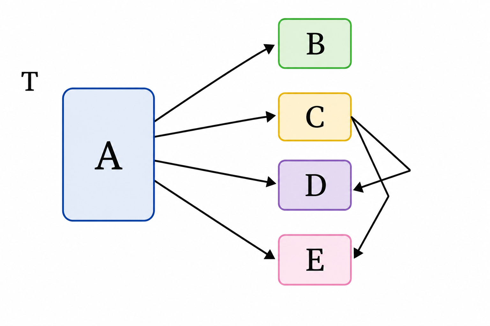
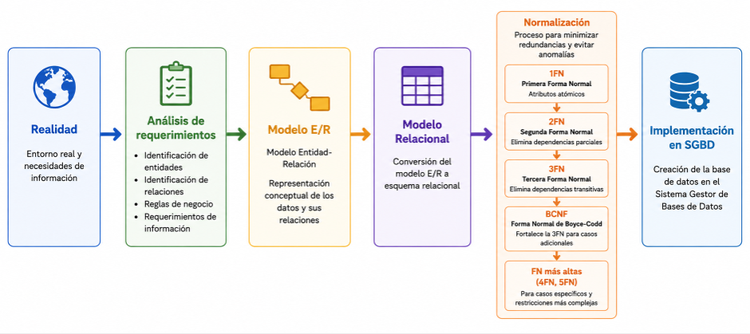
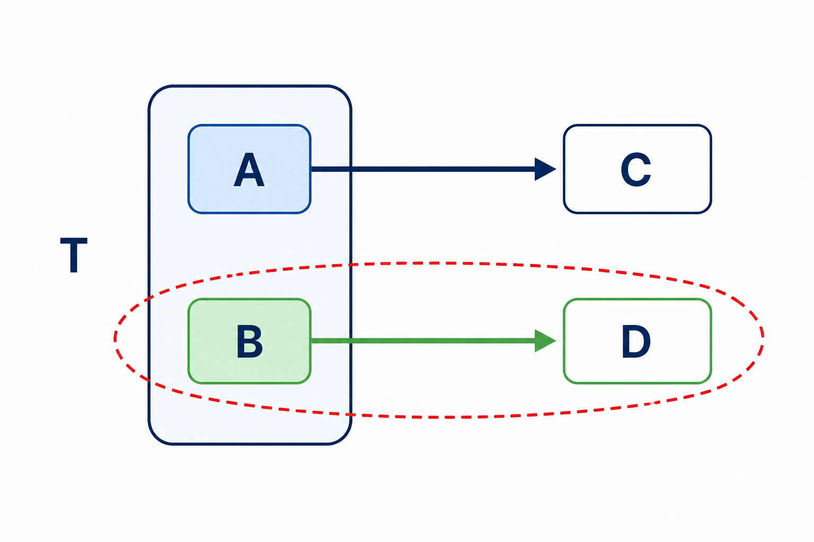
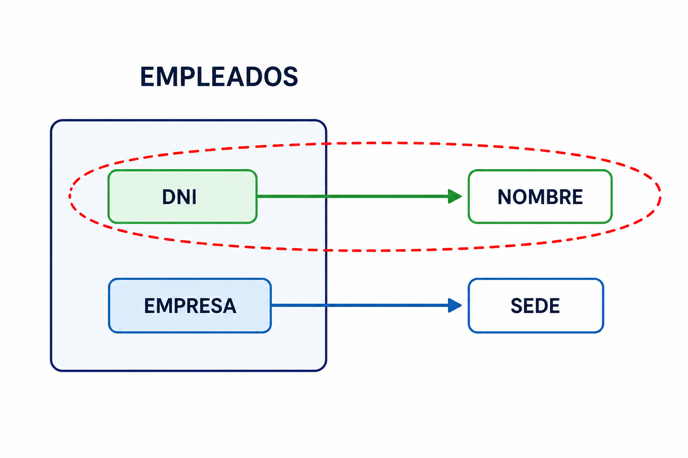

---
hide:
  - toc
---

# 6. Tercera Forma Normal (3FN)

Se dice que una tabla está en Tercera Forma Normal (3FN) cuando se cumplen dos condiciones:
<ul>
  <li>Se encuentra en 2FN.</li>
  <li>No existen dependencias transitivas.</li>
</ul>
  Es decir, ningún atributo no clave depende de otro atributo no clave.

  
---  
  
Esto significa que un atributo secundario solo puede depender directamente de la clave principal (o de una clave candidata) y nunca de otro atributo secundario. Si un atributo se obtiene a través de otro atributo no clave, existe una dependencia transitiva y la tabla no cumple la Tercera Forma Normal (3FN).

En un grafo de dependencias para comprobar la 3FN, solo se dibujan las dependencias entre atributos no clave, ya que las dependencias desde la clave hacia el resto de atributos se consideran implícitas.

**Ejemplo:** **A** es la clave principal, **B** es una clave candidata y se dan las siguientes dependencias:

**A** →**B B** →**A C** →**D**

**A** →**C B** →**C C** →**E**

**A** →**D B** →**D**

**A** →**E B** →**E**

El grafo queda del siguiente modo:  

**Opción 1**

{width=400}

**Opción 2**

{width=450}

!!!Warning "Ojo"
    Las flechas que muestran las dependencias funcionales que tiene la clave candidata B no se representan (como hemos dicho anteriormente) porque son evidentes y no simplifican la visión del grafo. Además, para la normalización, no se necesitan para nada; por el contrario, suelen complicar el análisis.

!!!Note ""
    La tabla T no está en 3FN ya que los atributos D y E son transitivamente dependientes respecto de la clave A.

**<u>Poner en 3FN</u>**

Para normalizar una tabla que no esté en tercera forma normal, es decir, que tenga dependencias transitivas, descompondremos la tabla en más de una tabla:

**A)** Una **primera tabla** con la clave principal más los atributos que no dependen transitivamente

{width=400}

**B)** Una **segunda tabla** con los atributos que dependen transitivamente, más el atributo del que dependen, que será clave principal

{width=400}

Se hará una descomposición por cada dependencia transitiva que haya que afecte a campos distintos.

## Ejemplo aplicado: empleados, departamentos y proyectos

Continuamos el [ejemplo del apartado 3.3](3_dependencia_funcional.md#ejemplo-empleados-departamentos-y-proyectos), que ya hemos descompuesto en [segunda forma normal](4_segunda_forma_normal_2fn.md#ejemplo-aplicado-empleados-departamentos-y-proyectos):

* **TRABAJA (A, B, H)**: DNI, Núm. proyecto, Horas semanales. Clave principal: **A . B**.
* **EMPLEADO (A, C, D, E, F)**: DNI, Nombre empleado, Sueldo, Núm. departamento, Nombre departamento. Clave principal: **A**.
* **PROYECTO (B, G)**: Núm. proyecto, Nombre proyecto. Clave principal: **B**; G es clave candidata porque el nombre del proyecto es único.

### Identificar la dependencia transitiva

TRABAJA y PROYECTO ya están en 3FN. En EMPLEADO, en cambio, tenemos:

**A → C | D | E**  
**E → F**  
**Por tanto, A → E → F**

Es decir: **DNI → Núm. departamento → Nombre departamento**. El nombre del departamento depende de un atributo que no es clave de EMPLEADO. Ni E ni F identifican a un empleado, ya que varios empleados pueden pertenecer al mismo departamento.

{ width=700 }

**EMPLEADO no está en 3FN**: el nombre del departamento se repite en las filas de sus empleados. Si el departamento 10 cambia de nombre, habría que modificar tanto la fila de Ana como la de Luis.

### Separar los datos del departamento

Descomponemos EMPLEADO en dos tablas:

1. **EMPLEADO (A, C, D, E)** conserva el DNI, el nombre, el sueldo y el número de departamento del empleado.
2. **DEPARTAMENTO (E, F)** guarda una sola vez el número y el nombre de cada departamento. Elegimos E como clave principal; F también es clave candidata, porque el nombre del departamento es único.

El atributo **E (num-d)** permanece en EMPLEADO como clave externa hacia DEPARTAMENTO. Así podemos consultar el nombre del departamento sin repetirlo en cada empleado.

**Grafo resultante en 3FN**

{ width=760 }

### Modelo relacional en 3FN

!!! quote "Resultado completo"
    - EMPLEADO (<u>dni</u>, nombre, sueldo, num-d)
        - PK: dni
        - FK: num-d → DEPARTAMENTO(num-d)
    - DEPARTAMENTO (<u>num-d</u>, nombre-d)
        - PK: num-d
        - Clave candidata alternativa: nombre-d (único).
    - PROYECTO (<u>num-p</u>, nombre-p)
        - PK: num-p
        - Clave candidata alternativa: nombre-p (único).
    - TRABAJA (<u>dni, num-p</u>, horas)
        - PK: (dni, num-p)
        - FK: dni → EMPLEADO(dni)
        - FK: num-p → PROYECTO(num-p)

Con los datos del ejemplo, las dos tablas que resultan de este paso son:

**EMPLEADO**

| DNI (A) | Nombre (C) | Sueldo (D) | Núm. departamento (E) |
|---------|------------|------------|-----------------------|
| 12345678A | Ana García López | 2400 | 10 |
| 87654321B | Luis Pérez Ruiz | 2200 | 10 |
| 11223344C | Marta Sánchez Gil | 2600 | 20 |

**DEPARTAMENTO**

| Núm. departamento (E) | Nombre departamento (F) |
|-----------------------|-------------------------|
| 10 | Informática |
| 20 | Administración |

TRABAJA y PROYECTO conservan las filas obtenidas en 2FN. Ahora basta con cambiar una sola fila de DEPARTAMENTO para actualizar su nombre. Podemos reconstruir la información anterior uniendo EMPLEADO y DEPARTAMENTO por **num-d**, sin perder datos.

!!! success "De la tabla inicial a la 3FN"
    En **2FN** separamos los datos del empleado y del proyecto de las horas de participación, eliminando las dependencias parciales. En **3FN** separamos el nombre del departamento de los datos del empleado, eliminando la dependencia transitiva **A → E → F** dentro de EMPLEADO.
