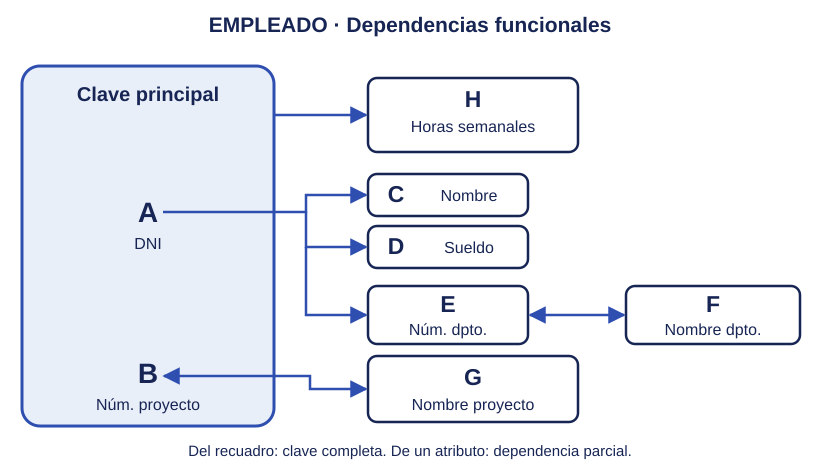
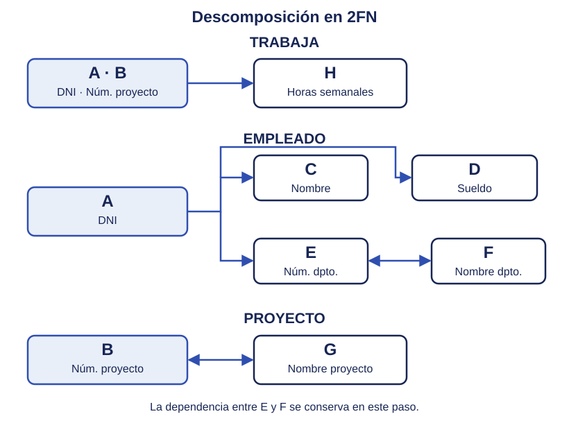
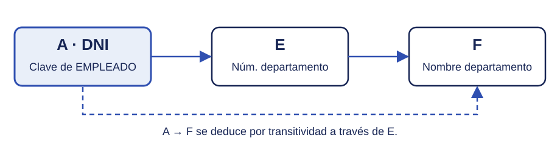
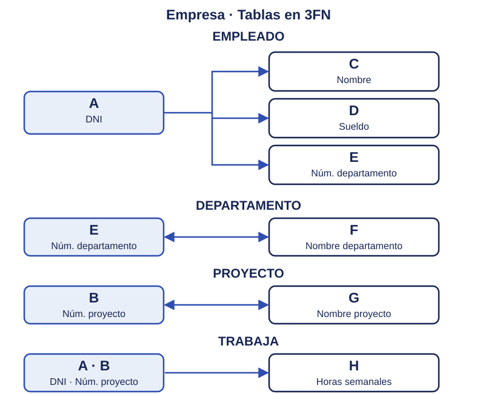

---
hide:
  - toc
---

# Ejemplo completo: normalización de la empresa

Seguimos el mismo caso de **empleados, departamentos y proyectos** de los temas de modelo E/R y modelo relacional. Partimos de una tabla que reúne los datos y la descomponemos paso a paso, manteniendo las letras **A–H** utilizadas en los apartados anteriores. Añadimos el atributo **I = Teléfono** para mostrar también el paso a 1FN. En esta ampliación, un empleado puede tener varios teléfonos, independientes de los proyectos en los que trabaja.

1. Tabla inicial y primera forma normal (1FN)

La tabla inicial **EMPLEADO** contiene una fila por cada participación de un empleado en un proyecto. El departamento indicado es el del empleado, que puede ser distinto del que controla el proyecto.

### Antes de la 1FN

Guardamos inicialmente los teléfonos de cada empleado juntos en una celda:

| DNI | Núm. proyecto | Nombre empleado | Sueldo (€) | Núm. departamento | Nombre departamento | Nombre proyecto | Horas semanales | Teléfonos |
|-----|---------------|-----------------|------------|-------------------|---------------------|-----------------|-----------------|-----------|
| 12345678A | 101 | Ana García López | 2400 | 10 | Informática | Portal web | 20 | 612345678, 698765432 |
| 12345678A | 102 | Ana García López | 2400 | 10 | Informática | App móvil | 15 | 612345678, 698765432 |
| 87654321B | 101 | Luis Pérez Ruiz | 2200 | 10 | Informática | Portal web | 30 | 623456789 |
| 11223344C | 102 | Marta Sánchez Gil | 2600 | 20 | Administración | App móvil | 10 | 634567890, 645678901 |
| 11223344C | 103 | Marta Sánchez Gil | 2600 | 20 | Administración | Gestión interna | 25 | 634567890, 645678901 |
| **A** | **B** | **C** | **D** | **E** | **F** | **G** | **H** | **I** |

Esta tabla **no está en 1FN**: Teléfonos contiene una lista de valores en algunas celdas. Por ejemplo, Ana tiene dos teléfonos.

### Aplicar la 1FN

Separamos los teléfonos en **TELEFONO_EMPLEADO (dni, telefono)**, con una fila por cada teléfono de un empleado. Su clave principal es **(dni, telefono)**: el DNI por sí solo no identifica una fila, porque un empleado puede tener varios teléfonos. No suponemos que un teléfono pertenezca a un único empleado.

**TELEFONO_EMPLEADO**

| DNI (A) | Teléfono (I) |
|---------|--------------|
| 12345678A | 612345678 |
| 12345678A | 698765432 |
| 87654321B | 623456789 |
| 11223344C | 634567890 |
| 11223344C | 645678901 |

Cada teléfono se guarda una sola vez por empleado, sin repetirlo por cada proyecto. En la tabla de participaciones quedan los ocho atributos originales:

**EMPLEADO en 1FN**

| DNI | Núm. proyecto | Nombre empleado | Sueldo (€) | Núm. departamento | Nombre departamento | Nombre proyecto | Horas semanales |
|-----|---------------|-----------------|------------|-------------------|---------------------|-----------------|-----------------|
| 12345678A | 101 | Ana García López | 2400 | 10 | Informática | Portal web | 20 |
| 12345678A | 102 | Ana García López | 2400 | 10 | Informática | App móvil | 15 |
| 87654321B | 101 | Luis Pérez Ruiz | 2200 | 10 | Informática | Portal web | 30 |
| 11223344C | 102 | Marta Sánchez Gil | 2600 | 20 | Administración | App móvil | 10 |
| 11223344C | 103 | Marta Sánchez Gil | 2600 | 20 | Administración | Gestión interna | 25 |
| **A** | **B** | **C** | **D** | **E** | **F** | **G** | **H** |

Los atributos son **A = DNI**, **B = Núm. proyecto**, **C = Nombre empleado**, **D = Sueldo**, **E = Núm. departamento**, **F = Nombre departamento**, **G = Nombre proyecto** y **H = Horas semanales**.

Elegimos **A . B** como clave principal: un empleado puede trabajar en varios proyectos y un proyecto puede tener varios empleados. Ahora ambas tablas están en **1FN**, porque cada celda contiene un único valor y no hay grupos repetidos de columnas.

2. Dependencias funcionales y grafo asociado

Analizamos las dependencias de los atributos A–H de EMPLEADO. TELEFONO_EMPLEADO se conserva por separado durante los pasos siguientes; con las reglas indicadas, ya está en FNBC. Los grafos siguientes muestran la normalización de la tabla de participaciones.

Las reglas de la empresa establecen estas dependencias:

* **A . B → H**: las horas semanales dependen del empleado y del proyecto juntos.
* **A → C | D | E**: el DNI determina el nombre, sueldo y departamento del empleado.
* **E ↔ F**: el número y el nombre del departamento se determinan mutuamente, porque ambos son únicos.
* **B ↔ G**: el número y el nombre del proyecto se determinan mutuamente, porque ambos son únicos.

También se deduce **A → F**, a través de **A → E → F**. Como G identifica al proyecto, **A . G** es otra clave candidata de la tabla inicial.

{ width=760 }

3. Segunda forma normal (2FN)

La tabla inicial **no está en 2FN**. C, D y E dependen solo de A; F también depende de A por transitividad. G depende solo de B. Son dependencias parciales respecto a la clave compuesta A . B. Solo las horas H necesitan la clave completa.

Separamos los atributos según su determinante:

| Tabla | Atributos | Clave principal |
|-------|-----------|-----------------|
| TRABAJA | A, B, H | A . B |
| EMPLEADO | A, C, D, E, F | A |
| PROYECTO | B, G | B |
| TELEFONO_EMPLEADO | A, I | A . I |

{ width=760 }

Ahora el sueldo y el nombre de un empleado se guardan una sola vez por DNI, y el nombre de un proyecto una sola vez por número de proyecto. **Todavía conservamos el nombre del departamento en EMPLEADO**: la 2FN permite la dependencia transitiva A → E → F.

4. Tercera forma normal (3FN)

TRABAJA y PROYECTO ya están en 3FN. EMPLEADO aún no la cumple, porque el nombre del departamento depende del DNI a través de su número:

**A → E → F: DNI → Núm. departamento → Nombre departamento**

{ width=700 }

Descomponemos EMPLEADO (A, C, D, E, F) en:

* **EMPLEADO (A, C, D, E)**: conserva los datos del empleado y el número de su departamento.
* **DEPARTAMENTO (E, F)**: guarda el número y el nombre de cada departamento una sola vez.

E queda en EMPLEADO como clave externa. Si el departamento 10 cambia de nombre, solo tendremos que modificar una fila de DEPARTAMENTO.

{ width=760 }

5. Solución: modelo relacional y datos

!!! quote "Modelo relacional final"
    - EMPLEADO (<u>dni</u>, nombre, sueldo, num-d)
        - PK: dni
        - FK: num-d → DEPARTAMENTO(num-d)
    - DEPARTAMENTO (<u>num-d</u>, nombre-d)
        - PK: num-d
        - Clave candidata alternativa: nombre-d (único).
    - PROYECTO (<u>num-p</u>, nombre-p)
        - PK: num-p
        - Clave candidata alternativa: nombre-p (único).
    - TELEFONO_EMPLEADO (<u>dni, telefono</u>)
        - PK: (dni, telefono)
        - FK: dni → EMPLEADO(dni)
    - TRABAJA (<u>dni, num-p</u>, horas)
        - PK: (dni, num-p)
        - FK: dni → EMPLEADO(dni)
        - FK: num-p → PROYECTO(num-p)

**EMPLEADO**

| DNI (A) | Nombre (C) | Sueldo (D) | Núm. departamento (E) |
|---------|------------|------------|-----------------------|
| 12345678A | Ana García López | 2400 | 10 |
| 87654321B | Luis Pérez Ruiz | 2200 | 10 |
| 11223344C | Marta Sánchez Gil | 2600 | 20 |

**DEPARTAMENTO**

| Núm. departamento (E) | Nombre departamento (F) |
|-----------------------|-------------------------|
| 10 | Informática |
| 20 | Administración |

**PROYECTO**

| Núm. proyecto (B) | Nombre proyecto (G) |
|------------------|---------------------|
| 101 | Portal web |
| 102 | App móvil |
| 103 | Gestión interna |

**TRABAJA**

| DNI (A) | Núm. proyecto (B) | Horas semanales (H) |
|---------|------------------|--------------------|
| 12345678A | 101 | 20 |
| 12345678A | 102 | 15 |
| 87654321B | 101 | 30 |
| 11223344C | 102 | 10 |
| 11223344C | 103 | 25 |

**TELEFONO_EMPLEADO**

| DNI (A) | Teléfono (I) |
|---------|--------------|
| 12345678A | 612345678 |
| 12345678A | 698765432 |
| 87654321B | 623456789 |
| 11223344C | 634567890 |
| 11223344C | 645678901 |

Podemos recuperar los ocho atributos A–H uniendo EMPLEADO con DEPARTAMENTO por **num-d**, con TRABAJA por **dni** y con PROYECTO por **num-p**. Los teléfonos se consultan en TELEFONO_EMPLEADO por **dni**. La descomposición conserva la información y las dependencias del ejemplo.

6. Comprobación de FNBC

Las cinco tablas **también están en FNBC**: en todas sus dependencias funcionales no triviales, el determinante es una superclave. En EMPLEADO es el DNI; en TRABAJA, la pareja DNI y número de proyecto. En DEPARTAMENTO y PROYECTO, tanto el número como el nombre son claves candidatas según las reglas de la empresa.

En TELEFONO_EMPLEADO no hay dependencias funcionales no triviales con un determinante que no sea superclave: su clave es la pareja **DNI y teléfono**.

**No necesitamos descomponer más las tablas.** En este ejemplo, al alcanzar la 3FN hemos alcanzado también la FNBC.
