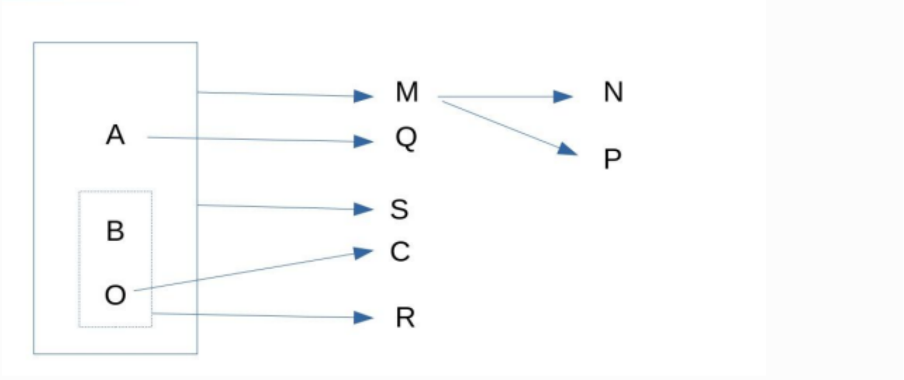
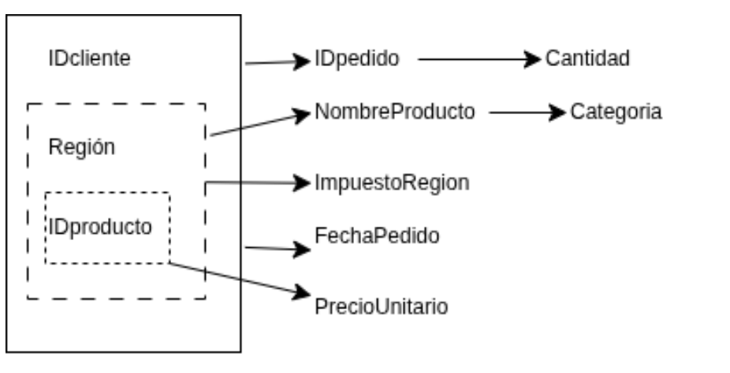
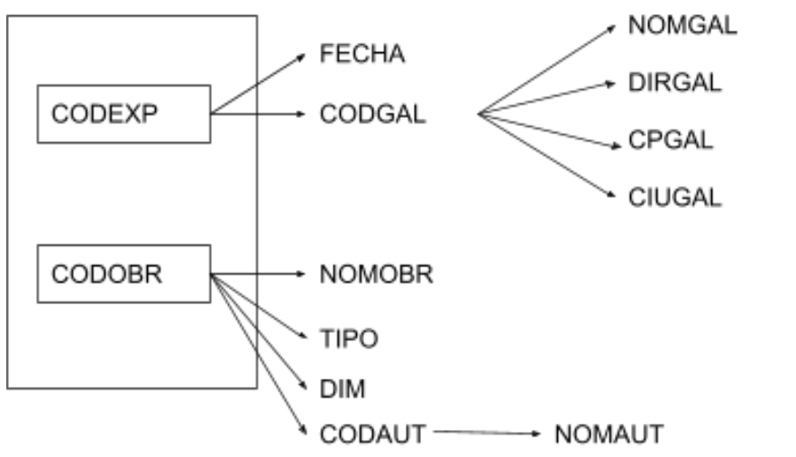

# Ejercicios

??? tip "Revisa tu solución"

    Antes de consultar las soluciones, utiliza el prompt de [Cómo utilizar la IA para aprender](../IA.md).

    **📤 Qué entregar a la IA**

    1. El **enunciado** y la tabla o grafo de partida.
    2. Tu **grafo de dependencias normalizado**, como imagen de Draw.io o fotografía clara.
    3. Las **tablas del modelo relacional**, con sus atributos, PK y FK. Por ejemplo:

    ```text
    EMPLEADO(dni, nombre)
    PK: dni

    TRABAJA(dni, num_proyecto, horas)
    PK: (dni, num_proyecto)
    FK: dni → EMPLEADO(dni)
    ```

    Explica cómo has marcado las claves en el grafo. Pide a la IA que revise **las dependencias, la normalización y las PK y FK**, dándote pistas sin resolver el ejercicio. Después de corregirlo, envía la versión actualizada.


## <span class="exercise-title"><span class="exercise-icon">📝</span><span>Ejercicio 1. Grafo de dependencias funcionales</span></span>

Las relaciones representadas por los grafos ya se encuentran en **1FN**. Normaliza hasta **3FN**.


{ width=700 }

## <span class="exercise-title"><span class="exercise-icon">📝</span><span>Ejercicio 2. Pedidos</span></span>


Las relaciones representadas por los grafos ya se encuentran en **1FN**. Normaliza hasta **3FN** y presenta las tablas resultantes en el modelo relacional, indicando sus claves primarias (PK) y foráneas (FK).

El grafo representa las dependencias entre los datos de una única tabla **PEDIDOS**. Antes de normalizarla, todos los campos pertenecen a la tabla que se muestra a continuación.

<div class="normalizacion-exercise-table" markdown>

| IDcliente | Región | IDproducto | IDpedido | Cantidad | NombreProducto | Categoria | ImpuestoRegion | FechaPedido | PrecioUnitario |
|-----------|--------|------------|----------|----------|----------------|-----------|----------------|-------------|----------------|

{ width=700 }


</div>

## <span class="exercise-title"><span class="exercise-icon">📝</span><span>Ejercicio 3. Órdenes de pedido</span></span>


<div class="normalizacion-exercise-table" markdown>

Las relaciones representadas por los grafos ya se encuentran en **1FN**. Normaliza hasta **3FN** y presenta las tablas resultantes en el modelo relacional, indicando sus claves primarias (PK) y foráneas (FK).

| **id_orden** | **fecha** | **id_cliente** | **nom_cliente** | **estado** | **num_art** | **nom_art** | **cantidad** | **precio** |
|-------------|-----------|----------------|-----------------|------------|-------------|-------------|----------|------------|
| 2301 | 23/02/11 | 101 | Martin | Caracas | 3786 | Red | 3 | 35,00 |
| 2301 | 23/02/11 | 101 | Martin | Caracas | 4011 | Raqueta | 6 | 65,00 |
| 2301 | 23/02/11 | 101 | Martin | Caracas | 9132 | Paq-3 | 8 | 4,75 |
| 2302 | 25/02/11 | 107 | Herman | Coro | 5794 | Paq-6 | 4 | 5,00 |
| 2303 | 27/02/11 | 110 | Pedro | Maracay | 4011 | Raqueta | 2 | 65,00 |
| 2303 | 27/02/11 | 110 | Pedro | Maracay | 3141 | Funda | 2 | 10,00 |

</div>


## <span class="exercise-title"><span class="exercise-icon">📝</span><span>Ejercicio 4</span></span>

La tabla ORDENES contiene información sobre las exposiciones, las galerías, las obras expuestas y sus autores.

<div class="normalizacion-exercise-table" markdown>

| codexp | codgal | nomgal | dirgal | cpgal | ciugal | fecha | codobr | nomobr | tip | dim | codaut | nomaut |
|--------|--------|--------|--------|-------|--------|-------|--------|--------|-----|-----|--------|--------|
| ART024 | ART | ARTACTUAL | C/ Enmig, 54 | 12001 | Castelló | Del 1-12-2012 al 15-12-2012 | GO-068 | Bodegón | Óleo | 60x40 | GM | Gregori Mifsud |
| ART024 | ART | ARTACTUAL | C/ Enmig, 54 | 12001 | Castelló | Del 1-12-2012 al 15-12-2012 | GO-069 | Bodegón | Óleo | 50x30 | GM | Gregori Mifsud |
| ART024 | ART | ARTACTUAL | C/ Enmig, 54 | 12001 | Castelló | Del 1-12-2012 al 15-12-2012 | GO-070 | Paisaje lunar | Óleo | 100x50 | GM | Gregori Mifsud |
| ART024 | ART | ARTACTUAL | C/ Enmig, 54 | 12001 | Castelló | Del 1-12-2012 al 15-12-2012 | RA-250 | Estampa antigua | Aquarela | 40x30 | RB | Ramon Bernat |

</div>

Se conocen las siguientes dependencias funcionales:

* **codexp → fecha, codgal**.
* **codgal → nomgal, dirgal, cpgal, ciugal**.
* **codobr → nomobr, tip, dim, codaut**.
* **codaut → nomaut**.
* La pareja **codexp + codobr** identifica la participación de una obra en una exposición, aunque no tiene otros atributos propios.

{ width=700 }

Descompón la tabla hasta 3FN y presenta el modelo relacional con sus PK y FK. Utiliza las dependencias indicadas en el enunciado.


## <span class="exercise-title"><span class="exercise-icon">📝</span><span>Ejercicio 5</span></span>

Se dispone de la siguiente tabla no normalizada, que almacena información sobre los trabajadores de una empresa:

<div class="normalizacion-exercise-table" markdown>

| nss | nombre | apellidos | puesto | salario | emails |
|-----|--------|-----------|--------|---------|--------|
| 111 | Juan | Pérez Arias | Jefe de Área | 3000 | juanp@ecn.es; jefe2@ecn.es |
| 222 | José | Sánchez Ramos | Administrativo | 1500 | juanp@ecn.es; jefe2@ecn.es |
| 333 | Ana | Díaz Ruiz | Administrativo | 1500 | adiaz@ecn.es; ana32@gmail.com |

</div>

**Tareas:**

1. Analiza la tabla y determina su clave primaria.
2. Identifica las dependencias funcionales y elabora su grafo. Explicita las reglas que asumas: los valores de una muestra no bastan para establecer una dependencia.
3. Normaliza paso a paso hasta 3FN.
4. Presenta las tablas resultantes con sus PK y FK.

## <span class="exercise-title"><span class="exercise-icon">📝</span><span>Ejercicio 6</span></span>

La tabla PELICULA contiene información sobre las películas, sus estudios y los actores que participan en ellas:

<div class="normalizacion-exercise-table" markdown>

| titulo | anyo | duracion | tipo | estudio | ciudadestudio | actor |
|--------|------|----------|------|---------|---------------|-------|
| Star Wars | 1977 | 124 | Color | Fox | Hollywood | Carrie Fisher |
| Star Wars | 1977 | 124 | Color | Fox | Hollywood | Mark Hamill |
| Star Wars | 1977 | 124 | Color | Fox | Hollywood | Harrison Ford |
| Mighty Ducks | 1991 | 104 | Color | Disney | Buena Vista | Emilio Estevez |
| Ben Hur | 1959 | 212 | Color | MGM | Hollywood | Charlton Heston |
| Ben Hur | 1959 | 212 | Color | MGM | Hollywood | Martha Scott |
| El retorno del Jedi | 1983 | 124 | Color | Fox | Hollywood | Carrie Fisher |

</div>

Se conocen las siguientes reglas del dominio:

* De un mismo título pueden existir versiones de distintos años, pero nunca con los mismos actores.
* Un actor puede participar en varias películas durante un mismo año.
* Un estudio no puede estar ubicado en más de una ciudad.
* Un actor puede trabajar con distintos estudios a lo largo de su carrera.

**Tareas:**

1. Determina la clave primaria de la tabla original y justifica tu elección.
2. Identifica las dependencias funcionales y las posibles claves candidatas.
3. Aplica la normalización hasta 3FN.
4. Presenta el esquema final con sus PK y FK.

## <span class="exercise-title"><span class="exercise-icon">📝</span><span>Ejercicio 7</span></span>

Una universidad utiliza una única tabla para registrar los alumnos y los cursos en los que se matriculan. El diseño actual genera redundancias y posibles errores de actualización.

**MATRICULA**

<div class="normalizacion-exercise-table" markdown>

| idmatricula | nombre | apellido | direccion | telefono | curso | codigo | carrera |
|-------------|--------|----------|-----------|----------|-------|--------|---------|
| 100 | Juan | Martín Arias | C/ Ongolmo 340, Concepción | 78872890 | base datos | bd1 | ingeniería civil informática |
| 100 | Juan | Martín Arias | C/ Ongolmo 340, Concepción | 78872890 | estadística | e2 | ingeniería civil informática |
| 100 | Juan | Martín Arias | C/ Ongolmo 340, Concepción | 78872890 | analítica | a5 | ingeniería civil informática |
| 200 | Ana | Rodríguez Ferrer | C/San Martín 840, Santiago | 78342367 | estadística | e2 | ingeniería comercial |
| 200 | Ana | Rodríguez Ferrer | C/San Martín 840, Santiago | 78342367 | analítica | a5 | ingeniería comercial |

</div>

**Tareas:**

1. Analiza los problemas de diseño e identifica las dependencias funcionales.
2. Determina la clave primaria y justifica tu elección.
3. Normaliza paso a paso hasta 3FN. Separa la dirección y la localidad para poder tratarlas como datos independientes.
4. Presenta las tablas resultantes con sus atributos, PK y FK.

Para interpretar el ejercicio, **idmatricula identifica al alumno**, tal como muestran las filas del enunciado; **codigo identifica al curso**. Explicita cualquier otra regla que necesites asumir.
