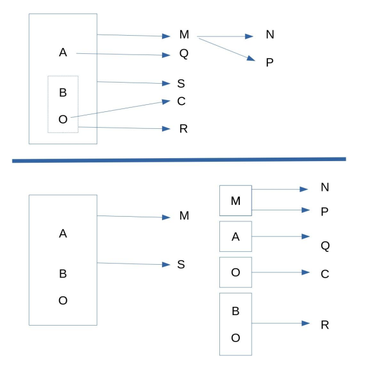
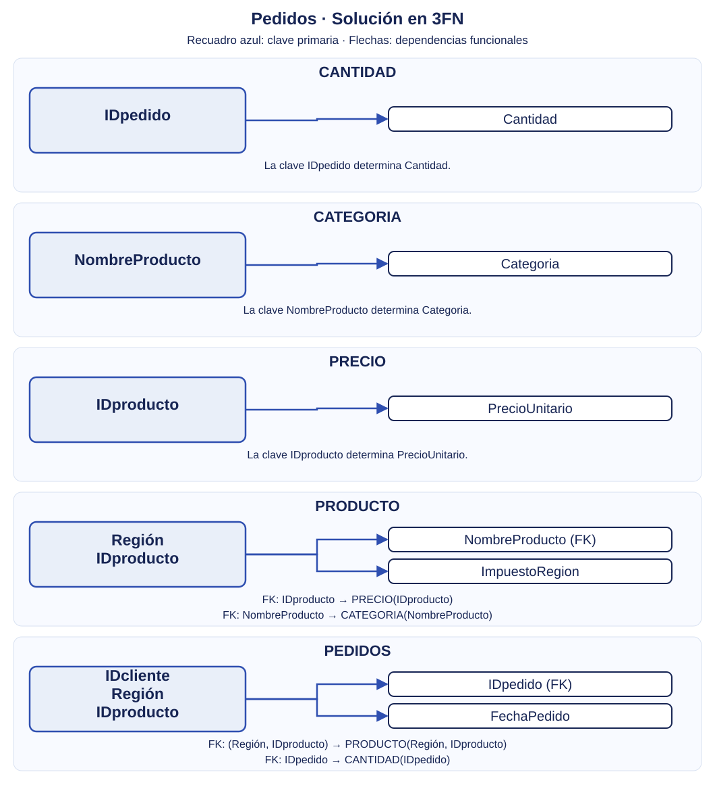
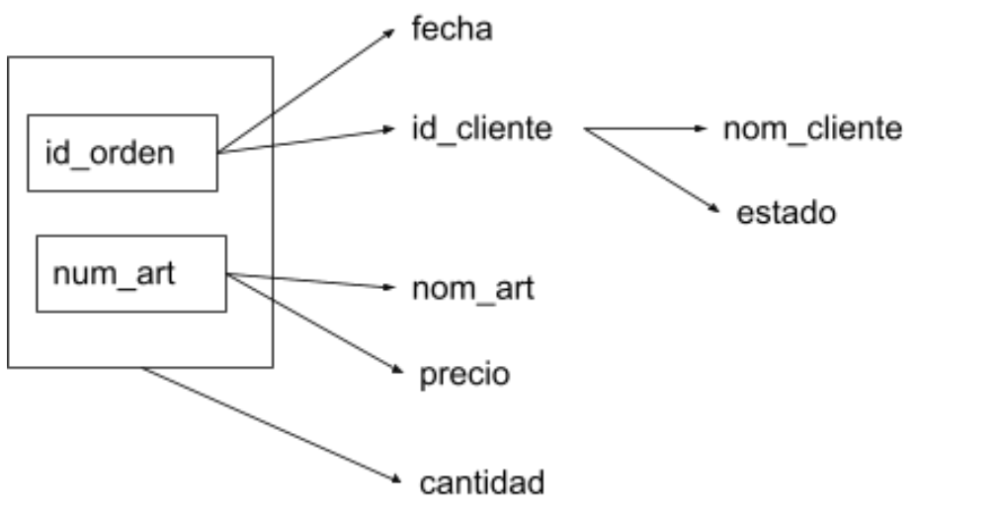
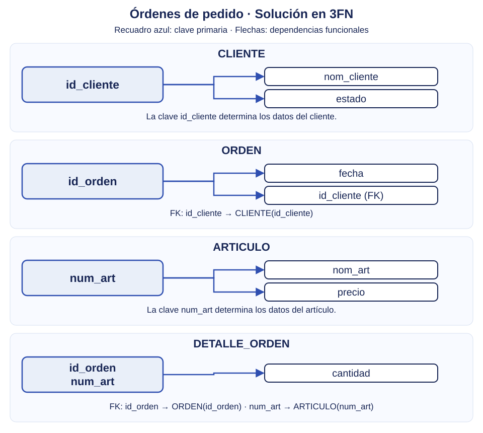
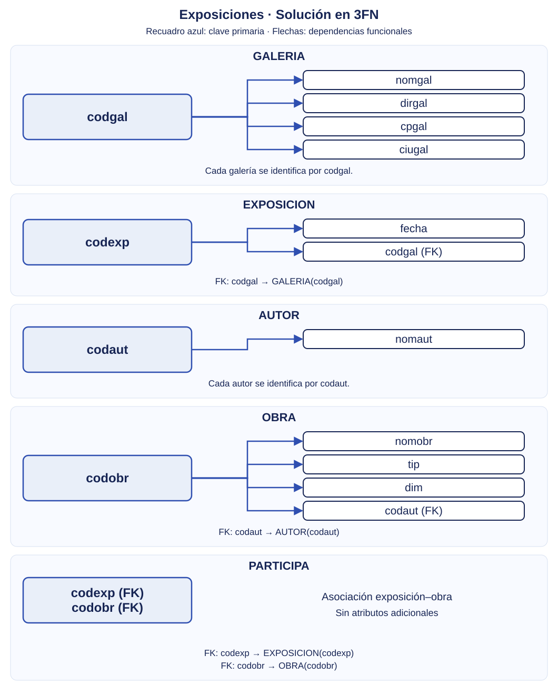
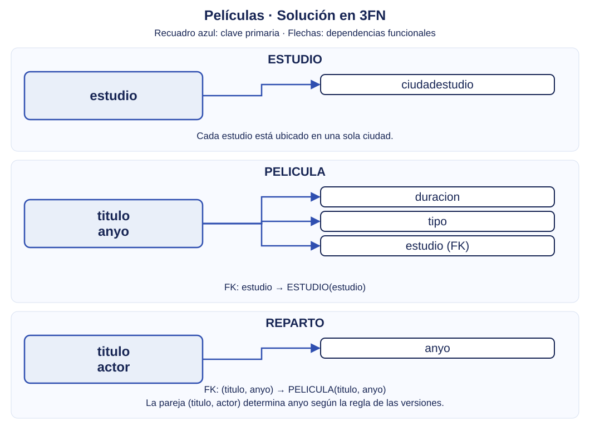

---
hide:
  - toc
---

# Soluciones

!!! warning "Antes de consultar la resolución"
    Intenta resolver cada ejercicio y compara después tu propuesta con la solución.

??? success "Ejercicio 1. Grafo de dependencias funcionales"

    

??? success "Ejercicio 2. Pedidos"

    Normaliza la relación del siguiente grafo y expresa el resultado en el modelo relacional.

    
    { width=700 }

    El grafo representa las dependencias entre los datos de una única tabla **PEDIDOS**. Antes de normalizarla, todos los campos pertenecen a la tabla que se muestra a continuación.

    

    | IDcliente | Región | IDproducto | IDpedido | Cantidad | NombreProducto | Categoria | ImpuestoRegion | FechaPedido | PrecioUnitario |
    |-----------|--------|------------|----------|----------|----------------|-----------|----------------|-------------|----------------|

    

    Las dependencias representadas son:

    - **IDcliente + Región + IDproducto → IDpedido, FechaPedido**.
    - **IDpedido → Cantidad**.
    - **Región + IDproducto → NombreProducto, ImpuestoRegion**.
    - **NombreProducto → Categoria**.
    - **IDproducto → PrecioUnitario**.

    ### 1. Primera forma normal (1FN)

    La relación ya está en **1FN**: todos sus atributos contienen valores atómicos.

    ### 2. Segunda forma normal (2FN)

    Identificamos las dependencias **parciales** respecto a la clave compuesta:

    - NombreProducto e ImpuestoRegion dependen solo de **Región + IDproducto**.
    - Categoria también depende de esa parte de la clave, a través de NombreProducto.
    - PrecioUnitario depende solo de **IDproducto**.

    En cambio, IDpedido y FechaPedido dependen de la clave completa. Cantidad permanece de momento junto a IDpedido, porque se obtiene a través de él.

    Separamos los atributos según sus determinantes:

    - **PEDIDOS** (<u>IDcliente, Región, IDproducto</u>, IDpedido, FechaPedido, Cantidad).
    - **PRODUCTO** (<u>Región, IDproducto</u>, NombreProducto, Categoria, ImpuestoRegion).
    - **PRECIO** (<u>IDproducto</u>, PrecioUnitario).

    Es importante separar PRECIO: dejar PrecioUnitario en PRODUCTO mantendría una dependencia parcial respecto a su clave (Región, IDproducto).

    ### 3. Tercera forma normal (3FN)

    Quedan dos dependencias transitivas:

    - En PEDIDOS: **IDcliente + Región + IDproducto → IDpedido → Cantidad**.
    - En PRODUCTO: **Región + IDproducto → NombreProducto → Categoria**.

    Separamos Cantidad y Categoria en sus propias tablas. Conservamos IDpedido en PEDIDOS y NombreProducto en PRODUCTO como claves externas.

    **Modelo relacional final**

    - **CANTIDAD** (<u>IDpedido</u>, Cantidad).
        - PK: IDpedido.
    - **CATEGORIA** (<u>NombreProducto</u>, Categoria).
        - PK: NombreProducto.
    - **PRECIO** (<u>IDproducto</u>, PrecioUnitario).
        - PK: IDproducto.
    - **PRODUCTO** (<u>Región, IDproducto</u>, NombreProducto, ImpuestoRegion).
        - PK: (Región, IDproducto).
        - FK: IDproducto → PRECIO(IDproducto).
        - FK: NombreProducto → CATEGORIA(NombreProducto).
    - **PEDIDOS** (<u>IDcliente, Región, IDproducto</u>, IDpedido, FechaPedido).
        - PK: (IDcliente, Región, IDproducto).
        - FK: (Región, IDproducto) → PRODUCTO(Región, IDproducto).
        - FK: IDpedido → CANTIDAD(IDpedido).

    **Esquema visual de la solución**

    { width=850 }

    Con las dependencias indicadas, todas las tablas cumplen **FNBC**: en todas sus dependencias funcionales no triviales, el determinante es una clave.

??? success "Ejercicio 3. Órdenes de pedido"

    **Tabla original de pedidos**

    

    | **id_orden** | **fecha** | **id_cliente** | **nom_cliente** | **estado** | **num_art** | **nom_art** | **cantidad** | **precio** |
    |-------------|-----------|----------------|-----------------|------------|-------------|-------------|----------|------------|
    | 2301 | 23/02/11 | 101 | Martin | Caracas | 3786 | Red | 3 | 35,00 |
    | 2301 | 23/02/11 | 101 | Martin | Caracas | 4011 | Raqueta | 6 | 65,00 |
    | 2301 | 23/02/11 | 101 | Martin | Caracas | 9132 | Paq-3 | 8 | 4,75 |
    | 2302 | 25/02/11 | 107 | Herman | Coro | 5794 | Paq-6 | 4 | 5,00 |
    | 2303 | 27/02/11 | 110 | Pedro | Maracay | 4011 | Raqueta | 2 | 65,00 |
    | 2303 | 27/02/11 | 110 | Pedro | Maracay | 3141 | Funda | 2 | 10,00 |

    

    El grafo representa las dependencias funcionales de esta relación.

    Normaliza la relación del siguiente grafo y expresa el resultado en el modelo relacional.

    La clave principal es **(id_orden, num_art)**.

    **Grafo inicial**

    { width=700 }

    ### 1. Primera forma normal (1FN)

    La relación ya está en **1FN**: todos sus atributos contienen valores atómicos.

    ### 2. Segunda forma normal (2FN)

    Las siguientes dependencias son **parciales**, porque sus determinantes son una parte de la clave compuesta:

    - **id_orden → fecha, id_cliente**.
    - **num_art → nom_art, precio**.

    La dependencia **id_orden + num_art → cantidad** es **total**: necesitamos conocer tanto la orden como el artículo para determinar la cantidad.

    Separamos los atributos según su determinante:

    - **ORDEN** (<u>id_orden</u>, fecha, id_cliente, nom_cliente, estado).
    - **ARTICULO** (<u>num_art</u>, nom_art, precio).
    - **DETALLE_ORDEN** (<u>id_orden, num_art</u>, cantidad).

    Los datos del cliente permanecen de momento en ORDEN, porque dependen de id_orden a través de id_cliente. La 2FN todavía permite esta dependencia transitiva.

    ### 3. Tercera forma normal (3FN)

    En ORDEN existe una dependencia transitiva:

    **id_orden → id_cliente → nom_cliente, estado**.

    Separamos los datos del cliente en una nueva tabla y conservamos id_cliente en ORDEN como clave externa.

    **Modelo relacional final**

    - **CLIENTE** (<u>id_cliente</u>, nom_cliente, estado).
        - PK: id_cliente.
    - **ORDEN** (<u>id_orden</u>, fecha, id_cliente).
        - PK: id_orden.
        - FK: id_cliente → CLIENTE(id_cliente).
    - **ARTICULO** (<u>num_art</u>, nom_art, precio).
        - PK: num_art.
    - **DETALLE_ORDEN** (<u>id_orden, num_art</u>, cantidad).
        - PK: (id_orden, num_art).
        - FK: id_orden → ORDEN(id_orden).
        - FK: num_art → ARTICULO(num_art).

    **Esquema visual de la solución**

    { width=850 }

    La cantidad queda en DETALLE_ORDEN porque depende de la combinación de orden y artículo. El precio queda en ARTICULO, tal como establece la dependencia num_art → precio del grafo.

    Con las dependencias indicadas, las cuatro tablas también cumplen **FNBC**: en todas sus dependencias funcionales no triviales, el determinante es una clave.

??? success "Ejercicio 4. Exposiciones"

    **Tabla original ORDENES**

    

    | codexp | codgal | nomgal | dirgal | cpgal | ciugal | fecha | codobr | nomobr | tip | dim | codaut | nomaut |
    |--------|--------|--------|--------|-------|--------|-------|--------|--------|-----|-----|--------|--------|
    | ART024 | ART | ARTACTUAL | C/ Enmig, 54 | 12001 | Castelló | Del 1-12-2012 al 15-12-2012 | GO-068 | Bodegón | Óleo | 60x40 | GM | Gregori Mifsud |
    | ART024 | ART | ARTACTUAL | C/ Enmig, 54 | 12001 | Castelló | Del 1-12-2012 al 15-12-2012 | GO-069 | Bodegón | Óleo | 50x30 | GM | Gregori Mifsud |
    | ART024 | ART | ARTACTUAL | C/ Enmig, 54 | 12001 | Castelló | Del 1-12-2012 al 15-12-2012 | GO-070 | Paisaje lunar | Óleo | 100x50 | GM | Gregori Mifsud |
    | ART024 | ART | ARTACTUAL | C/ Enmig, 54 | 12001 | Castelló | Del 1-12-2012 al 15-12-2012 | RA-250 | Estampa antigua | Aquarela | 40x30 | RB | Ramon Bernat |

    

    Partimos de la relación:

    **ORDENES** (<u>codexp, codobr</u>, codgal, nomgal, dirgal, cpgal, ciugal, fecha, nomobr, tip, dim, codaut, nomaut).

    La clave principal es **(codexp, codobr)**: una exposición puede incluir varias obras y una obra puede participar en distintas exposiciones.

    **Grafo inicial**

    { width=700 }

    Las dependencias establecidas por el enunciado son:

    - **codexp → fecha, codgal**.
    - **codgal → nomgal, dirgal, cpgal, ciugal**.
    - **codobr → nomobr, tip, dim, codaut**.
    - **codaut → nomaut**.

    ### 1. Primera forma normal (1FN)

    Partimos de la relación en **1FN**, tal como indica el enunciado de los ejercicios desde grafos. Tratamos fecha como el período de la exposición y dim como la dimensión de la obra, sin descomponerlos en este ejercicio.

    ### 2. Segunda forma normal (2FN)

    La tabla no está en 2FN: sus atributos descriptivos dependen solo de una parte de la clave compuesta.

    - **codexp → fecha, codgal**: la fecha y la galería dependen solo de la exposición. Los datos de la galería también se obtienen a partir de codexp, a través de codgal.
    - **codobr → nomobr, tip, dim, codaut**: los datos de la obra dependen solo de su código. El nombre del autor también se obtiene a partir de codobr, a través de codaut.

    Separamos los datos según su determinante:

    - **EXPOSICION** (<u>codexp</u>, fecha, codgal, nomgal, dirgal, cpgal, ciugal).
    - **OBRA** (<u>codobr</u>, nomobr, tip, dim, codaut, nomaut).
    - **PARTICIPA** (<u>codexp, codobr</u>).

    PARTICIPA conserva la asociación entre exposición y obra. **Es necesaria aunque no tenga atributos adicionales**: si la elimináramos, perderíamos la información sobre qué obras se exponen en cada exposición.

    ### 3. Tercera forma normal (3FN)

    Quedan dos dependencias transitivas:

    - En EXPOSICION: **codexp → codgal → nomgal, dirgal, cpgal, ciugal**.
    - En OBRA: **codobr → codaut → nomaut**.

    Separamos los datos de la galería y del autor en dos tablas nuevas. Conservamos codgal en EXPOSICION y codaut en OBRA como claves externas.

    **Modelo relacional final**

    - **GALERIA** (<u>codgal</u>, nomgal, dirgal, cpgal, ciugal).
        - PK: codgal.
    - **EXPOSICION** (<u>codexp</u>, fecha, codgal).
        - PK: codexp.
        - FK: codgal → GALERIA(codgal).
    - **AUTOR** (<u>codaut</u>, nomaut).
        - PK: codaut.
    - **OBRA** (<u>codobr</u>, nomobr, tip, dim, codaut).
        - PK: codobr.
        - FK: codaut → AUTOR(codaut).
    - **PARTICIPA** (<u>codexp, codobr</u>).
        - PK: (codexp, codobr).
        - FK: codexp → EXPOSICION(codexp).
        - FK: codobr → OBRA(codobr).

    **Esquema visual de la solución**

    { width=850 }

    Ahora los datos de cada galería se guardan una sola vez, los del autor una sola vez y las participaciones se registran mediante parejas de códigos. Con las dependencias indicadas, las cinco tablas cumplen **3FN y FNBC**.

    No añadimos **cpgal → ciugal**, porque el enunciado no establece esa dependencia. La descomposición se basa en las reglas dadas, no únicamente en las coincidencias de las cuatro filas de muestra.

??? success "Ejercicio 5. Trabajador"

    **Tabla original TRABAJADOR**

    

    | nss | nombre | apellidos | puesto | salario | emails |
    |-----|--------|-----------|--------|---------|--------|
    | 111 | Juan | Pérez Arias | Jefe de Área | 3000 | juanp@ecn.es; jefe2@ecn.es |
    | 222 | José | Sánchez Ramos | Administrativo | 1500 | juanp@ecn.es; jefe2@ecn.es |
    | 333 | Ana | Díaz Ruiz | Administrativo | 1500 | adiaz@ecn.es; ana32@gmail.com |

    

    La clave que identifica a cada trabajador es **nss**. El atributo emails es multivaluado: todavía no tenemos una relación en 1FN.

    **Dependencias y reglas utilizadas**

    - **nss → nombre, apellidos, puesto, salario**.
    - Para desarrollar la descomposición hasta 3FN, **suponemos que cada puesto tiene un salario fijo**: **puesto → salario**. Esta regla debe confirmarse con la empresa; no basta con observar los salarios de la muestra.
    - Un trabajador puede tener varios emails y un email puede ser compartido por distintos trabajadores, como ocurre en los datos.

    ### 1. Primera forma normal (1FN)

    Separamos el atributo multivaluado en una tabla con **una fila por cada email de un trabajador**:

    - **TRABAJADOR** (<u>nss</u>, nombre, apellidos, puesto, salario).
    - **EMAIL_TRABAJADOR** (<u>nss, email</u>).

    **EMAIL_TRABAJADOR en 1FN**

    | nss | email |
    |-----|-------|
    | 111 | juanp@ecn.es |
    | 111 | jefe2@ecn.es |
    | 222 | juanp@ecn.es |
    | 222 | jefe2@ecn.es |
    | 333 | adiaz@ecn.es |
    | 333 | ana32@gmail.com |

    La clave de EMAIL_TRABAJADOR es **(nss, email)**. Ni nss ni email identifican una fila por separado. Ahora cada celda contiene un único valor.

    ### 2. Segunda forma normal (2FN)

    Las dos tablas ya están en **2FN**:

    - TRABAJADOR tiene una clave simple, nss; no hay dependencias parciales.
    - EMAIL_TRABAJADOR solo contiene los atributos de su clave compuesta, sin atributos no clave.

    No es necesario descomponer ninguna tabla en este paso.

    ### 3. Tercera forma normal (3FN)

    Con la regla del salario fijo por puesto, en TRABAJADOR existe la dependencia transitiva:

    **nss → puesto → salario**.

    Separamos los salarios por puesto y conservamos puesto en TRABAJADOR como clave externa.

    **Modelo relacional final**

    - **PUESTO** (<u>puesto</u>, salario).
        - PK: puesto.
    - **TRABAJADOR** (<u>nss</u>, nombre, apellidos, puesto).
        - PK: nss.
        - FK: puesto → PUESTO(puesto).
    - **EMAIL_TRABAJADOR** (<u>nss, email</u>).
        - PK: (nss, email).
        - FK: nss → TRABAJADOR(nss).

    **Esquema visual de la solución**

    { width=850 }

    Ahora los salarios se guardan una sola vez por puesto y los emails se registran sin repetir el resto de los datos del trabajador. Con las reglas utilizadas, las tres tablas cumplen **3FN y FNBC**.

    Si cada trabajador pudiera tener un salario diferente dentro del mismo puesto, **puesto → salario no se cumpliría**: salario permanecería en TRABAJADOR y no crearíamos PUESTO para esta descomposición.

??? success "Ejercicio 6. Películas"

    **Tabla original PELICULA**

    

    | titulo | anyo | duracion | tipo | estudio | ciudadestudio | actor |
    |--------|------|----------|------|---------|---------------|-------|
    | Star Wars | 1977 | 124 | Color | Fox | Hollywood | Carrie Fisher |
    | Star Wars | 1977 | 124 | Color | Fox | Hollywood | Mark Hamill |
    | Star Wars | 1977 | 124 | Color | Fox | Hollywood | Harrison Ford |
    | Mighty Ducks | 1991 | 104 | Color | Disney | Buena Vista | Emilio Estevez |
    | Ben Hur | 1959 | 212 | Color | MGM | Hollywood | Charlton Heston |
    | Ben Hur | 1959 | 212 | Color | MGM | Hollywood | Martha Scott |
    | El retorno del Jedi | 1983 | 124 | Color | Fox | Hollywood | Carrie Fisher |

    

    **Dependencias y claves candidatas**

    - **titulo + anyo → duracion, tipo, estudio**: título y año identifican una versión de la película.
    - **estudio → ciudadestudio**: cada estudio está ubicado en una sola ciudad.
    - **titulo + actor → anyo**: según la regla del enunciado, un actor no participa en dos versiones de un mismo título.

    Por tanto, **(titulo, actor)** identifica una fila de la relación original: determina el año y, a través de título y año, el resto de los datos. Es la **clave candidata que elegimos como primaria**.

    **(titulo, anyo, actor)** también identifica la fila, pero es una **superclave no mínima**, porque anyo se puede deducir de titulo y actor. Título y año solos no identifican la participación: una película puede tener varios actores.

    ### 1. Primera forma normal (1FN)

    La tabla ya está en **1FN**: cada fila contiene un único actor y cada celda un único valor. Que una película aparezca en varias filas no incumple la 1FN.

    ### 2. Segunda forma normal (2FN)

    Con la clave mínima **(titulo, actor)**, la tabla ya está en **2FN**. Ninguno de los atributos no clave depende solo de titulo ni solo de actor según las reglas dadas.

    No debemos presentar titulo + anyo como una parte de esa clave: anyo no pertenece a la clave candidata elegida. La separación de los datos de la película se justifica en el paso siguiente.

    ### 3. Tercera forma normal (3FN)

    La relación no está en 3FN:

    - **titulo + anyo → duracion, tipo, estudio**: titulo + anyo no es superclave de la relación original, porque no identifica al actor, y los atributos de la derecha no son primarios.
    - **estudio → ciudadestudio**: estudio tampoco es superclave de la relación original y ciudadestudio no es un atributo primario.

    Separamos los datos de cada versión de la película, los del estudio y las participaciones de los actores. En PELICULA, la dependencia **titulo + anyo → estudio → ciudadestudio** se elimina llevando la ciudad a ESTUDIO.

    **Modelo relacional final**

    - **ESTUDIO** (<u>estudio</u>, ciudadestudio).
        - PK: estudio.
    - **PELICULA** (<u>titulo, anyo</u>, duracion, tipo, estudio).
        - PK: (titulo, anyo).
        - FK: estudio → ESTUDIO(estudio).
    - **REPARTO** (<u>titulo, actor</u>, anyo).
        - PK: (titulo, actor).
        - FK: (titulo, anyo) → PELICULA(titulo, anyo).

    La clave externa de REPARTO incluye anyo aunque este no forme parte de su clave primaria. Conservamos así tanto la película concreta en la que participa el actor como la regla que impide repetir actor en versiones de un mismo título.

    **Esquema visual de la solución**

    { width=850 }

    El estudio y su ciudad se guardan una sola vez, los datos de cada película una sola vez por título y año y sus actores en REPARTO. Con las dependencias del enunciado, las tres tablas también cumplen **FNBC**.

??? success "Ejercicio 7. Matrículas universitarias"

    **Tabla original MATRICULA**

    

    | idmatricula | nombre | apellido | direccion | telefono | curso | codigo | carrera |
    |-------------|--------|----------|-----------|----------|-------|--------|---------|
    | 100 | Juan | Martín Arias | C/ Ongolmo 340, Concepción | 78872890 | base datos | bd1 | ingeniería civil informática |
    | 100 | Juan | Martín Arias | C/ Ongolmo 340, Concepción | 78872890 | estadística | e2 | ingeniería civil informática |
    | 100 | Juan | Martín Arias | C/ Ongolmo 340, Concepción | 78872890 | analítica | a5 | ingeniería civil informática |
    | 200 | Ana | Rodríguez Ferrer | C/San Martín 840, Santiago | 78342367 | estadística | e2 | ingeniería comercial |
    | 200 | Ana | Rodríguez Ferrer | C/San Martín 840, Santiago | 78342367 | analítica | a5 | ingeniería comercial |

    

    **Interpretación y dependencias funcionales**

    Tal como indica el enunciado, **idmatricula identifica al alumno** y **codigo identifica al curso**. Suponemos que cada alumno tiene una dirección, un teléfono y una carrera. No suponemos que el nombre del curso sea único.

    - **idmatricula → nombre, apellido, direccion, telefono, carrera**.
    - **codigo → curso**.
    - Clave principal de la relación original: **(idmatricula, codigo)**.

    Ni idmatricula ni codigo identifican una fila por separado: un alumno se matricula en varios cursos y un curso puede tener varios alumnos.

    ### 1. Primera forma normal (1FN)

    Para tratar por separado la dirección y la localidad, descomponemos el atributo direccion, tal como pide el ejercicio:

    | idmatricula | direccion | localidad |
    |-------------|-----------|-----------|
    | 100 | C/ Ongolmo 340 | Concepción |
    | 200 | C/San Martín 840 | Santiago |

    Esta tabla muestra cómo se separa el campo; todavía no es la descomposición completa de la relación. Sustituimos direccion por **direccion y localidad** en cada fila original:

    **MATRICULA** (<u>idmatricula, codigo</u>, nombre, apellido, direccion, localidad, telefono, curso, carrera).

    Cada fila ya contiene un solo curso. Repetir los datos de un alumno en filas distintas **no es, por sí mismo, una infracción de la 1FN**; las dependencias parciales de esos datos se eliminan en 2FN.

    ### 2. Segunda forma normal (2FN)

    Existen dependencias parciales respecto a (idmatricula, codigo):

    - Los datos del alumno dependen solo de **idmatricula**, incluida localidad tras separar la dirección.
    - El nombre del curso depende solo de **codigo**.

    Separamos los atributos según su determinante y conservamos la relación de matrícula:

    - **ALUMNO** (<u>idmatricula</u>, nombre, apellido, direccion, localidad, telefono, carrera).
    - **CURSO** (<u>codigo</u>, curso).
    - **MATRICULA** (<u>idmatricula, codigo</u>).

    MATRICULA es necesaria aunque no tenga atributos adicionales: guarda qué cursos ha elegido cada alumno.

    ### 3. Tercera forma normal (3FN)

    Con las reglas indicadas, no quedan dependencias transitivas entre atributos no clave. Las tres tablas obtenidas en 2FN **ya están en 3FN**: no hace falta otra descomposición.

    No separamos carrera en una tabla propia, porque el enunciado no aporta otros atributos ni dependencias que lo exijan. Tampoco suponemos que direccion determine localidad: una misma dirección escrita puede existir en distintas localidades.

    **Modelo relacional final**

    - **ALUMNO** (<u>idmatricula</u>, nombre, apellido, direccion, localidad, telefono, carrera).
        - PK: idmatricula.
    - **CURSO** (<u>codigo</u>, curso).
        - PK: codigo.
    - **MATRICULA** (<u>idmatricula, codigo</u>).
        - PK: (idmatricula, codigo).
        - FK: idmatricula → ALUMNO(idmatricula).
        - FK: codigo → CURSO(codigo).

    **Esquema visual de la solución**

    { width=850 }

    La unión de las tres tablas por idmatricula y codigo recupera las cinco matrículas originales, con dirección y localidad separadas. Con las reglas utilizadas, las tablas también cumplen **FNBC**.

