---
hide:
  - toc
---

# Soluciones

!!! warning "Antes de consultar la resolución"
    Intenta resolver cada ejercicio y compara después tu propuesta con la solución.

??? success "Ejercicio 1. Grafo de dependencias funcionales"

    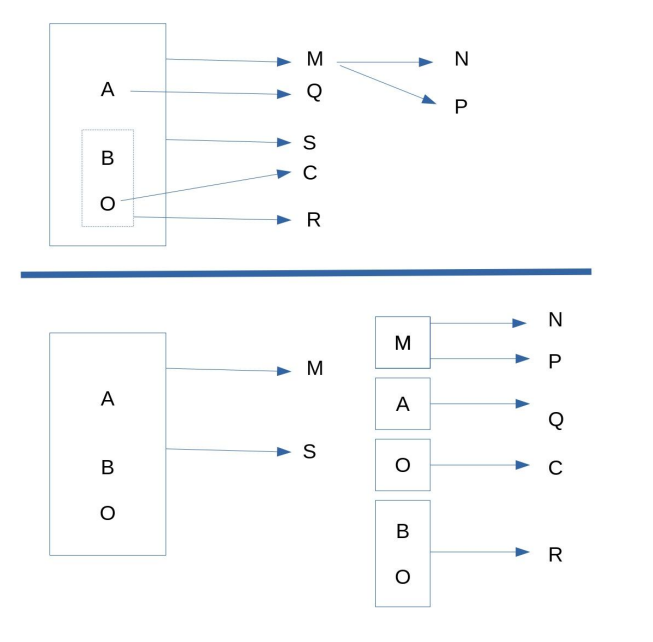

??? success "Ejercicio 2. Pedidos"

    Normaliza la relación del siguiente grafo y expresa el resultado en el modelo relacional.

    
    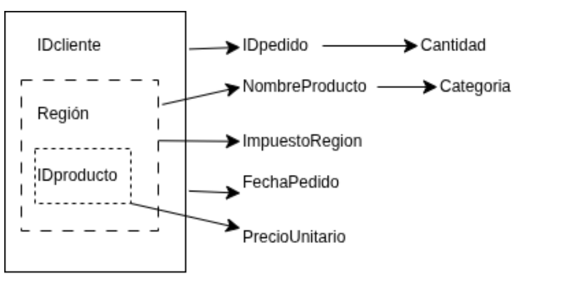{ width=700 }

    El grafo representa las dependencias entre los datos de una única tabla **PEDIDOS**. Antes de normalizarla, todos los campos pertenecen a la tabla que se muestra a continuación.

    

    | IDcliente | Región | IDproducto | IDpedido | Cantidad | NombreProducto | Categoria | ImpuestoRegion | FechaPedido | PrecioUnitario |
    |-----------|--------|------------|----------|----------|----------------|-----------|----------------|-------------|----------------|

    

    Las dependencias representadas son:

    - **IDcliente + Región + IDproducto → IDpedido, FechaPedido**.
    - **IDpedido → Cantidad**.
    - **Región + IDproducto → NombreProducto, ImpuestoRegion**.
    - **NombreProducto → Categoria**.
    - **IDproducto → PrecioUnitario**.

    ### 1. Primera forma normal (1FN)

    La relación ya está en **1FN**: todos sus atributos contienen valores atómicos.

    ### 2. Segunda forma normal (2FN)

    Identificamos las dependencias **parciales** respecto a la clave compuesta:

    - NombreProducto e ImpuestoRegion dependen solo de **Región + IDproducto**.
    - Categoria también depende de esa parte de la clave, a través de NombreProducto.
    - PrecioUnitario depende solo de **IDproducto**.

    En cambio, IDpedido y FechaPedido dependen de la clave completa. Cantidad permanece de momento junto a IDpedido, porque se obtiene a través de él.

    Separamos los atributos según sus determinantes:

    - **PEDIDOS** (<u>IDcliente, Región, IDproducto</u>, IDpedido, FechaPedido, Cantidad).
    - **PRODUCTO** (<u>Región, IDproducto</u>, NombreProducto, Categoria, ImpuestoRegion).
    - **PRECIO** (<u>IDproducto</u>, PrecioUnitario).

    Es importante separar PRECIO: dejar PrecioUnitario en PRODUCTO mantendría una dependencia parcial respecto a su clave (Región, IDproducto).

    ### 3. Tercera forma normal (3FN)

    Quedan dos dependencias transitivas:

    - En PEDIDOS: **IDcliente + Región + IDproducto → IDpedido → Cantidad**.
    - En PRODUCTO: **Región + IDproducto → NombreProducto → Categoria**.

    Separamos Cantidad y Categoria en sus propias tablas. Conservamos IDpedido en PEDIDOS y NombreProducto en PRODUCTO como claves externas.

    **Modelo relacional final**

    - **CANTIDAD** (<u>IDpedido</u>, Cantidad).
        - PK: IDpedido.
    - **CATEGORIA** (<u>NombreProducto</u>, Categoria).
        - PK: NombreProducto.
    - **PRECIO** (<u>IDproducto</u>, PrecioUnitario).
        - PK: IDproducto.
    - **PRODUCTO** (<u>Región, IDproducto</u>, NombreProducto, ImpuestoRegion).
        - PK: (Región, IDproducto).
        - FK: IDproducto → PRECIO(IDproducto).
        - FK: NombreProducto → CATEGORIA(NombreProducto).
    - **PEDIDOS** (<u>IDcliente, Región, IDproducto</u>, IDpedido, FechaPedido).
        - PK: (IDcliente, Región, IDproducto).
        - FK: (Región, IDproducto) → PRODUCTO(Región, IDproducto).
        - FK: IDpedido → CANTIDAD(IDpedido).

    **Esquema visual de la solución**

    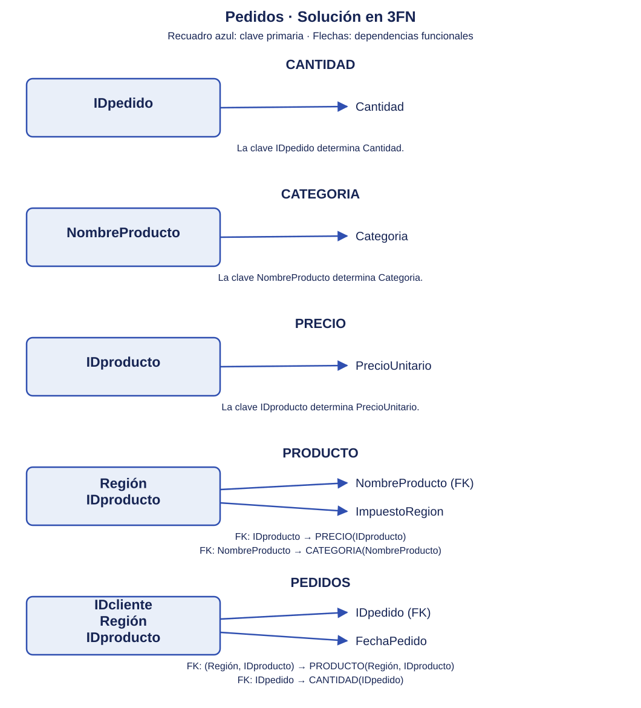{ width=850 }

    Con las dependencias indicadas, todas las tablas cumplen **FNBC**: en todas sus dependencias funcionales no triviales, el determinante es una clave.

??? success "Ejercicio 3. Líneas de pedido"

    **Tabla original de pedidos**

    

    | **id_orden** | **fecha** | **id_cliente** | **nom_cliente** | **ciudad** | **num_art** | **nom_art** | **cantidad** | **precio_art** |
    |-------------|-----------|----------------|-----------------|------------|-------------|-------------|----------|------------|
    | 2301 | 23/02/11 | 101 | Martin | Caracas | 3786 | Red | 3 | 35,00 |
    | 2301 | 23/02/11 | 101 | Martin | Caracas | 4011 | Raqueta | 6 | 65,00 |
    | 2301 | 23/02/11 | 101 | Martin | Caracas | 9132 | Paq-3 | 8 | 4,75 |
    | 2302 | 25/02/11 | 107 | Herman | Coro | 5794 | Paq-6 | 4 | 5,00 |
    | 2303 | 27/02/11 | 110 | Pedro | Maracay | 4011 | Raqueta | 2 | 65,00 |
    | 2303 | 27/02/11 | 110 | Pedro | Maracay | 3141 | Funda | 2 | 10,00 |

    

    El grafo representa las dependencias funcionales de esta relación.

    Normaliza la relación del siguiente grafo y expresa el resultado en el modelo relacional.

    La clave principal es **(id_orden, num_art)**.

    **Grafo inicial**

    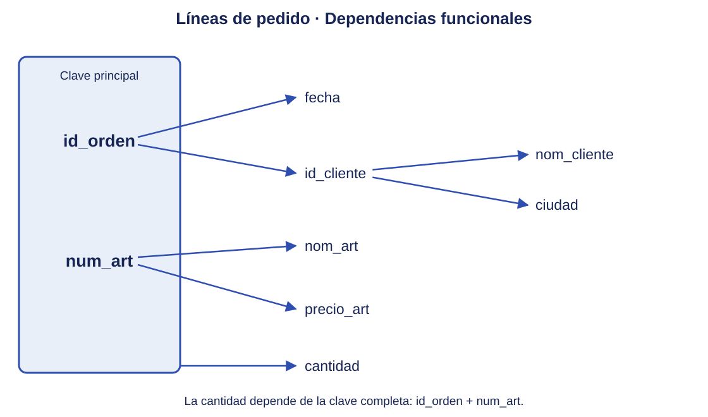{ width=700 }

    ### 1. Primera forma normal (1FN)

    La relación ya está en **1FN**: todos sus atributos contienen valores atómicos.

    ### 2. Segunda forma normal (2FN)

    Las siguientes dependencias son **parciales**, porque sus determinantes son una parte de la clave compuesta:

    - **id_orden → fecha, id_cliente**.
    - **num_art → nom_art, precio_art**.

    La dependencia **id_orden + num_art → cantidad** es **total**: necesitamos conocer tanto la orden como el artículo para determinar la cantidad.

    Separamos los atributos según su determinante:

    - **ORDEN** (<u>id_orden</u>, fecha, id_cliente, nom_cliente, ciudad).
    - **ARTICULO** (<u>num_art</u>, nom_art, precio_art).
    - **DETALLE_ORDEN** (<u>id_orden, num_art</u>, cantidad).

    Los datos del cliente permanecen de momento en ORDEN, porque dependen de id_orden a través de id_cliente. La 2FN todavía permite esta dependencia transitiva.

    ### 3. Tercera forma normal (3FN)

    En ORDEN existe una dependencia transitiva:

    **id_orden → id_cliente → nom_cliente, ciudad**.

    Separamos los datos del cliente en una nueva tabla y conservamos id_cliente en ORDEN como clave externa.

    **Modelo relacional final**

    - **CLIENTE** (<u>id_cliente</u>, nom_cliente, ciudad).
        - PK: id_cliente.
    - **ORDEN** (<u>id_orden</u>, fecha, id_cliente).
        - PK: id_orden.
        - FK: id_cliente → CLIENTE(id_cliente).
    - **ARTICULO** (<u>num_art</u>, nom_art, precio_art).
        - PK: num_art.
    - **DETALLE_ORDEN** (<u>id_orden, num_art</u>, cantidad).
        - PK: (id_orden, num_art).
        - FK: id_orden → ORDEN(id_orden).
        - FK: num_art → ARTICULO(num_art).

    **Esquema visual de la solución**

    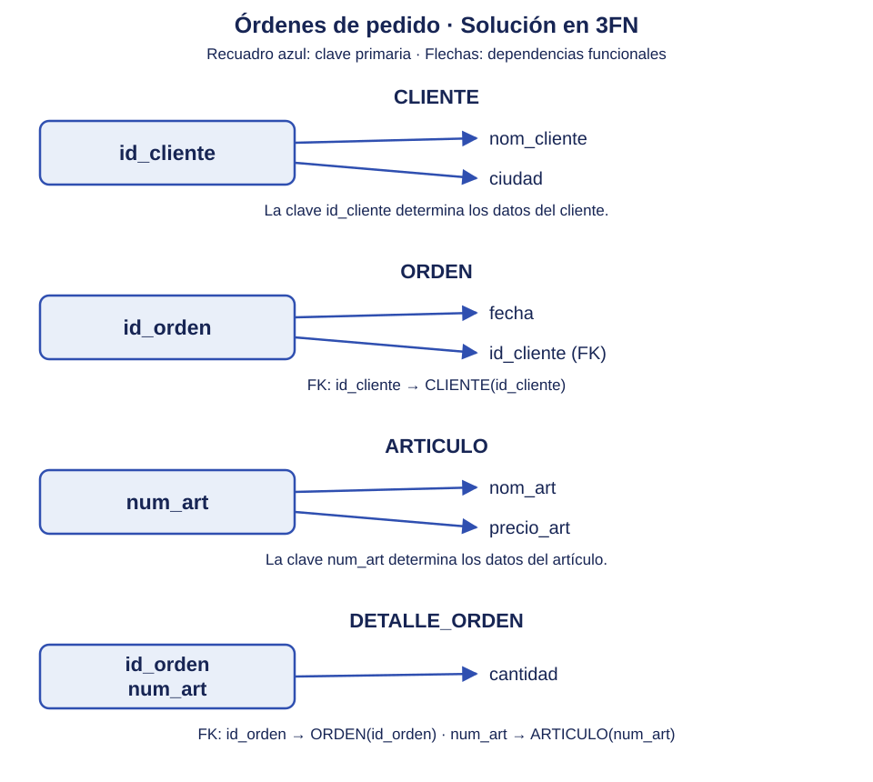{ width=850 }

    La cantidad queda en DETALLE_ORDEN porque depende de la combinación de orden y artículo. El atributo precio_art queda en ARTICULO, tal como establece la dependencia num_art → precio_art del grafo.

    Con las dependencias indicadas, las cuatro tablas también cumplen **FNBC**: en todas sus dependencias funcionales no triviales, el determinante es una clave.

??? success "Ejercicio 4. Exposiciones"

    **Tabla original EXPOSICIONES**

    

    | codexp | codgal | nomgal | dirgal | cpgal | ciugal | fecha | codobr | nomobr | tip | dim | codaut | nomaut |
    |--------|--------|--------|--------|-------|--------|-------|--------|--------|-----|-----|--------|--------|
    | ART024 | ART | ARTACTUAL | C/ Enmig, 54 | 12001 | Castelló | Del 1-12-2012 al 15-12-2012 | GO-068 | Bodegón | Óleo | 60x40 | GM | Gregori Mifsud |
    | ART024 | ART | ARTACTUAL | C/ Enmig, 54 | 12001 | Castelló | Del 1-12-2012 al 15-12-2012 | GO-069 | Bodegón | Óleo | 50x30 | GM | Gregori Mifsud |
    | ART024 | ART | ARTACTUAL | C/ Enmig, 54 | 12001 | Castelló | Del 1-12-2012 al 15-12-2012 | GO-070 | Paisaje lunar | Óleo | 100x50 | GM | Gregori Mifsud |
    | ART024 | ART | ARTACTUAL | C/ Enmig, 54 | 12001 | Castelló | Del 1-12-2012 al 15-12-2012 | RA-250 | Estampa antigua | Aquarela | 40x30 | RB | Ramon Bernat |

    

    Partimos de la relación:

    **ORDENES** (<u>codexp, codobr</u>, codgal, nomgal, dirgal, cpgal, ciugal, fecha, nomobr, tip, dim, codaut, nomaut).

    La clave principal es **(codexp, codobr)**: una exposición puede incluir varias obras y una obra puede participar en distintas exposiciones.

    Para cumplir la **Primera Forma Normal (1FN)**, hemos separado el campo compuesto **fecha** en dos atributos: **fecha_inicio** y **fecha_fin**. Así, el valor «Del 1-12-2012 al 15-12-2012» pasa a almacenarse como **01/12/2012** y **15/12/2012**, cada uno en su propia columna. El siguiente grafo ya incorpora esta separación.

    **Grafo tras separar las fechas (1FN)**

    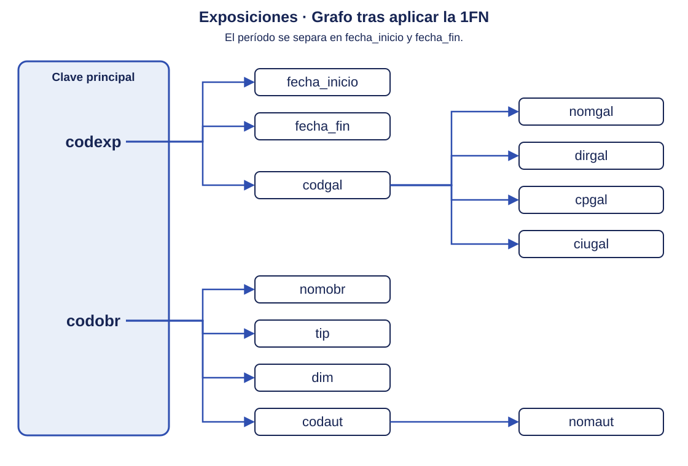{ width=700 }

    Las dependencias representadas, con las fechas ya separadas, son:

    - **codexp → fecha_inicio, fecha_fin, codgal**.
    - **codgal → nomgal, dirgal, cpgal, ciugal**.
    - **codobr → nomobr, tip, dim, codaut**.
    - **codaut → nomaut**.

    ### 1. Primera forma normal (1FN)

    El campo **fecha** combina dos datos que queremos consultar por separado: el inicio y el fin de la exposición. Antes de continuar, lo descomponemos en **fecha_inicio** y **fecha_fin**:

    | Valor original de fecha | fecha_inicio | fecha_fin |
    |-------------------------|--------------|-----------|
    | Del 1-12-2012 al 15-12-2012 | 01/12/2012 | 15/12/2012 |

    Sustituimos fecha por estos dos campos en las cuatro filas originales. **No creamos otra tabla ni duplicamos filas**: se trata de separar un atributo compuesto dentro de la misma relación. Para este ejercicio conservamos dim como un único dato de dimensión.

    La relación en 1FN queda así:

    **ORDENES** (<u>codexp, codobr</u>, codgal, nomgal, dirgal, cpgal, ciugal, fecha_inicio, fecha_fin, nomobr, tip, dim, codaut, nomaut).

    La dependencia del grafo se actualiza a **codexp → fecha_inicio, fecha_fin, codgal**. La clave principal no cambia.

    ### 2. Segunda forma normal (2FN)

    La tabla no está en 2FN: sus atributos descriptivos dependen solo de una parte de la clave compuesta.

    - **codexp → fecha_inicio, fecha_fin, codgal**: las fechas y la galería dependen solo de la exposición. Los datos de la galería también se obtienen a partir de codexp, a través de codgal.
    - **codobr → nomobr, tip, dim, codaut**: los datos de la obra dependen solo de su código. El nombre del autor también se obtiene a partir de codobr, a través de codaut.

    Separamos los datos según su determinante:

    - **EXPOSICION** (<u>codexp</u>, fecha_inicio, fecha_fin, codgal, nomgal, dirgal, cpgal, ciugal).
    - **OBRA** (<u>codobr</u>, nomobr, tip, dim, codaut, nomaut).
    - **PARTICIPA** (<u>codexp, codobr</u>).

    PARTICIPA conserva la asociación entre exposición y obra. **Es necesaria aunque no tenga atributos adicionales**: si la elimináramos, perderíamos la información sobre qué obras se exponen en cada exposición.

    ### 3. Tercera forma normal (3FN)

    Quedan dos dependencias transitivas:

    - En EXPOSICION: **codexp → codgal → nomgal, dirgal, cpgal, ciugal**.
    - En OBRA: **codobr → codaut → nomaut**.

    Separamos los datos de la galería y del autor en dos tablas nuevas. Conservamos codgal en EXPOSICION y codaut en OBRA como claves externas.

    **Modelo relacional final**

    - **GALERIA** (<u>codgal</u>, nomgal, dirgal, cpgal, ciugal).
        - PK: codgal.
    - **EXPOSICION** (<u>codexp</u>, fecha_inicio, fecha_fin, codgal).
        - PK: codexp.
        - FK: codgal → GALERIA(codgal).
    - **AUTOR** (<u>codaut</u>, nomaut).
        - PK: codaut.
    - **OBRA** (<u>codobr</u>, nomobr, tip, dim, codaut).
        - PK: codobr.
        - FK: codaut → AUTOR(codaut).
    - **PARTICIPA** (<u>codexp, codobr</u>).
        - PK: (codexp, codobr).
        - FK: codexp → EXPOSICION(codexp).
        - FK: codobr → OBRA(codobr).

    **Esquema visual de la solución**

    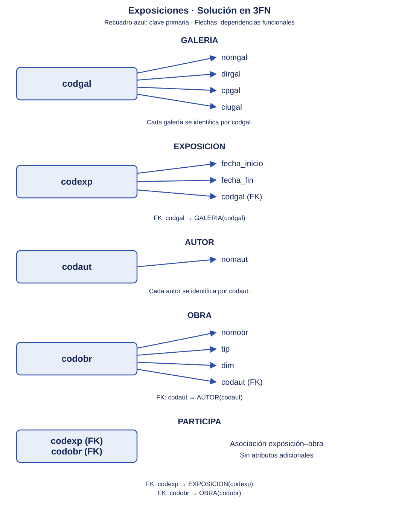{ width=850 }

    Ahora los datos de cada galería se guardan una sola vez, los del autor una sola vez y las participaciones se registran mediante parejas de códigos. Con las dependencias indicadas, las cinco tablas cumplen **3FN**.

    No añadimos **cpgal → ciugal**, porque el enunciado no establece esa dependencia. La descomposición se basa en las reglas dadas, no únicamente en las coincidencias de las cuatro filas de muestra.

??? success "Ejercicio 5. Trabajador"

    **Tabla original TRABAJADOR**

    

    | nss | nombre | apellidos | puesto | salario | emails |
    |-----|--------|-----------|--------|---------|--------|
    | 111 | Juan | Pérez Arias | Jefe de Área | 3000 | juanp@ecn.es; jefe2@ecn.es |
    | 222 | José | Sánchez Ramos | Administrativo | 1500 | juanp@ecn.es; jefe2@ecn.es |
    | 333 | Ana | Díaz Ruiz | Administrativo | 1500 | adiaz@ecn.es; ana32@gmail.com |

    

    La clave que identifica a cada trabajador es **nss**. El atributo emails es multivaluado: todavía no tenemos una relación en 1FN.

    **Dependencias y reglas utilizadas**

    - **nss → nombre, apellidos, puesto, salario**.
    - Para desarrollar la descomposición hasta 3FN, **suponemos que cada puesto tiene un salario fijo**: **puesto → salario**. Esta regla debe confirmarse con la empresa; no basta con observar los salarios de la muestra.
    - Un trabajador puede tener varios emails y un email puede ser compartido por distintos trabajadores, como ocurre en los datos.

    ### 1. Primera forma normal (1FN)

    Separamos el atributo multivaluado en una tabla con **una fila por cada email de un trabajador**:

    - **TRABAJADOR** (<u>nss</u>, nombre, apellidos, puesto, salario).
    - **EMAIL_TRABAJADOR** (<u>nss, email</u>).

    **EMAIL_TRABAJADOR en 1FN**

    | nss | email |
    |-----|-------|
    | 111 | juanp@ecn.es |
    | 111 | jefe2@ecn.es |
    | 222 | juanp@ecn.es |
    | 222 | jefe2@ecn.es |
    | 333 | adiaz@ecn.es |
    | 333 | ana32@gmail.com |

    La clave de EMAIL_TRABAJADOR es **(nss, email)**. Ni nss ni email identifican una fila por separado. Ahora cada celda contiene un único valor.

    **Grafo de dependencias tras aplicar 1FN**

    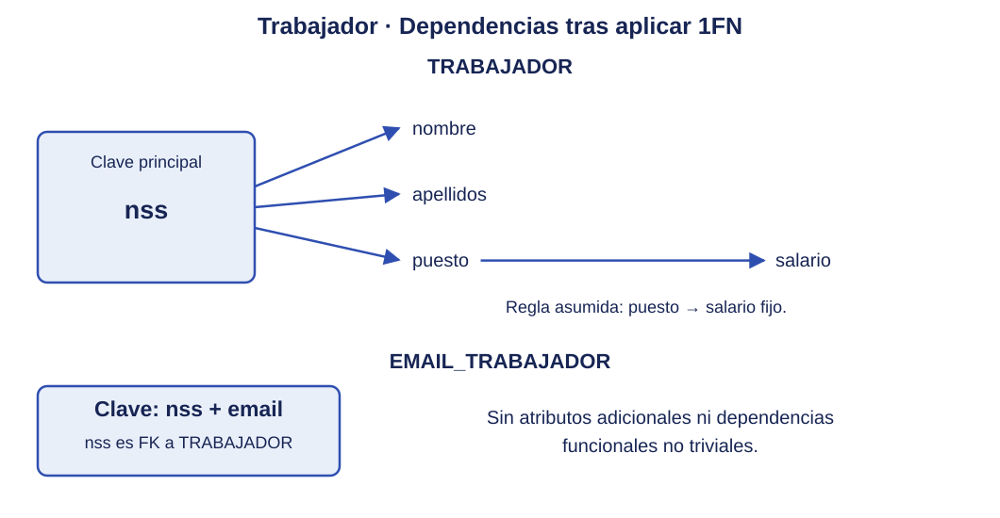{ width=850 }

    ### 2. Segunda forma normal (2FN)

    Las dos tablas ya están en **2FN**:

    - TRABAJADOR tiene una clave simple, nss; no hay dependencias parciales.
    - EMAIL_TRABAJADOR solo contiene los atributos de su clave compuesta, sin atributos no clave.

    No es necesario descomponer ninguna tabla en este paso.

    ### 3. Tercera forma normal (3FN)

    Con la regla del salario fijo por puesto, en TRABAJADOR existe la dependencia transitiva:

    **nss → puesto → salario**.

    Separamos los salarios por puesto y conservamos puesto en TRABAJADOR como clave externa.

    **Modelo relacional final**

    - **PUESTO** (<u>puesto</u>, salario).
        - PK: puesto.
    - **TRABAJADOR** (<u>nss</u>, nombre, apellidos, puesto).
        - PK: nss.
        - FK: puesto → PUESTO(puesto).
    - **EMAIL_TRABAJADOR** (<u>nss, email</u>).
        - PK: (nss, email).
        - FK: nss → TRABAJADOR(nss).

    **Esquema visual de la solución**

    { width=850 }

    Ahora los salarios se guardan una sola vez por puesto y los emails se registran sin repetir el resto de los datos del trabajador. Con las reglas utilizadas, las tres tablas cumplen **3FN**.

    Si cada trabajador pudiera tener un salario diferente dentro del mismo puesto, **puesto → salario no se cumpliría**: salario permanecería en TRABAJADOR y no crearíamos PUESTO para esta descomposición.

??? success "Ejercicio 6. Películas"

    **Tabla original PELICULA**

    

    | titulo | anyo | duracion | tipo | estudio | ciudadestudio | actor |
    |--------|------|----------|------|---------|---------------|-------|
    | Star Wars | 1977 | 124 | Color | Fox | Hollywood | Carrie Fisher |
    | Star Wars | 1977 | 124 | Color | Fox | Hollywood | Mark Hamill |
    | Star Wars | 1977 | 124 | Color | Fox | Hollywood | Harrison Ford |
    | Mighty Ducks | 1991 | 104 | Color | Disney | Buena Vista | Emilio Estevez |
    | Ben Hur | 1959 | 212 | Color | MGM | Hollywood | Charlton Heston |
    | Ben Hur | 1959 | 212 | Color | MGM | Hollywood | Martha Scott |
    | El retorno del Jedi | 1983 | 124 | Color | Fox | Hollywood | Carrie Fisher |

    

    **Dependencias y clave principal**

    - **titulo + anyo → duracion, tipo, estudio**: título y año identifican una versión de la película.
    - **estudio → ciudadestudio**: cada estudio está ubicado en una sola ciudad.
    - Un actor puede participar en varias versiones del mismo título y una película puede tener varios actores.

    La clave principal de la tabla original es **(titulo, anyo, actor)**. Los tres campos son necesarios: título y año no distinguen a los actores de una película; título y actor no distinguen las versiones en las que participa; año y actor no distinguen las películas de ese año.

    ### 1. Primera forma normal (1FN)

    La tabla ya está en **1FN**: cada fila contiene un único actor y cada celda un único valor. Que una película aparezca en varias filas no incumple la 1FN.

    **Grafo de dependencias tras aplicar 1FN**

    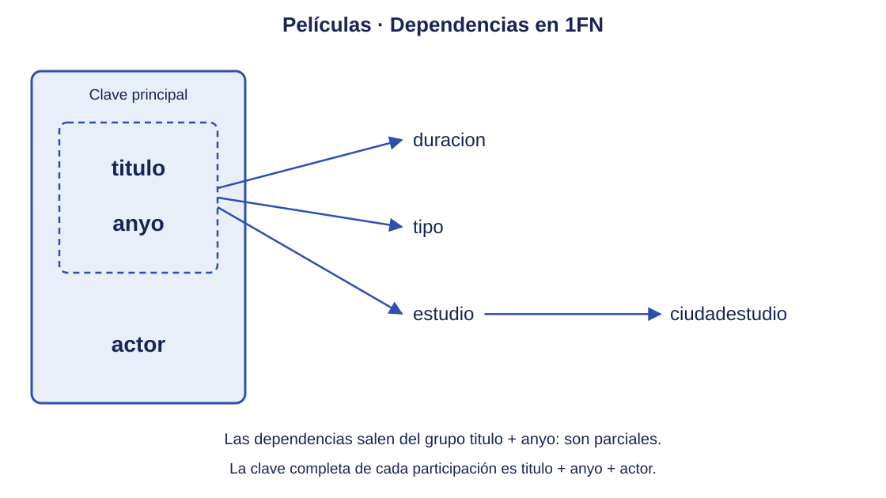{ width=850 }

    ### 2. Segunda forma normal (2FN)

    La tabla **no está en 2FN**: duracion, tipo y estudio dependen solo de **titulo + anyo**, una parte de la clave principal. ciudadestudio también depende de esa parte, a través de estudio.

    Separamos los datos de la película de las participaciones de los actores:

    - **PELICULA** (<u>titulo, anyo</u>, duracion, tipo, estudio, ciudadestudio).
    - **REPARTO** (<u>titulo, anyo, actor</u>).

    REPARTO conserva qué actores participan en cada versión. No tiene atributos adicionales y ya está en 3FN. En PELICULA aún queda una dependencia transitiva.

    ### 3. Tercera forma normal (3FN)

    En PELICULA tenemos la cadena:

    **titulo + anyo → estudio → ciudadestudio**.

    Separamos la ciudad del estudio en ESTUDIO y conservamos estudio en PELICULA como clave externa.

    **Modelo relacional final**

    - **ESTUDIO** (<u>estudio</u>, ciudadestudio).
        - PK: estudio.
    - **PELICULA** (<u>titulo, anyo</u>, duracion, tipo, estudio).
        - PK: (titulo, anyo).
        - FK: estudio → ESTUDIO(estudio).
    - **REPARTO** (<u>titulo, anyo, actor</u>).
        - PK: (titulo, anyo, actor).
        - FK: (titulo, anyo) → PELICULA(titulo, anyo).

    La clave compuesta de REPARTO permite registrar varios actores en una película y también al mismo actor en distintas versiones del mismo título.

    **Esquema visual de la solución**

    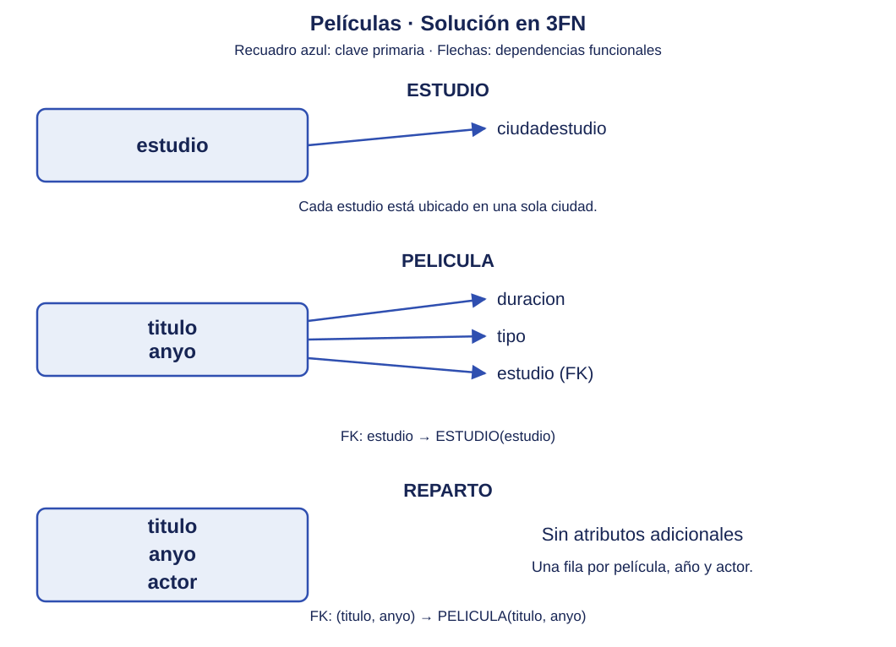{ width=850 }

    El estudio y su ciudad se guardan una sola vez, los datos de cada película una sola vez por título y año y sus actores en REPARTO.

??? success "Ejercicio 7. Matrículas"

    **Tabla original MATRICULA**

    

    | idmatricula | nombre | apellido | direccion | telefono | curso | codigo | carrera |
    |-------------|--------|----------|-----------|----------|-------|--------|---------|
    | 100 | Juan | Martín Arias | C/ Ongolmo 340, Concepción | 78872890 | base datos | bd1 | ingeniería civil informática |
    | 100 | Juan | Martín Arias | C/ Ongolmo 340, Concepción | 78872890 | estadística | e2 | ingeniería civil informática |
    | 100 | Juan | Martín Arias | C/ Ongolmo 340, Concepción | 78872890 | analítica | a5 | ingeniería civil informática |
    | 200 | Ana | Rodríguez Ferrer | C/San Martín 840, Santiago | 78342367 | estadística | e2 | ingeniería comercial |
    | 200 | Ana | Rodríguez Ferrer | C/San Martín 840, Santiago | 78342367 | analítica | a5 | ingeniería comercial |

    

    **Interpretación y dependencias funcionales**

    Tal como indica el enunciado, **idmatricula identifica al alumno** y **codigo identifica al curso**. Suponemos que cada alumno tiene una dirección, un teléfono y una carrera. No suponemos que el nombre del curso sea único.

    - **idmatricula → nombre, apellido, direccion, telefono, carrera**.
    - **codigo → curso**.
    - Clave principal de la relación original: **(idmatricula, codigo)**.

    Ni idmatricula ni codigo identifican una fila por separado: un alumno se matricula en varios cursos y un curso puede tener varios alumnos.

    ### 1. Primera forma normal (1FN)

    Para tratar por separado la dirección y la localidad, descomponemos el atributo direccion, tal como pide el ejercicio:

    | idmatricula | direccion | localidad |
    |-------------|-----------|-----------|
    | 100 | C/ Ongolmo 340 | Concepción |
    | 200 | C/San Martín 840 | Santiago |

    Esta tabla muestra cómo se separa el campo; todavía no es la descomposición completa de la relación. Sustituimos direccion por **direccion y localidad** en cada fila original:

    **MATRICULA** (<u>idmatricula, codigo</u>, nombre, apellido, direccion, localidad, telefono, curso, carrera).

    Cada fila ya contiene un solo curso. Repetir los datos de un alumno en filas distintas **no es, por sí mismo, una infracción de la 1FN**; las dependencias parciales de esos datos se eliminan en 2FN.

    **Grafo de dependencias tras aplicar 1FN**

    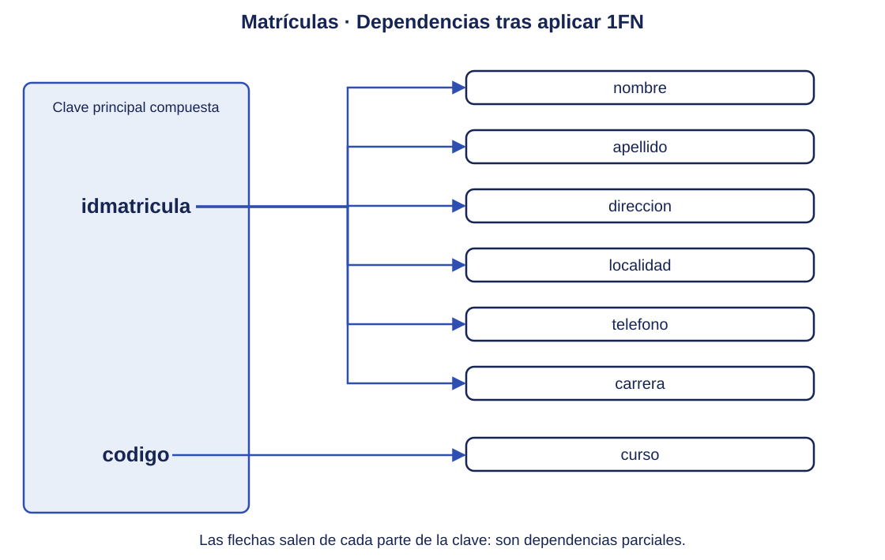{ width=850 }

    ### 2. Segunda forma normal (2FN)

    Existen dependencias parciales respecto a (idmatricula, codigo):

    - Los datos del alumno dependen solo de **idmatricula**, incluida localidad tras separar la dirección.
    - El nombre del curso depende solo de **codigo**.

    Separamos los atributos según su determinante y conservamos la relación de matrícula:

    - **ALUMNO** (<u>idmatricula</u>, nombre, apellido, direccion, localidad, telefono, carrera).
    - **CURSO** (<u>codigo</u>, curso).
    - **MATRICULA** (<u>idmatricula, codigo</u>).

    MATRICULA es necesaria aunque no tenga atributos adicionales: guarda qué cursos ha elegido cada alumno.

    ### 3. Tercera forma normal (3FN)

    Con las reglas indicadas, no quedan dependencias transitivas entre atributos no clave. Las tres tablas obtenidas en 2FN **ya están en 3FN**: no hace falta otra descomposición.

    No separamos carrera en una tabla propia, porque el enunciado no aporta otros atributos ni dependencias que lo exijan. Tampoco suponemos que direccion determine localidad: una misma dirección escrita puede existir en distintas localidades.

    **Modelo relacional final**

    - **ALUMNO** (<u>idmatricula</u>, nombre, apellido, direccion, localidad, telefono, carrera).
        - PK: idmatricula.
    - **CURSO** (<u>codigo</u>, curso).
        - PK: codigo.
    - **MATRICULA** (<u>idmatricula, codigo</u>).
        - PK: (idmatricula, codigo).
        - FK: idmatricula → ALUMNO(idmatricula).
        - FK: codigo → CURSO(codigo).

    **Esquema visual de la solución**

    { width=850 }

    La unión de las tres tablas por idmatricula y codigo recupera las cinco matrículas originales, con dirección y localidad separadas.

??? success "Ejercicio 8. Recetas de cocina: ingredientes en una celda"

    **Tabla original RECETAS_COCINA**

    

    | Cod_Plato | Nombre_Plato | Cocinero | Región | Tipo_Plato | Ingredientes |
    | --- | --- | --- | --- | --- | --- |
    | P01 | Paella Valenciana | Carlos García | valenciana | Principal | Arroz, Pollo, Judías Verdes, Tomate |
    | P02 | Ensalada Mixta | María López | internacional | Entrante | Lechuga, Tomate, Atún, Aceitunas |
    | P03 | Tarta de Queso | Laura Sánchez | vasca | Postre | Queso Crema, Galletas, Mantequilla |
    | P04 | Gazpacho Andaluz | Antonio Martínez | andaluza | Principal | Tomate, Pepino, Pimiento, Aceite |
    | P05 | Cocido Madrileño | Javier Pérez | madrileña | Entrante | Garbanzos, Carne, Patata |
    | P06 | Flan de Huevo | Elena Rodríguez | internacional | Postre | Huevos, Leche, Azúcar |

    

    **Clave y reglas utilizadas**

    Cod_Plato identifica cada plato en la tabla original. Suponemos que cada plato tiene un nombre, un cocinero, una región y un tipo:

    **Cod_Plato → Nombre_Plato, Cocinero, Región, Tipo_Plato**.

    Un plato puede tener varios ingredientes y un ingrediente puede aparecer en varios platos. No suponemos que el cocinero determine la región ni el tipo de plato; las coincidencias de los datos no bastan para establecer esas reglas.

    ### 1. Primera forma normal (1FN)

    La tabla no está en 1FN. Ingredientes es **multivaluado**: contiene una lista de valores en una sola celda.

    Separamos la lista de ingredientes en filas, una por cada pareja de plato e ingrediente.

    Conservamos los datos del plato en RECETA y creamos RECETA_INGREDIENTE para sus ingredientes. Su clave es **(Cod_Plato, Ingrediente)**: cada ingrediente se registra una sola vez en cada receta.

    **Ejemplo de las filas de la paella**

    | Cod_Plato | Ingrediente |
    |-----------|-------------|
    | P01 | Arroz |
    | P01 | Pollo |
    | P01 | Judías Verdes |
    | P01 | Tomate |

    Este proceso se aplica a los seis platos. No creamos columnas nuevas para añadir ingredientes y el nombre del plato no se repite en las filas de RECETA_INGREDIENTE.

    **Grafo de dependencias tras aplicar 1FN**

    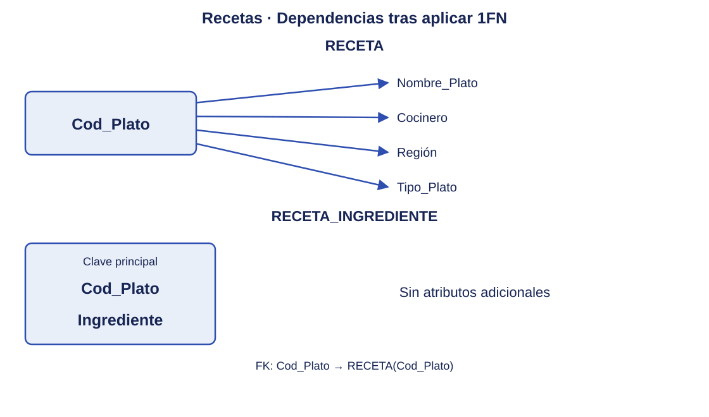{ width=850 }

    ### 2. Segunda forma normal (2FN)

    Las dos tablas ya están en 2FN:

    - RECETA tiene clave simple, Cod_Plato; no hay dependencias parciales.
    - RECETA_INGREDIENTE solo contiene los atributos de su clave compuesta.

    No necesitamos otra descomposición. Si hubiéramos repetido los datos del plato junto a cada ingrediente en una sola tabla en 1FN, tendríamos que separarlos ahora, porque dependen solo de Cod_Plato.

    ### 3. Tercera forma normal (3FN)

    Con las reglas utilizadas no hay dependencias transitivas entre atributos no clave. Las tablas obtenidas en el primer paso ya cumplen 3FN.

    No creamos una tabla INGREDIENTE independiente, porque este ejercicio no aporta atributos propios del ingrediente ni exige un catálogo separado.

    **Modelo relacional final**

    - **RECETA** (<u>Cod_Plato</u>, Nombre_Plato, Cocinero, Región, Tipo_Plato).
        - PK: Cod_Plato.
    - **RECETA_INGREDIENTE** (<u>Cod_Plato, Ingrediente</u>).
        - PK: (Cod_Plato, Ingrediente).
        - FK: Cod_Plato → RECETA(Cod_Plato).

    **Esquema visual de la solución**

    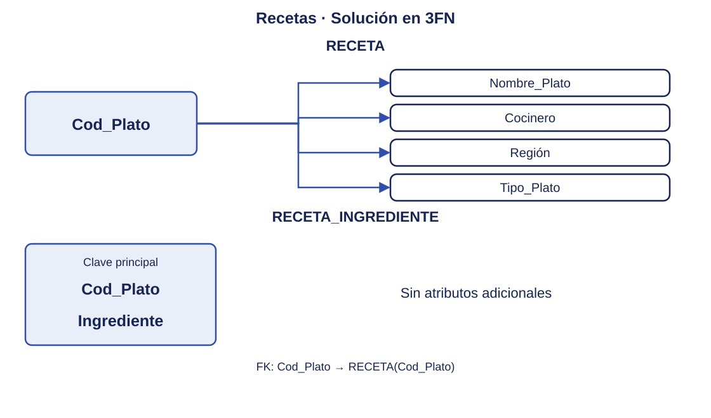{ width=850 }

    La lista original se recupera consultando los ingredientes asociados a cada Cod_Plato, sin perder los datos de los seis platos.

??? success "Ejercicio 9. Recetas de cocina: una columna por ingrediente"

    **Tabla original RECETAS_COCINA**

    

    | Cod_Plato | Nombre_Plato | Cocinero | Región | Tipo_Plato | Ingrediente1 | Ingrediente2 | Ingrediente3 | Ingrediente4 |
    | --- | --- | --- | --- | --- | --- | --- | --- | --- |
    | P01 | Paella Valenciana | Carlos García | valenciana | Principal | Arroz | Pollo | Judías Verdes | Tomate |
    | P02 | Ensalada Mixta | María López | internacional | Entrante | Lechuga | Tomate | Atún | Aceitunas |
    | P03 | Tarta de Queso | Laura Sánchez | vasca | Postre | Queso Crema | Galletas | Mantequilla | NULL |
    | P04 | Gazpacho Andaluz | Antonio Martínez | andaluza | Principal | Tomate | Pepino | Pimiento | Aceite |
    | P05 | Cocido Madrileño | Javier Pérez | madrileña | Entrante | Garbanzos | Carne | Patata | NULL |
    | P06 | Flan de Huevo | Elena Rodríguez | internacional | Postre | Huevos | Leche | Azúcar | NULL |

    

    **Clave y reglas utilizadas**

    Cod_Plato identifica cada plato en la tabla original. Suponemos que cada plato tiene un nombre, un cocinero, una región y un tipo:

    **Cod_Plato → Nombre_Plato, Cocinero, Región, Tipo_Plato**.

    Un plato puede tener varios ingredientes y un ingrediente puede aparecer en varios platos. No suponemos que el cocinero determine la región ni el tipo de plato; las coincidencias de los datos no bastan para establecer esas reglas.

    ### 1. Primera forma normal (1FN)

    La tabla no está en 1FN. Ingrediente1, Ingrediente2, Ingrediente3 e Ingrediente4 forman un **grupo repetitivo**: representan el mismo atributo en distintas columnas.

    Convertimos las cuatro columnas de ingredientes en filas de una única columna Ingrediente.

    Conservamos los datos del plato en RECETA y creamos RECETA_INGREDIENTE para sus ingredientes. Su clave es **(Cod_Plato, Ingrediente)**: cada ingrediente se registra una sola vez en cada receta.

    **Ejemplo de las filas de la paella**

    | Cod_Plato | Ingrediente |
    |-----------|-------------|
    | P01 | Arroz |
    | P01 | Pollo |
    | P01 | Judías Verdes |
    | P01 | Tomate |

    No creamos una fila con Ingrediente = NULL: esos valores indican que no hay un cuarto ingrediente.

    Este proceso se aplica a los seis platos. No creamos columnas nuevas para añadir ingredientes y el nombre del plato no se repite en las filas de RECETA_INGREDIENTE.

    **Grafo de dependencias tras aplicar 1FN**

    { width=850 }

    ### 2. Segunda forma normal (2FN)

    Las dos tablas ya están en 2FN:

    - RECETA tiene clave simple, Cod_Plato; no hay dependencias parciales.
    - RECETA_INGREDIENTE solo contiene los atributos de su clave compuesta.

    No necesitamos otra descomposición. Si hubiéramos repetido los datos del plato junto a cada ingrediente en una sola tabla en 1FN, tendríamos que separarlos ahora, porque dependen solo de Cod_Plato.

    ### 3. Tercera forma normal (3FN)

    Con las reglas utilizadas no hay dependencias transitivas entre atributos no clave. Las tablas obtenidas en el primer paso ya cumplen 3FN.

    No creamos una tabla INGREDIENTE independiente, porque este ejercicio no aporta atributos propios del ingrediente ni exige un catálogo separado.

    **Modelo relacional final**

    - **RECETA** (<u>Cod_Plato</u>, Nombre_Plato, Cocinero, Región, Tipo_Plato).
        - PK: Cod_Plato.
    - **RECETA_INGREDIENTE** (<u>Cod_Plato, Ingrediente</u>).
        - PK: (Cod_Plato, Ingrediente).
        - FK: Cod_Plato → RECETA(Cod_Plato).

    **Esquema visual de la solución**

    { width=850 }

    El resultado es el mismo que en el ejercicio 8: cambia la forma inicial de guardar los ingredientes, pero no las tablas necesarias para representarlos.

??? success "Ejercicio 10. Recetas de cocina: ingredientes, cantidades y stock"

    **Tabla original RECETAS_COCINA**

    

    | Cod_Plato | Nombre_Plato | Cocinero | Región | Tipo_Plato | Ingrediente1 | Cantidad1 | Stock1 | Ingrediente2 | Cantidad2 | Stock2 | Ingrediente3 | Cantidad3 | Stock3 | Ingrediente4 | Cantidad4 | Stock4 |
    | --- | --- | --- | --- | --- | --- | --- | --- | --- | --- | --- | --- | --- | --- | --- | --- | --- |
    | P01 | Paella Valenciana | Carlos García | valenciana | Principal | Arroz | 300g | 50 kg | Pollo | 200g | 20 kg | Judías Verdes | 100g | 15 kg | Tomate | 50g | 40 kg |
    | P02 | Ensalada Mixta | María López | internacional | Entrante | Lechuga | 150g | 30 kg | Tomate | 80g | 40 kg | Atún | 50g | 10 kg | Aceitunas | 30g | 8 kg |
    | P03 | Tarta de Queso | Laura Sánchez | vasca | Postre | Queso Crema | 250g | 12 kg | Galletas | 150g | 20 kg | Mantequilla | 80g | 5 kg | NULL | NULL | NULL |
    | P04 | Gazpacho Andaluz | Antonio Martínez | andaluza | Principal | Tomate | 500g | 40 kg | Pepino | 150g | 18 kg | Pimiento | 100g | 12 kg | Aceite | 30ml | 25 l |
    | P05 | Cocido Madrileño | Javier Pérez | madrileña | Entrante | Garbanzos | 300g | 35 kg | Carne | 250g | 30 kg | Patata | 200g | 60 kg | NULL | NULL | NULL |
    | P06 | Flan de Huevo | Elena Rodríguez | internacional | Postre | Huevos | 4 ud | 500 ud | Leche | 500ml | 100 l | Azúcar | 100g | 80 kg | NULL | NULL | NULL |

    

    **Clave y reglas utilizadas**

    Cod_Plato identifica cada plato en la tabla original. Para resolver el ejercicio suponemos que Ingrediente identifica un ingrediente del almacén y que **Stock es su existencia disponible en ese almacén en el momento considerado**, común a todas las recetas. Cantidad, en cambio, indica cuánto se necesita de ese ingrediente para preparar cada plato.

    Las dependencias, una vez eliminados los grupos repetitivos, son:

    - **Cod_Plato → Nombre_Plato, Cocinero, Región, Tipo_Plato**.
    - **Cod_Plato + Ingrediente → Cantidad**.
    - **Ingrediente → Stock**.

    No se deducen reglas adicionales sobre el cocinero, la región o el tipo de plato a partir de las coincidencias de las filas.

    ### 1. Primera forma normal (1FN)

    Los grupos **Ingrediente1, Cantidad1, Stock1**, **Ingrediente2, Cantidad2, Stock2**, etc., se repiten. Convertimos cada grupo completo en una fila, manteniendo juntos el ingrediente, su cantidad y su stock.

    Obtenemos:

    - **RECETA** (<u>Cod_Plato</u>, Nombre_Plato, Cocinero, Región, Tipo_Plato).
    - **RECETA_INGREDIENTE** (<u>Cod_Plato, Ingrediente</u>, Cantidad, Stock).

    Omitimos los grupos en los que no hay ingrediente; no creamos filas con NULL como parte de la clave. Suponemos una sola cantidad por ingrediente y receta.

    **Ejemplo de la paella tras aplicar 1FN**

    | Cod_Plato | Ingrediente | Cantidad | Stock |
    |-----------|-------------|----------|-------|
    | P01 | Arroz | 300g | 50 kg |
    | P01 | Pollo | 200g | 20 kg |
    | P01 | Judías Verdes | 100g | 15 kg |
    | P01 | Tomate | 50g | 40 kg |

    La cantidad y el stock son medidas con su unidad indicada; para este ejercicio las tratamos como valores atómicos.

    **Grafo de dependencias tras aplicar 1FN**

    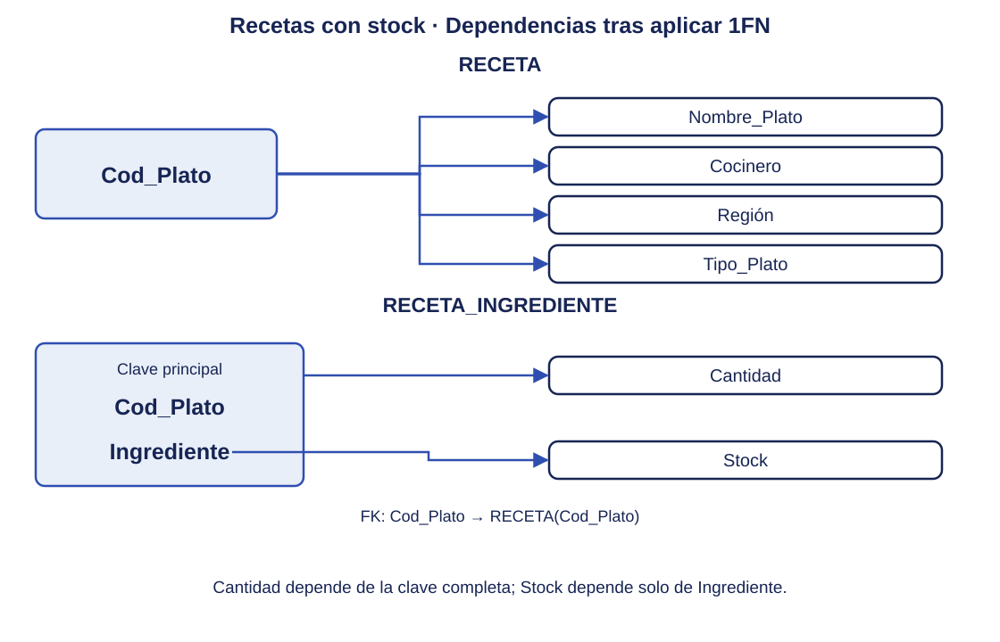{ width=850 }

    ### 2. Segunda forma normal (2FN)

    RECETA ya está en 2FN. RECETA_INGREDIENTE no la cumple: **Ingrediente → Stock** es una dependencia parcial respecto a la clave **(Cod_Plato, Ingrediente)**. El stock del tomate, por ejemplo, se repite en la paella, la ensalada y el gazpacho.

    Separamos el stock en **INGREDIENTE (Ingrediente, Stock)**. En RECETA_INGREDIENTE conservamos Cantidad, que depende de la clave completa: la paella necesita 50g de tomate, la ensalada 80g y el gazpacho 500g.

    ### 3. Tercera forma normal (3FN)

    Con las reglas indicadas, las tres tablas resultantes ya están en 3FN: no quedan dependencias transitivas entre atributos no clave. No es necesaria otra descomposición.

    **Modelo relacional final**

    - **RECETA** (<u>Cod_Plato</u>, Nombre_Plato, Cocinero, Región, Tipo_Plato).
        - PK: Cod_Plato.
    - **INGREDIENTE** (<u>Ingrediente</u>, Stock).
        - PK: Ingrediente.
    - **RECETA_INGREDIENTE** (<u>Cod_Plato, Ingrediente</u>, Cantidad).
        - PK: (Cod_Plato, Ingrediente).
        - FK: Cod_Plato → RECETA(Cod_Plato).
        - FK: Ingrediente → INGREDIENTE(Ingrediente).

    **Esquema visual de la solución**

    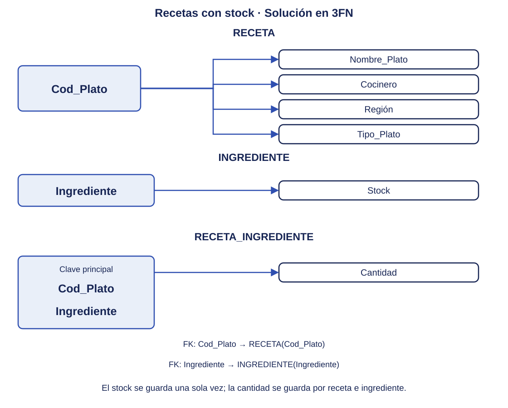{ width=850 }

    El stock se actualiza en una sola fila de INGREDIENTE, mientras que cada receta conserva su cantidad. Podemos reconstruir los datos uniendo las tablas por Cod_Plato e Ingrediente. Si el stock se gestionara por almacén o fecha, habría que incorporar esos datos al diseño; esa situación no forma parte del ejercicio.
